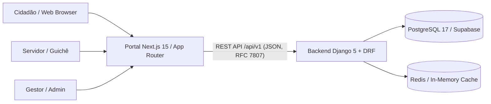

# Arquitetura do Sistema — SOSP

**Sistema de Orientação para Serviços Públicos**  
*Documento de Arquitetura de Software e Engenharia de Sistemas*

---

## 1. Visão Geral Arquitetural (ADR-001)

O SOSP adota o padrão de **Monólito Modular** desacoplado, dividido em duas camadas principais:

### 1.1. Camada de Apresentação (`portal/`)
- **Tecnologias:** Next.js 15 (App Router), React 19, TypeScript 5, Tailwind CSS.
- **Princípio Inegociável:** Zero acesso direto ao banco de dados ou ao Supabase SDK. Toda interação de dados é mediada pela API REST oficial `/api/v1` em `backend/`.
- **Rotas e Telas:**
  - `/` (Home com busca de serviços)
  - `/servicos` e `/servicos/[id]` (Ficha orientativa e guia de documentos)
  - `/login` e `/login/institucional` (Autenticação de cidadãos e servidores)
  - `/cidadao/meus-agendamentos` e `/cidadao/protocolos/[protocol]` (Área do cidadão)
  - `/servidor/painel` e `/servidor/relatorios` (Área operacional do servidor de guichê)
  - `/admin/*` (Gestão geral restrita a gestores e administradores)

### 1.2. Camada de Aplicação e Negócio (`backend/`)
- **Tecnologias:** Python 3.10+, Django 5.1+, Django REST Framework (DRF) 3.15+.
- **Padrão Monolítico Modular:** 9 módulos de domínio independentes:
  1. `accounts`: Cidadãos, usuários internos, autenticação (Argon2id), sessões e RBAC.
  2. `catalog`: Órgãos, unidades de atendimento, catálogo de serviços e documentos.
  3. `search`: Busca textual e filtros combinados.
  4. `guidance`: Guias de etapas, checklists e geração de comprovantes.
  5. `scheduling`: Slots de 30 min, controle de capacidade, agendamento atômico e protocolos.
  6. `feedback`: Módulo reservado para a v2.0 (`FEATURE_REVIEWS_ENABLED`).
  7. `notifications`: E-mails transacionais (MVP) e gateways na v2.0.
  8. `reports`: Relatórios operacionais e gerenciais consolidados.
  9. `audit`: Trilha transversal de auditoria imutável (`auditEvent`).

- **Regra de Fronteira:** Proibido importar `models.py` entre módulos diferentes. A comunicação ocorre exclusivamente através de `services.py` e `selectors.py`.

---

## 2. Padrões de Programação Orientada a Objetos (POO)

A camada autoral do SOSP implementa integralmente os **4 Pilares de POO**:

1. **Abstração:**
   - Classes base abstratas (`AbstractRepository` com `abc.ABC` e `@abstractmethod` em `backend/common/repositories.py`; `ReportExporter` com `abc.ABC` e `@abstractmethod` em `backend/apps/reports/exporters.py`).
   - Protocolos tipados (`BaseRepository`) que definem contratos mínimos para persistência.

2. **Encapsulamento:**
   - Objetos de Valor (Value Objects) em `backend/common/domain/value_objects.py`, integrados nos fluxos de negócio em `backend/apps/accounts/services.py` e `backend/apps/scheduling/services.py`:
     - `CpfDocument`: valida dígitos verificadores, garante imutabilidade e expõe `@property clean_value`, `formatted` e `masked` (usado no cadastro, validação de CPF e mascaramento LGPD).
     - `RegistrationNumber`: encapsula matrículas de servidores (`202XXXXX`, `SSP-1001`), com validação e extração de prefixo (usado no login institucional e provisionamento de usuários internos).
     - `ProtocolCode`: encapsula a lógica do formato oficial `AAAAMMDD-XXXX` (RN-20, usado na emissão e consulta de protocolos).

3. **Herança:**
   - Repositórios concretos (`CitizenInMemoryRepository`, `CitizenDjangoORMRepository`, `SchedulingInMemoryRepository`, `SchedulingDjangoORMRepository`) herdam formalmente de `AbstractRepository`.
   - Exportadores concretos (`CsvExporter`, `PdfExporter` em `backend/apps/reports/exporters.py`) herdam de `ReportExporter`.
   - Models de banco herdam de `django.db.models.Model` e `CompositeKeyModel`.
   - Views de API herdam de `rest_framework.views.APIView`.
   - Classes de permissão de segurança herdam de `BasePermission`.

4. **Polimorfismo:**
   - Desacoplamento transparente de persistência via `CitizenRepositoryProxy` e `SchedulingRepositoryProxy`: o sistema alterna dinamicamente entre repositórios em memória e repositórios ORM conforme a configuração de ambiente (`REPOSITORY_BACKEND`).
   - Polimorfismo nos exportadores de relatórios (`ReportExporter`, `CsvExporter`, `PdfExporter` e fábrica `get_report_exporter` em `backend/apps/reports/exporters.py`, consumidos por `ReportsService.create_export`).

---

## 3. Modelo de Dados e Identificadores (ADR-002)

- **PostgreSQL 17 com nomes em camelCase sem aspas:**
  Tabelas e colunas utilizam nomes `camelCase` (ex.: `accountsCitizen`, `accountsInternalUser`, `catalogService`, `schedulingAppointment`, `createdAt`, `updatedAt`, `deletedAt`).
- **Exclusão Lógica e Auditoria:**
  Nenhuma tabela de negócio realiza exclusão física (`DELETE`). Todas utilizam marcação lógica (`isActive = False`, `deletedAt = NOW()`). Toda mutação relevante gera registro em `auditEvent`.

