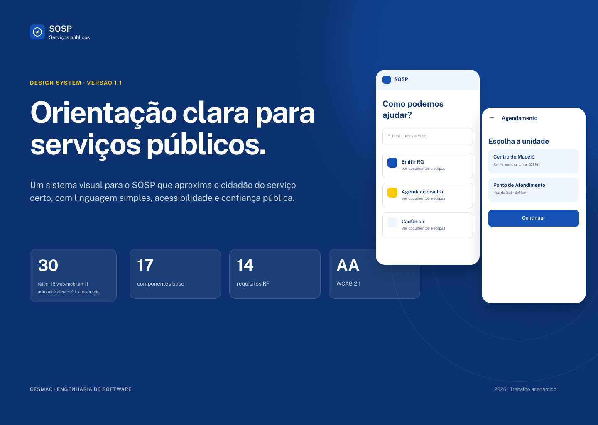

# SOSP — Sistema de Orientação para Serviços Públicos

> **CESMAC — Engenharia de Software · Trabalho Acadêmico**
> **Versão da Documentação:** `1.1.0` · **Status:** Em revisão

O **SOSP (Sistema de Orientação para Serviços Públicos)** é um portal web responsivo cujo objetivo é orientar o cidadão sobre como acessar serviços públicos municipais, estaduais e federais (como emissão de RG/CPF, SUS, INSS, DETRAN, CRAS, matrícula escolar, IPTU e Carteira de Trabalho).

A partir de uma busca em linguagem simples, o sistema entrega uma **ficha orientativa completa** (o que é o serviço, quem tem direito, documentos necessários, pré-requisitos, prazos, custos e unidades de atendimento), um **guia passo a passo com checklist interativo e geração de PDF**, além de realizar **todo o agendamento presencial (100% interno no SOSP)** e o **acompanhamento por protocolo (`AAAAMMDD-XXXX`)** até a conclusão do atendimento.

---

## Links Rápidos e Artefatos Principais

| Artefato | Acesso | Descrição |
|---|---|---|
| **Índice Geral da Documentação** | [`docs/README.md`](docs/README.md) | Ponto de partida oficial (Pilar 0) e guia de leitura por perfil |
| **Documento de Requisitos (PDF)** | [`Documento_de_Requisitos_Modelo_RF_v10.pdf`](docs/Documento_de_Requisitos_Modelo_RF_v10.pdf) | Especificação formal de requisitos (RF, RNF, RS, Matriz de Risco, Rastreabilidade e Pontos de Função) |
| **Protótipo Oficial (Figma)** | [Figma `SOSP`](https://www.figma.com/design/P8Pf9aZiagXQulJpP2guqz/SOSP?node-id=0-1) | 30 telas no total (15 cidadão web+mobile, 5 servidor, 6 admin e 4 transversais — 45 frames) |
| **Protótipo Consolidado (PDF)** | [`sosp-prototipo-2026-11-01.pdf`](docs/design/exports/sosp-prototipo-2026-11-01.pdf) | PDF consolidado com a capa e os 45 frames exportados das 30 telas |
| **Índice de Telas e Node IDs** | [`docs/design/README.md`](docs/design/README.md) | Mapeamento das 30 telas (45 frames) com RF, UC e `node-id` do Figma |
| **Contrato da API (OpenAPI 3.1)** | [`docs/api/openapi.yaml`](docs/api/openapi.yaml) | Especificação REST versionada em `/api/v1` |
| **Schema do Banco (DDL SQL)** | [`docs/database/schema.sql`](docs/database/schema.sql) | Modelo físico PostgreSQL 17 com 34 tabelas em `camelCase` |

---

## Arquitetura da Documentação (`docs/`)

Toda a engenharia do projeto está estruturada em **6 Pilares**, acompanhados de Casos de Uso, ADRs (Architecture Decision Records) e roteiro de demonstração:

| Pilar / Documento | Conteúdo Principal |
|---|---|
| [**Pilar 0 — Índice da Documentação**](docs/README.md) | Visão geral, hierarquia de fontes de verdade, links externos, equipe e guia de leitura |
| [**Pilar 1 — Produto e Requisitos**](docs/01-product-specs.md) | Problema, personas, user stories, RF-01 a RF-14, RNFs, RNs, RS, critérios de aceite e matriz de divergências |
| [**Pilar 2 — Design e UX**](docs/02-design-ux.md) | Princípios de design, jornadas, estados de interface, tokens, componentes, acessibilidade WCAG 2.1 AA e microcopy |
| [**Pilar 3 — Arquitetura de Software**](docs/03-architecture.md) | Diagramas C4, monólito modular, fronteiras de contexto, segurança, integrações e topologia |
| [**Pilar 4 — Dados e API**](docs/04-data-api.md) | Convenções `camelCase`, diagrama ER, catálogo de 34 tabelas, endpoints REST, paginação, erros (`RFC 9457`) e jobs assíncronos |
| [**Pilar 5 — Engenharia, DevOps e Operação**](docs/05-engineering-devops.md) | Onboarding, variáveis de ambiente, Git Flow simplificado, estratégia de testes, CI/CD, observabilidade, backup e feature flags |
| [**Pilar 6 — Gestão do Projeto**](docs/06-project-management.md) | Stakeholders, escopo do MVP, organização do time, Scrum + Kanban, cronograma por marcos, matriz de riscos e Definition of Ready |
| [**Casos de Uso (`UC-01` a `UC-17`)**](docs/use-cases/README.md) | Especificação detalhada dos fluxos principais, alternativos, exceções e pós-condições |
| [**Decisões Arquiteturais (`ADR-001` a `ADR-008`)**](docs/adr/) | Registros formais das decisões técnicas e seus trade-offs |
| [**Roteiro da Demonstração (7 min)**](docs/demo-7-minutos.md) | Roteiro cronometrado de apresentação da jornada completa e defesa técnica |
| [**Glossário**](docs/glossario.md) | Padronização dos termos de domínio e conceitos técnicos utilizados no projeto |

---

## Resumo Tecnológico e Arquitetural

O SOSP adota uma arquitetura de **Monólito Modular** ([ADR-001](docs/adr/ADR-001-monolito-modular-django-nextjs.md)), priorizando simplicidade operacional, tipagem de ponta a ponta e fronteiras de módulo bem definidas:

- **Portal Web (Cidadão, Servidor e Admin):** `Next.js 15` (App Router, React 19, TypeScript), responsivo para desktop (`1440 px`) e dispositivos móveis (`390 px`), consumindo exclusivamente a API REST.
- **API e Back-office:** `Django 5` + `Django REST Framework (DRF)` em Python 3.12, concentrando 100% das regras de negócio, autenticação local (`Argon2id`), RBAC e escrita no banco.
- **Banco de Dados:** `PostgreSQL 17` gerenciado no **Supabase** (região São Paulo, [ADR-008](docs/adr/ADR-008-supabase-postgresql-gerenciado.md)), utilizando busca textual (`tsvector` + `pg_trgm`) e convenção `camelCase` ([ADR-002](docs/adr/ADR-002-postgresql-camelcase.md)).
- **Processamento Assíncrono e Cache:** `Redis 7` + workers para geração assíncrona de comprovantes/guias em PDF, envio de e-mails transacionais e fila de retentativas com DLQ ([ADR-005](docs/adr/ADR-005-processamento-assincrono-dlq.md)).
- **Armazenamento de Arquivos:** `S3 / MinIO` em bucket privado com acesso restrito via URL assinada de curta duração e validação antivírus ([ADR-006](docs/adr/ADR-006-armazenamento-s3-minio.md)).
- **Integrações Externas:** Consulta de CEP via `ViaCEP`, localidades via `API do IBGE`, envio de notificações e preparação arquitetural para login único `Gov.br (OAuth 2.0 / OIDC)` como evolução futura ([ADR-003](docs/adr/ADR-003-autenticacao-govbr-rbac.md)).

---

## Escopo Funcional (RF-01 a RF-14)

| Bloco | Requisitos | Descrição Resumida |
|---|---|---|
| **Conta e Acesso** | `RF-01`, `RF-02` | Cadastro manual do cidadão, autenticação local por CPF e senha (`Argon2id`), recuperação de senha por código de 6 dígitos e modal informativo para o botão Gov.br (implementação futura) |
| **Catálogo e Governança** | `RF-03`, `RF-04`, `RF-05`, `RF-12` | Gestão de órgãos públicos, unidades de atendimento (expediente, feriados, limite diário de vagas), catálogo de serviços versionado e controle de usuários internos (Servidor, Admin, Super Admin) |
| **Descoberta e Orientação** | `RF-06`, `RF-07` | Busca por palavra-chave e filtros (Categoria, Órgão, Canal, Município), ficha orientativa em 8 blocos, guia passo a passo, checklist salvo por CPF, alerta de prioridade (PCD/Idoso) e geração de PDF |
| **Agendamento e Protocolo** | `RF-08`, `RF-09` | Agendamento presencial 100% interno no SOSP em slots de 30 min, emissão de protocolo `AAAAMMDD-XXXX`, linha do tempo de status e envio de anexos (`jpg`, `png`, `pdf` até 10 MB) |
| **Apoio e Gestão** | `RF-11`, `RF-14` | FAQ por serviço/categoria, assistente de busca rápida, abertura de protocolo de dúvida e relatórios gerenciais com exportação CSV/PDF |
| **Evolução (v2.0 / Feature Flags)** | `RF-10`, `RF-13` | Avaliação de atendimento (1 a 5 estrelas) e notificações multicanal (WhatsApp/Push/SMS) controladas por feature flags ([ADR-007](docs/adr/ADR-007-feature-flags.md)) |

---

## Equipe e Papéis

| Integrante | Papel no Projeto | Responsabilidades Principais |
|---|---|---|
| **Mozart Melo** | Product Owner (PO) | Priorização do backlog, validação de requisitos, definição de escopo do MVP e aprovação de divergências |
| **Arthur Franco** | Tech Lead · Back-end · DevOps | Arquitetura, ADRs, API Django, workers, schema SQL, migrações, segurança, CI/CD e infraestrutura |
| **Luiz Gustavo** | Front-end · Design · QA | Portal Next.js, prototipação no Figma (30 telas / 45 frames), Design System, acessibilidade, plano de testes e critérios de aceite |

---

*Para detalhes completos de implementação, regras de negócio e arquitetura, consulte o [**Índice da Documentação (`docs/README.md`)**](docs/README.md).*
