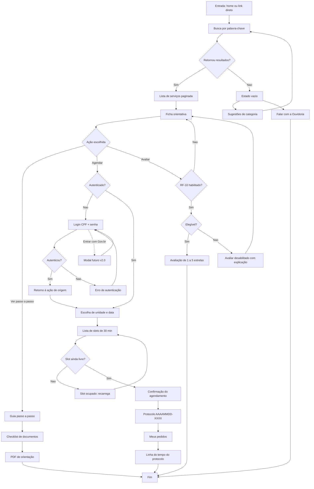
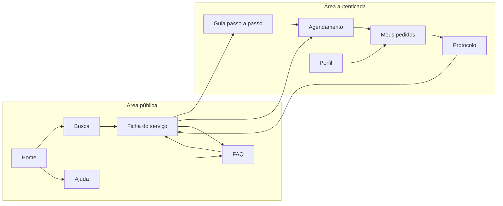
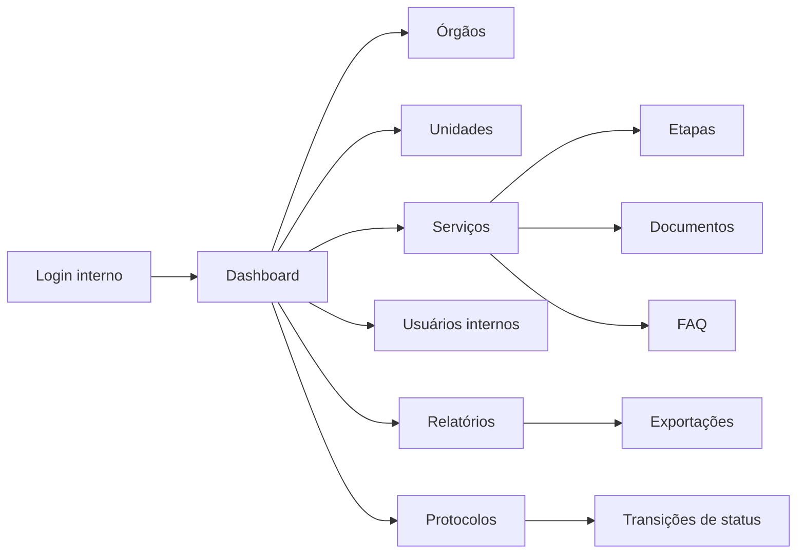
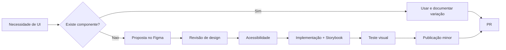

# Pilar 2 — Design e Experiência do Usuário

> **Projeto:** SOSP — Sistema de Orientação para Serviços Públicos
> **Versão:** 1.1.0 · **Data:** 31/10/2026 · **Status:** Em revisão
> **Autores:** Arthur Franco e Luiz Gustavo — CESMAC
> **Documentos irmãos:** [Pilar 1](01-product-specs.md) · [Pilar 3](03-architecture.md) · [Pilar 4](04-data-api.md) · [Pilar 5](05-engineering-devops.md)
> **Documentos complementares:** [Índice de telas](design/README.md) · [Casos de uso](use-cases/README.md) · [Exportações](design/exports/README.md) · [Glossário](glossario.md)
> **Protótipo oficial:** [Figma `SOSP`](https://www.figma.com/design/P8Pf9aZiagXQulJpP2guqz/SOSP?node-id=0-1) · **Acesso somente visualização**

---

## Sumário

1. [Princípios de design](#1-princípios-de-design)
2. [Fluxo do usuário](#2-fluxo-do-usuário)
3. [Mapa de navegação](#3-mapa-de-navegação)
4. [Matriz de estados de interface](#4-matriz-de-estados-de-interface)
5. [Design tokens](#5-design-tokens)
6. [Arquitetura de componentes](#6-arquitetura-de-componentes)
7. [Acessibilidade](#7-acessibilidade)
8. [Microcopy e mensagens](#8-microcopy-e-mensagens)
9. [Responsividade](#9-responsividade)
10. [Governança do Design System](#10-governança-do-design-system)

---

## 1. Princípios de design

O SOSP não é um portal de notícias nem um painel administrativo. É uma ferramenta de decisão: o cidadão chega com uma necessidade e precisa sair com uma resposta. Os cinco princípios abaixo resolvem conflitos de design quando duas soluções parecem igualmente boas.

| # | Princípio | O que significa na prática | O que é proibido |
|---|---|---|---|
| 1 | **Responder antes de pedir** | A ficha é pública. O cadastro só aparece quando há efeito transacional | Bloquear a ficha atrás de login |
| 2 | **Uma pergunta por bloco** | Cada seção da ficha responde a uma pergunta do cidadão, com título em linguagem simples | Agrupar "dados gerais" e esconder custo e prazo |
| 3 | **O próximo passo é óbvio** | Cada tela tem uma ação primária e, no máximo, duas secundárias | Três botões com o mesmo peso visual |
| 4 | **Nada acontece sem feedback** | Loading, erro, vazio e sucesso têm representação explícita | Botão que "não faz nada" enquanto a requisição corre |
| 5 | **Acessível por padrão** | Contraste, foco, teclado e rótulo são requisitos de aceite, não revisão final | Cor como único indicador de status |

### 1.1 Hierarquia visual

| Nível | Uso | Peso | Exemplo |
|---|---|---|---|
| Primário | Ação que conclui a tarefa | Botão sólido azul `#1351B4` | "Agendar atendimento" |
| Secundário | Alternativa relevante | Botão contornado | "Ver passo a passo" |
| Terciário | Ação de apoio ou saída | Link com sublinhado no hover | "Limpar filtros" |
| Destrutivo | Ação irreversível | Botão vermelho `#E52207` | "Cancelar agendamento" |

### 1.2 Densidade

A densidade muda por contexto, não por gosto:

| Contexto | Densidade | Espaçamento base | Motivo |
|---|---|---|---|
| Portal do cidadão (mobile) | Confortável | 16 px entre blocos | Uso com uma mão, leitura em movimento |
| Portal do cidadão (desktop) | Confortável | 24 px entre blocos | Leitura longa, comparação de serviços |
| Back-office | Compacta | 8 px entre linhas de tabela | Volume de registros e varredura rápida |

---

## 2. Fluxo do usuário

### 2.1 Jornada crítica

O fluxo cobre o caminho completo — descoberta, orientação, agendamento e acompanhamento — incluindo os desvios que o protótipo precisa representar: busca sem resultado, gate de login, retorno à ação, slot ocupado, erro de rede e avaliação indisponível.



### 2.2 Desvios e recuperação

| Desvio | Onde ocorre | O que o usuário vê | Como se recupera |
|---|---|---|---|
| Busca sem resultado | Lista | Título literal do RF-06, sugestões e Ouvidoria | Limpar filtros, trocar termo ou abrir dúvida |
| Erro de rede na busca | Lista | "Não foi possível buscar agora. Verifique sua conexão." | Botão "Tentar novamente" preserva o termo |
| Serviço inativo | Ficha | 404 com "Este serviço não está mais disponível." | Voltar à busca |
| Login cancelado | Gate | Retorna à ficha com aviso neutro | Repetir a ação quando quiser |
| Sessão expirada | Agendamento | "Sua sessão expirou. Entre novamente para concluir." | Login com retorno preservado |
| Slot ocupado | Confirmação | "Este horário acabou de ser preenchido." | Lista recarrega com alternativas |
| Falha ao gerar PDF | Guia | "Não foi possível gerar o PDF. Tente novamente." | Reprocessamento automático com backoff |
| Anexo inválido | Protocolo | "Formato inválido. Envie jpg, png ou pdf de até 10 MB." | Escolher outro arquivo |

### 2.3 Regra de retorno pós-login

O gate de login não pode destruir o contexto. A implementação usa um parâmetro `returnTo` assinado, com allowlist de rotas internas:

```text
GET /servicos/123/agendar
  → 302 /api/v1/auth/login
  → Formulário CPF + senha
  → POST /api/v1/auth/login (credenciais)
  → 302 /servicos/123/agendar?resume=appointment
```

O botão "Entrar com Gov.br" exibe um modal informando que a integração estará disponível na v2.0 e retorna ao formulário CPF + senha.

O `returnTo` é validado contra uma lista de prefixos permitidos (`/servicos/`, `/meus-pedidos/`, `/protocolos/`). URLs externas são descartadas e o usuário volta para a home.

---

## 3. Mapa de navegação

### 3.1 Portal do cidadão



### 3.2 Back-office



### 3.3 Regras de navegação

| Regra | Aplicação |
|---|---|
| A home não é um menu | Ela apresenta a busca como ação principal e atalhos por categoria |
| A ficha é o centro | Toda tela autenticada tem caminho de volta para a ficha de origem |
| "Meus pedidos" é o hub | Agendamentos, protocolos e dúvidas vivem ali, não em menus separados |
| O back-office não replica o portal | Navegação própria, densa, com tabelas e filtros |
| Nenhum nível tem mais de 3 cliques da home | Exceção: protocolo antigo, acessível por busca |

---

## 4. Matriz de estados de interface

Cada tela crítica precisa de quatro estados implementados e testados. "Não previsto" é o estado que mais gera defeito em demonstração.

### 4.1 Busca (tela 04)

| Estado | Gatilho | O que aparece | Ação disponível | Regra |
|---|---|---|---|---|
| Inicial | Campo vazio, sem filtros | Campo de busca em destaque, categorias sugeridas, serviços populares | Buscar, escolher categoria | Não listar 148 serviços de uma vez |
| Loading | Requisição em andamento | Skeleton de 10 cards com a mesma altura | Cancelar (opcional) | Sem spinner de página inteira |
| Sucesso | `resultCount > 0` | Lista de 10 cards, total e paginação | Abrir ficha, filtrar, paginar | Anunciar "10 de 148 resultados" para leitor de tela |
| Vazio | `resultCount = 0` | Título literal, sugestões de categoria, Ouvidoria | Limpar filtros, abrir dúvida | Não usar ilustração que esconda o texto |
| Erro de rede | Falha de transporte | "Não foi possível buscar agora. Verifique sua conexão." | Tentar novamente | Preservar termo e filtros |
| Erro de servidor | 5xx | "O serviço está indisponível no momento. Tente em alguns minutos." | Tentar novamente, voltar | Registrar trace ID visível para suporte |

### 4.2 Ficha (tela 05)

| Estado | Gatilho | O que aparece | Ação disponível | Regra |
|---|---|---|---|---|
| Loading | Requisição em andamento | Skeleton dos oito blocos | Voltar | Manter o título do serviço se já conhecido |
| Sucesso | Serviço ativo | Oito blocos, atualização, ações | Ver passo a passo, Agendar, Avaliar (condicional) | Custo e prazo sempre visíveis sem rolagem no desktop |
| Bloco ausente | Dado não cadastrado | Bloco omitido com nota "Informação não disponível" | — | Nunca inventar dado; serviço incompleto não é publicado |
| Erro 404 | Serviço inativo | "Este serviço não está mais disponível." | Voltar à busca | Não revelar dados do serviço |
| Erro de rede | Falha | Mensagem + tentar novamente | Tentar novamente | — |

### 4.3 Guia passo a passo (telas 06 e 07)

| Estado | Gatilho | O que aparece | Ação disponível | Regra |
|---|---|---|---|---|
| Loading | Requisição | Skeleton da lista de etapas | Voltar | — |
| Sucesso | Guia disponível | Etapas numeradas, checklist, tempo | Marcar item, baixar PDF | Progresso salvo a cada marcação |
| Progresso parcial | Itens marcados | Barra "3 de 5 documentos" | Continuar | Persistido por CPF |
| Concluído | Todos obrigatórios marcados | Confirmação "Você está pronto" | Baixar PDF, agendar | Evento de conclusão registrado |
| PDF em geração | Job enfileirado | "Gerando seu PDF…" | Aguardar | Timeout de 30 s com fallback |
| PDF com falha | Job falhou | "Não foi possível gerar o PDF. Tente novamente." | Tentar novamente | Retry automático com backoff |

### 4.4 Agendamento (telas 08, 09 e 10)

| Estado | Gatilho | O que aparece | Ação disponível | Regra |
|---|---|---|---|---|
| Sem login | CTA clicado | "Entre para agendar" com explicação | Entrar com Gov.br | Retorno preservado |
| Loading de slots | Data escolhida | Skeleton de horários | Trocar data | — |
| Slots disponíveis | Dia com vagas | Grade de horários de 30 min | Escolher horário | Horários lotados ausentes, não desabilitados |
| Dia sem vagas | Feriado ou lotado | "Não há horários neste dia." | Escolher outra data | Destacar próximas datas com vaga |
| Confirmação | Slot escolhido | Resumo: serviço, unidade, data, hora | Confirmar, voltar | Exibir endereço completo |
| Sucesso | Agendamento criado | Protocolo, comprovante, lembrete | Baixar comprovante, ver pedidos | Copiar protocolo com um toque |
| Conflito | Slot ocupado | "Este horário acabou de ser preenchido." | Escolher outro | Recarregar automaticamente |

### 4.5 Protocolo (tela 10)

| Estado | Gatilho | O que aparece | Ação disponível | Regra |
|---|---|---|---|---|
| Loading | Abertura | Skeleton da linha do tempo | Voltar | — |
| Sucesso | Protocolo do titular | Status atual, linha do tempo, anexos | Anexar, cancelar (se aplicável) | Ordem cronológica reversa |
| Aguardando documento | Status específico | Destaque com o documento solicitado | Anexar arquivo | Upload com validação imediata |
| Cancelado | Status final | Motivo e data | Voltar | Sem ação de reabrir |
| Concluído | Status final | Data e convite para avaliar (v2.0) | Avaliar | Avaliação única |
| Não encontrado | Protocolo de terceiro | 404 genérico | Voltar | Não revelar existência |

### 4.6 Login (tela 01)

| Estado | Gatilho | O que aparece | Ação disponível | Regra |
|---|---|---|---|---|
| Login CPF + senha | Acesso ao gate | Formulário com campos CPF e senha, botão "Entrar", link "Criar conta", link "Esqueceu a senha?" e botão "Entrar com Gov.br" (cinza/desabilitado visualmente mas clicável) | Entrar, criar conta, recuperar senha, Gov.br (futuro) | CPF e senha são obrigatórios; Gov.br exibe modal de futuro |
| Modal Gov.br futuro | Clique em "Entrar com Gov.br" | Modal sobreposto com texto "A integração com o Gov.br estará disponível em uma futura atualização (v2.0). Utilize seu CPF e senha para entrar." e botão "Entendi, quero usar CPF e senha" | Fechar modal e retornar ao formulário CPF + senha | Modal não bloqueia navegação; pode ser fechado com X |
| Recuperação de senha | Link "Esqueceu a senha?" | Campos CPF e e-mail, botão "Enviar código" | Enviar código de recuperação | CPF deve corresponder ao e-mail cadastrado |
| Redefinir senha | Código válido inserido | Campos Código (6 dígitos), Nova senha, Confirmar senha, botão "Redefinir" | Redefinir senha | Senha deve cumprir política mínima de segurança |
| Bloqueio | 5 tentativas inválidas | "Conta temporariamente bloqueada. Tente novamente em 5 minutos." | Aguardar | Contador regressivo visível |
| Sessão expirada | 30 min inativo | "Sua sessão expirou." | Entrar novamente | Retorno preservado |

### 4.7 Cadastro (tela 02)

| Estado | Gatilho | O que aparece | Ação disponível | Regra |
|---|---|---|---|---|
| Inicial | Acesso ao formulário | Formulário completo com campos: CPF, nome, data de nascimento, e-mail, celular, gênero, PCD (sim/não), deficiência (condicional, exibida apenas se PCD = sim), nome da mãe, nome do pai (opcional), senha, confirmar senha | Preencher campos, submeter | Todos os campos obrigatórios têm validação individual |
| Validação de CEP | CEP preenchido e campo perde foco | Loading "Buscando endereço…" | Aguardar | Preencher automaticamente logradouro, bairro, cidade e UF |
| CEP não encontrado | CEP inválido | "Endereço não localizado" (MSG-04) | Preencher endereço manualmente | Manter CEP visível para correção |
| Sucesso | Cadastro validado | "Cadastro realizado com sucesso" (MSG-05) | Ir para login | Redirecionar para tela de login |
| CPF duplicado | CPF já existe | "CPF já cadastrado" (MSG-02) | Corrigir CPF ou recuperar senha | Link para recuperação de senha |
| E-mail duplicado | E-mail já existe | "E-mail já cadastrado" (MSG-03) | Corrigir e-mail | — |
| Senha inválida | Senha fora da política | "A senha deve ter no mínimo 8 caracteres, 1 letra maiúscula, 1 número e 1 caractere especial." | Corrigir senha | Validar em tempo real ao digitar |
| Erro de rede | Falha de transporte | "Sem conexão. Verifique sua internet e tente novamente." | Tentar novamente | Preservar todos os campos preenchidos |
| Cancelamento | Clique em "Cancelar" | Modal de confirmação: "Todas as alterações serão perdidas. Deseja realmente cancelar?" | Confirmar cancelamento, voltar ao formulário | Dados não salvos são descartados |

### 4.8 Estados globais

| Estado | Onde | Comportamento |
|---|---|---|
| Offline | Todo o portal | Banner "Você está sem conexão. Algumas informações podem estar desatualizadas." |
| Manutenção | Todo o portal | Página com horário previsto e canal de contato |
| Erro 500 | Qualquer rota | Página com trace ID, "Voltar ao início" e link para Ouvidoria |
| 404 | Rota inexistente | Página com busca e categorias |
| Sessão expirada | Área autenticada | Modal com login e retorno |

---

## 5. Design tokens

Os tokens são a camada de contrato entre design e código. Um valor hex nunca aparece em componente; aparece em token semântico.

### 5.1 Cores

**Paleta institucional**

| Token | Hex | Uso |
|---|---|---|
| `--blue-500` | `#1351B4` | Cor primária, links, ação principal |
| `--blue-700` | `#0C326F` | Hover e estados pressionados |
| `--blue-100` | `#EFF5FF` | Fundo de destaque suave |
| `--yellow-500` | `#FFCD07` | Aviso, destaque institucional |
| `--yellow-700` | `#8A6D00` | Texto sobre amarelo |
| `--green-500` | `#168821` | Sucesso |
| `--red-500` | `#E52207` | Erro e ação destrutiva |
| `--gray-900` | `#101828` | Texto principal |
| `--gray-700` | `#4A5568` | Texto secundário |
| `--gray-500` | `#667085` | Texto auxiliar e placeholder |
| `--gray-300` | `#CBD2DC` | Borda |
| `--gray-100` | `#F1F3F6` | Fundo de seção |
| `--white` | `#FFFFFF` | Superfície |

**Tokens semânticos**

| Token | Valor | Onde usar |
|---|---|---|
| `--color-primary` | `--blue-500` | Ação principal, link, foco |
| `--color-primary-hover` | `--blue-700` | Hover e pressed |
| `--color-surface` | `--white` | Fundo de card e página |
| `--color-surface-muted` | `--gray-100` | Fundo de seção alternada |
| `--color-text` | `--gray-900` | Texto principal |
| `--color-text-muted` | `--gray-700` | Texto secundário |
| `--color-border` | `--gray-300` | Borda de input e card |
| `--color-success` | `--green-500` | Confirmação |
| `--color-warning` | `--yellow-500` | Alerta |
| `--color-danger` | `--red-500` | Erro |
| `--color-focus` | `--blue-500` | Anel de foco de 2 px |

**Contraste verificado**

| Combinação | Razão | Conforme AA |
|---|---|---|
| `#101828` sobre `#FFFFFF` | 16,1:1 | Sim |
| `#4A5568` sobre `#FFFFFF` | 7,5:1 | Sim |
| `#1351B4` sobre `#FFFFFF` | 8,6:1 | Sim |
| `#FFFFFF` sobre `#1351B4` | 8,6:1 | Sim |
| `#8A6D00` sobre `#FFCD07` | 4,8:1 | Sim |
| `#FFCD07` sobre `#FFFFFF` | 1,4:1 | **Não** — usar apenas como fundo com texto escuro |

### 5.2 Tipografia

| Token | Família | Peso | Tamanho | Entrelinha | Uso |
|---|---|---|---|---|---|
| `--font-family` | Public Sans, system-ui, sans-serif | — | — | — | Toda a interface |
| `--text-display` | Public Sans | 700 | 40 px | 48 px | Título de campanha (raro) |
| `--text-h1` | Public Sans | 700 | 32 px | 40 px | Título de página |
| `--text-h2` | Public Sans | 600 | 24 px | 32 px | Seção |
| `--text-h3` | Public Sans | 600 | 20 px | 28 px | Subseção e título de card |
| `--text-body` | Public Sans | 400 | 16 px | 24 px | Corpo padrão |
| `--text-body-sm` | Public Sans | 400 | 14 px | 20 px | Texto auxiliar |
| `--text-caption` | Public Sans | 400 | 12 px | 16 px | Legenda e metadado |
| `--text-button` | Public Sans | 600 | 16 px | 24 px | Rótulo de botão |

**Regras:** o corpo mínimo no mobile é 16 px; nunca reduzir para caber. Texto em negrito não substitui hierarquia. A fonte carrega com fallback de sistema para funcionar offline.

### 5.3 Espaçamento

Malha de 4 px. Todo espaçamento é múltiplo de 4.

| Token | Valor | Uso |
|---|---|---|
| `--space-1` | 4 px | Separação entre ícone e texto |
| `--space-2` | 8 px | Padding interno de chip |
| `--space-3` | 12 px | Gap entre campos relacionados |
| `--space-4` | 16 px | Padding padrão de card e input |
| `--space-5` | 20 px | Gap entre cards no mobile |
| `--space-6` | 24 px | Separação entre blocos |
| `--space-8` | 32 px | Separação entre seções |
| `--space-10` | 40 px | Topo de página |
| `--space-12` | 48 px | Separação de seções no desktop |
| `--space-16` | 64 px | Bloco institucional |

### 5.4 Raios, sombras e movimento

| Token | Valor | Uso |
|---|---|---|
| `--radius-sm` | 4 px | Input, chip |
| `--radius-md` | 8 px | Card, botão |
| `--radius-lg` | 16 px | Modal, drawer |
| `--radius-full` | 9999 px | Avatar, pílula |
| `--shadow-sm` | `0 1px 2px rgba(16,24,40,.06)` | Card em repouso |
| `--shadow-md` | `0 4px 8px rgba(16,24,40,.08)` | Card elevado, dropdown |
| `--shadow-lg` | `0 12px 24px rgba(16,24,40,.12)` | Modal |
| `--duration-fast` | 120 ms | Hover, foco |
| `--duration-base` | 200 ms | Abertura de accordion |
| `--duration-slow` | 320 ms | Drawer e modal |
| `--easing` | `cubic-bezier(.2,0,0,1)` | Todas as transições |

**Movimento reduzido:** com `prefers-reduced-motion: reduce`, todas as transições caem para 0 ms e skeleton deixa de animar.

### 5.5 Breakpoints e grid

| Token | Largura | Colunas | Margem | Gutter |
|---|---|---|---|---|
| `--bp-mobile` | 390 px | 4 | 16 px | 16 px |
| `--bp-tablet` | 768 px | 8 | 24 px | 16 px |
| `--bp-desktop` | 1024 px | 12 | 40 px | 24 px |
| `--bp-wide` | 1440 px | 12 | 120 px | 24 px |

Largura útil máxima: **1200 px**. Acima disso, o conteúdo centraliza e as margens crescem.

### 5.6 Z-index

| Token | Valor | Camada |
|---|---|---|
| `--z-base` | 0 | Conteúdo |
| `--z-sticky` | 100 | Header e CTA fixo |
| `--z-dropdown` | 200 | Select e menu |
| `--z-overlay` | 300 | Overlay de modal |
| `--z-modal` | 400 | Modal e drawer |
| `--z-toast` | 500 | Toast |
| `--z-skip-link` | 600 | Skip link de acessibilidade |

---

## 6. Arquitetura de componentes

O Design System usa o prefixo `.sosp-` e modificadores com dois hífens (`sosp-button--primary`). Todo componente entrega estados de repouso, hover, foco, ativo, desabilitado, carregando e erro quando aplicável.

### 6.1 Inventário

| # | Componente | Classe | Variantes | Estados | Quando usar |
|---|---|---|---|---|---|
| 1 | Botão | `.sosp-button` | primary, secondary, tertiary, danger | default, hover, focus, active, disabled, loading | Ação explícita |
| 2 | Link | `.sosp-link` | inline, standalone | default, hover, focus, visited | Navegação |
| 3 | Campo de texto | `.sosp-input` | text, email, tel, password | default, focus, filled, disabled, error, readonly | Entrada de dado |
| 4 | Área de texto | `.sosp-textarea` | — | default, focus, error, disabled | Texto longo |
| 5 | Select | `.sosp-select` | native, custom | default, open, focus, error, disabled | Escolha única |
| 6 | Busca | `.sosp-search` | inline, page | default, focus, loading, error | RF-06 |
| 7 | Checkbox | `.sosp-checkbox` | — | unchecked, checked, indeterminate, disabled, error | Checklist |
| 8 | Radio | `.sosp-radio` | — | unchecked, checked, disabled, error | Escolha exclusiva |
| 9 | Switch | `.sosp-switch` | — | off, on, disabled | Preferência binária |
| 10 | Chip | `.sosp-chip` | filter, removable | default, selected, focus, disabled | Filtro rápido |
| 11 | Tag | `.sosp-tag` | neutral, success, warning, danger, info | — | Status e canal |
| 12 | Badge | `.sosp-badge` | dot, count | — | Contagem em navegação |
| 13 | Card | `.sosp-card` | default, interactive | default, hover, focus | Agrupamento |
| 14 | Card de serviço | `.sosp-service-card` | list, grid | default, hover, focus, loading | Resultado de busca |
| 15 | Item de lista | `.sosp-list-item` | — | default, hover, selected | Listas densas |
| 16 | Tabela | `.sosp-table` | default, compact | default, sorted, empty, loading | Back-office |
| 17 | Paginação | `.sosp-pagination` | numbered, load-more | default, current, disabled | Listas paginadas |
| 18 | Breadcrumb | `.sosp-breadcrumb` | — | default, current | Hierarquia |
| 19 | Tabs | `.sosp-tabs` | underline, pill | default, active, focus | Seções irmãs |
| 20 | Accordion | `.sosp-accordion` | — | closed, open, focus | FAQ (RF-11) |
| 21 | Modal | `.sosp-modal` | sm, md, lg | open, closing | Confirmação |
| 22 | Drawer | `.sosp-drawer` | left, right, bottom | open, closing | Filtros no mobile |
| 23 | Toast | `.sosp-toast` | success, error, info | entering, visible, leaving | Feedback efêmero |
| 24 | Alerta | `.sosp-alert` | info, success, warning, danger | — | Mensagem persistente |
| 25 | Erro inline | `.sosp-field-error` | — | — | Validação de campo |
| 26 | Skeleton | `.sosp-skeleton` | text, card, avatar | shimmer, static | Loading |
| 27 | Estado vazio | `.sosp-empty` | default, compact | — | Zero data |
| 28 | Stepper | `.sosp-stepper` | horizontal, vertical | current, done, upcoming | Guia passo a passo |
| 29 | Timeline | `.sosp-timeline` | — | current, done, cancelled | Protocolo |
| 30 | Avatar | `.sosp-avatar` | sm, md, lg | image, initials, fallback | Perfil |
| 31 | Header público | `.sosp-header` | — | default, scrolled | Portal |
| 32 | Barra Gov.br | `.sosp-govbar` | — | — | Identidade institucional |
| 33 | Footer | `.sosp-footer` | — | — | Links institucionais |
| 34 | Sidebar | `.sosp-sidebar` | — | expanded, collapsed | Back-office |
| 35 | Card de indicador | `.sosp-stat` | — | default, loading | Relatórios |
| 36 | Gráfico de barras | `.sosp-chart` | bar, stacked | default, empty | Relatórios |
| 37 | Upload | `.sosp-upload` | dropzone, button | default, drag, uploading, error, success | Anexos |
| 38 | Estrelas de avaliação | `.sosp-rating` | input, readonly | empty, filled, disabled | RF-10 |
| 39 | Mapa | `.sosp-map` | embed, static | loading, ready, unavailable | Onde fazer |
| 40 | Banner de cookies | `.sosp-cookie` | — | visible, hidden | LGPD |

> São 40 componentes no inventário consolidado. O documento de Design System registra 37 componentes na versão 1.1; os itens 38 a 40 entram com o RF-10, o bloco de mapa e o banner de cookies.

### 6.2 Anatomia de um card de serviço

```text
┌─────────────────────────────────────────────────────┐
│ [Tag Canal]  [Tag Categoria]                        │
│ Nome do serviço                                     │
│ Órgão responsável                                   │
│ Descrição curta em até duas linhas                  │
│ ─────────────────────────────────────────────────── │
│ Gratuito · Até 10 dias · 3 unidades                 │
│                                        [Ver ficha →] │
└─────────────────────────────────────────────────────┘
```

**Regras do card**

| Elemento | Obrigatório | Regra |
|---|---|---|
| Nome | Sim | Até 2 linhas com ellipsis |
| Órgão | Sim | Sigla + nome curto |
| Canal | Sim | Tag com texto, nunca só cor |
| Custo | Sim | "Gratuito" ou "R$ 45,00" |
| Prazo | Sim | "Até 10 dias" |
| Unidades | Condicional | Só para canal presencial/híbrido |
| Ação | Sim | Link "Ver ficha" com área de toque de 44 px |

### 6.3 Contrato de props (TypeScript)

```ts
export type ServiceChannel = "online" | "inPerson" | "hybrid";

export interface ServiceCardProps {
  id: string;
  name: string;
  agencyAcronym: string;
  agencyName: string;
  category: string;
  channel: ServiceChannel;
  isFree: boolean;
  costAmount: number | null;
  averageDeadlineDays: number;
  unitCount: number;
  summary: string;
  href: string;
}

export interface EmptyStateProps {
  title: string;
  description: string;
  primaryAction?: { label: string; href: string };
  secondaryAction?: { label: string; href: string };
}
```

---

## 7. Acessibilidade

Meta: **WCAG 2.1 nível AA** e **eMAG**. Acessibilidade é critério de aceite, não etapa final.

### 7.1 Checklist de implementação

| Categoria | Requisito | Como verificar |
|---|---|---|
| Contraste | Texto 4,5:1; componentes e ícones 3:1 | axe-core + inspeção |
| Teclado | Toda função operável sem mouse | Percorrer a jornada só com Tab/Enter/Esc |
| Foco | Anel visível de 2 px, nunca `outline: none` sem substituto | Inspeção visual |
| Semântica | HTML nativo antes de ARIA; landmarks e headings hierárquicos | Leitor de tela |
| Formulários | `<label for>`, `aria-describedby` para erro e ajuda | Inspeção + leitor |
| Erros | Mensagem textual associada ao campo, não só borda vermelha | Teste com falha proposital |
| Imagens | `alt` descritivo ou vazio quando decorativa | Inspeção |
| Movimento | Respeitar `prefers-reduced-motion` | Emulação no navegador |
| Zoom | 200% sem perda de conteúdo nem rolagem horizontal | Teste no navegador |
| Toque | Alvo mínimo 44×44 px, com 8 px de separação | Inspeção |
| Tempo | Nenhum limite de tempo em formulário; sessão avisa antes de expirar | Teste |
| Vídeo/áudio | Legendas e transcrição quando houver | Revisão de conteúdo |

### 7.2 Mapa de teclado

| Tecla | Ação |
|---|---|
| `Tab` | Próximo elemento focável |
| `Shift + Tab` | Elemento anterior |
| `Enter` | Ativa link ou botão |
| `Espaço` | Ativa botão, marca checkbox, abre select |
| `Esc` | Fecha modal, drawer, dropdown ou toast |
| `Setas` | Navega entre opções de radio, tabs e menu |
| `Home` / `End` | Primeiro/último item de uma lista |
| `Skip link` | Primeiro Tab da página leva ao conteúdo principal |

### 7.3 Leitor de tela

| Elemento | Anúncio esperado |
|---|---|
| Resultado da busca | "10 de 148 resultados para RG" em `aria-live="polite"` |
| Erro de campo | "Campo obrigatório. CPF inválido." ao focar o campo |
| Toast | "Agendamento confirmado. Protocolo 20261029-0001." |
| Skeleton | `aria-busy="true"` no container, sem anunciar cada card |
| Timeline | Lista ordenada com status atual em `aria-current="step"` |
| Estrelas | "Nota 4 de 5" com `role="img"` e rótulo textual |

### 7.4 Testes obrigatórios

| Teste | Ferramenta | Frequência |
|---|---|---|
| Varredura automatizada | axe-core no CI | Todo PR |
| Navegação por teclado | Manual | Toda sprint |
| Leitor de tela | VoiceOver (macOS/iOS) e NVDA (Windows) | Toda release |
| Zoom 200% | Manual | Toda release |
| Contraste | Contrast checker | Todo componente novo |
| Teste com usuário PCD | Sessão moderada | Trimestral |

---

## 8. Microcopy e mensagens

### 8.1 Princípios de escrita

1. **Frase curta, voz ativa.** "Não foi possível agendar" em vez de "O agendamento não pôde ser realizado pelo sistema".
2. **Dizer o que fazer, não só o que falhou.** Toda mensagem de erro tem uma saída.
3. **Sem código técnico.** Nunca exibir `500`, `timeout` ou `SQLSTATE` para o cidadão.
4. **Sem culpa.** "Verifique o CPF" em vez de "Você digitou errado".
5. **Consistência literal.** Mensagens exigidas pelo requisito são reproduzidas exatamente.

### 8.2 Mensagens literais do requisito

| ID | Contexto | Texto exato | Origem |
|---|---|---|---|
| MSG-01 | Busca sem resultado | "Nenhum serviço encontrado. Tente outro termo ou categoria." | RF-06 |
| MSG-02 | CPF duplicado | "CPF já cadastrado" | RF-01 |
| MSG-03 | E-mail duplicado | "E-mail já cadastrado" | RF-01 |
| MSG-04 | CEP não encontrado | "Endereço não localizado" | RF-01 |
| MSG-05 | Cadastro concluído | "Cadastro realizado com sucesso" | RF-01 |
| MSG-06 | Cancelamento de formulário | "Todas as alterações serão perdidas. Deseja realmente cancelar?" | RF-01 |
| MSG-07 | Credenciais inválidas | "CPF ou senha inválidos" | RF-02 |
| MSG-08 | Senha temporária vencida | "Senha temporária expirada. Solicite uma nova ao administrador." | RF-02 |
| MSG-09 | Agendamento duplicado | "Você já tem um agendamento ativo para este serviço." | RF-08 |
| MSG-10 | Data passada | "Não é possível agendar em data passada." | RF-08 |
| MSG-11 | Avaliação duplicada | "Você já avaliou este atendimento." | RF-10 |
| MSG-12 | FAQ sem resposta | "Não encontrei. Deseja abrir dúvida para um servidor?" | RF-11 |
| MSG-13 | Modal Gov.br futuro | "A integração com o Gov.br estará disponível em uma futura atualização (v2.0). Utilize seu CPF e senha para entrar." | RF-02 |
| MSG-14 | Senha inválida (cadastro) | "A senha deve ter no mínimo 8 caracteres, 1 letra maiúscula, 1 número e 1 caractere especial." | RF-01 |
| MSG-15 | Bloqueio por tentativas | "Conta temporariamente bloqueada. Tente novamente em 5 minutos." | RF-02 |
| MSG-16 | Código enviado | "Enviamos um código de 6 dígitos para o e-mail cadastrado." | RF-02 |
| MSG-17 | Código expirado | "Código expirado. Solicite um novo." | RF-02 |

### 8.3 Mensagens de sistema

| Contexto | Título | Corpo | Ação |
|---|---|---|---|
| Erro de rede | "Sem conexão" | "Verifique sua internet e tente novamente." | Tentar novamente |
| Erro de servidor | "Serviço indisponível" | "Estamos com uma instabilidade. Tente em alguns minutos." | Tentar novamente |
| Sessão expirada | "Sua sessão expirou" | "Entre novamente para continuar de onde parou." | Entrar |
| Slot ocupado | "Horário preenchido" | "Este horário acabou de ser reservado. Escolha outro." | Ver horários |
| Upload inválido | "Arquivo não aceito" | "Envie jpg, png ou pdf de até 10 MB." | Escolher arquivo |
| Manutenção | "Estamos atualizando o sistema" | "Voltamos às 14h. Se precisar de ajuda, fale com a Ouvidoria." | Ir para Ouvidoria |

### 8.4 Tom por contexto

| Contexto | Tom | Exemplo |
|---|---|---|
| Orientação | Direto e acolhedor | "Você precisa levar RG e comprovante de residência." |
| Erro | Neutro e resolutivo | "Não foi possível salvar. Tente novamente." |
| Confirmação | Objetivo | "Agendamento confirmado para 12/11/2026, às 9h." |
| Prioridade | Respeitoso, sem exposição | "Esta unidade oferece atendimento preferencial." |
| Jurídico | Claro, com referência | "Tratamos seus dados conforme a LGPD." |

---

## 9. Responsividade

### 9.1 Comportamento por componente

| Componente | Mobile (390 px) | Tablet (768 px) | Desktop (1200 px) |
|---|---|---|---|
| Header | Logo + menu hambúrguer | Logo + menu | Logo + navegação completa |
| Busca | Campo em largura total, filtros em drawer | Campo + filtros em linha | Campo largo + filtros em coluna |
| Cards de serviço | 1 coluna | 2 colunas | 3 colunas |
| Ficha | Blocos empilhados, CTA fixo no rodapé | 2 colunas | Conteúdo + coluna de ações |
| Tabela do back-office | Cards empilhados | Tabela com scroll horizontal | Tabela completa |
| Paginação | "Carregar mais" | Numérica | Numérica |
| Modal | Bottom sheet | Modal central | Modal central |
| Filtros | Drawer inferior | Drawer lateral | Coluna fixa |

### 9.2 Regras de layout

1. O CTA principal nunca fica abaixo da dobra no mobile: usa barra fixa com `safe-area-inset-bottom`.
2. Texto não justificado; alinhamento à esquerda.
3. Linhas de texto entre 45 e 75 caracteres no desktop.
4. Nenhuma rolagem horizontal em 390 px.
5. Imagens com `max-width: 100%` e `aspect-ratio` definido para evitar layout shift.
6. A barra Gov.br permanece visível no topo em todas as larguras.

### 9.3 Testes de responsividade

| Largura | Dispositivo de referência | O que verificar |
|---|---|---|
| 320 px | iPhone SE (1ª geração) | Nenhum corte de texto; botões ainda tocáveis |
| 390 px | iPhone 14 / Android comum | Layout oficial do protótipo |
| 768 px | iPad retrato | Transição de 1 para 2 colunas |
| 1024 px | Notebook pequeno | Sidebar e coluna de filtros |
| 1440 px | Desktop | Largura útil de 1200 px e margens de 120 px |

---

## 10. Governança do Design System

| Regra | Aplicação |
|---|---|
| **Fonte visual** | O protótipo oficial é o [Figma `SOSP`](https://www.figma.com/design/P8Pf9aZiagXQulJpP2guqz/SOSP?node-id=0-1), com 30 telas (15 cidadão web com suporte mobile, 5 servidor, 6 administrativas e 4 transversais — 45 frames); o índice está em [design/README.md](design/README.md) |
| **Fonte única de token** | Tokens em `DesignSystem/css/tokens.css`; componentes em `components.css`; nenhum valor hex solto em página |
| **Antes de criar, procurar** | Verificar os 40 componentes e as 30 telas antes de propor um novo |
| **Versionamento** | Mudança de token é minor; remoção ou renome é major |
| **Revisão obrigatória** | Todo componente novo passa por design + acessibilidade + front-end |
| **Documentação viva** | Storybook é o catálogo; a documentação em Markdown aponta para ele |
| **Regressão visual** | Snapshot por componente e por tela crítica no CI |
| **Depreciação** | Componente antigo recebe aviso, prazo e substituto antes de ser removido |

### 10.1 Fluxo de contribuição



### 10.2 Critério de pronto de um componente

| # | Critério |
|---|---|
| 1 | Tokens aplicados, nenhum valor mágico |
| 2 | Todos os estados implementados |
| 3 | Teclado e leitor de tela validados |
| 4 | Contraste AA |
| 5 | Documentado no Storybook com exemplos de uso e anti-uso |
| 6 | Teste de regressão visual |
| 7 | Consumido por ao menos uma tela real |

### 10.3 Protótipo oficial e índice de telas

O Figma `SOSP` é a **fonte oficial de aparência**. Ele contém **30 telas no total** (representadas em 45 frames: 15 do cidadão em versão web e mobile, 5 do servidor, 6 administrativas e 4 transversais) — e é a referência para hierarquia, espaçamento, conteúdo e estados visuais. O acesso é somente visualização.

| Artefato | Papel | Em caso de conflito |
|---|---|---|
| [Figma `SOSP`](https://www.figma.com/design/P8Pf9aZiagXQulJpP2guqz/SOSP?node-id=0-1) | Aparência e conteúdo de tela | Vale para aparência |
| [Índice de telas](design/README.md) | Numeração estável, RF/UC, status e `node-id` | Diz onde a tela está e por que existe |
| [Pilar 1](01-product-specs.md) | Comportamento, regra e escopo | Vale o requisito |
| [`Prototipo/rf006_*.html`](../../Prototipo/) | Prova de implementação do recorte RF-06 | Não é fonte; é artefato derivado |
| [`DesignSystem/index.html`](../../DesignSystem/index.html) | Catálogo de tokens e componentes | Vale para token e componente |

**Regras de uso:**

1. Nenhuma tela é implementada sem estar no [índice](design/README.md) e ligada a um RF ou a uma decisão explícita de tela de apoio.
2. O `node-id` de cada frame no Figma está mapeado na tabela do [índice](design/README.md).
3. As telas marcadas `v2.0` (avaliação) só existem com a flag correspondente ligada.
4. As telas com divergência aberta (D1–D13) são implementadas conforme o requisito, não conforme o frame, até a divergência ser encerrada.
5. A exportação oficial segue o [padrão de exportações](design/exports/README.md); o índice registra o que já foi exportado.

---

**Anterior:** [Pilar 1 — Visão de Produto e Requisitos](01-product-specs.md) · **Próximo:** [Pilar 3 — Arquitetura de Software](03-architecture.md)
