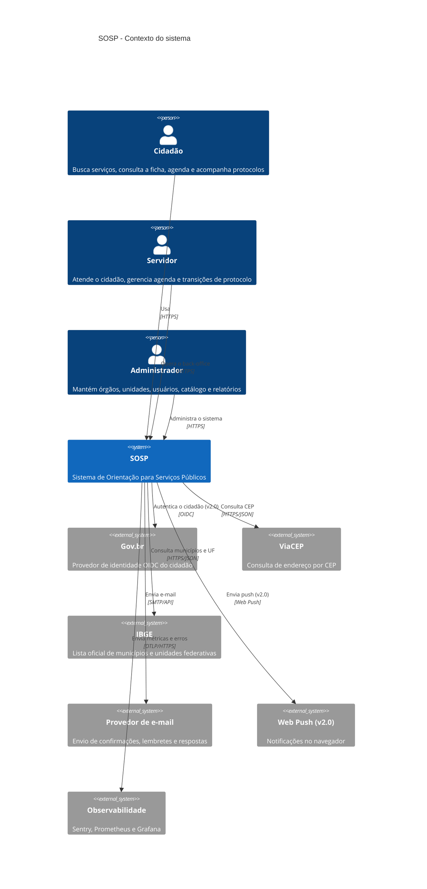
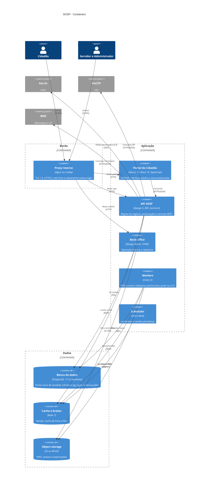
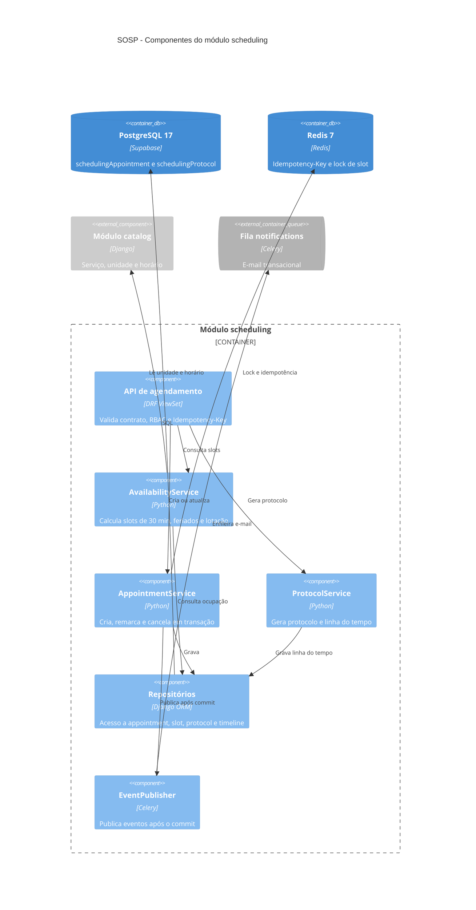
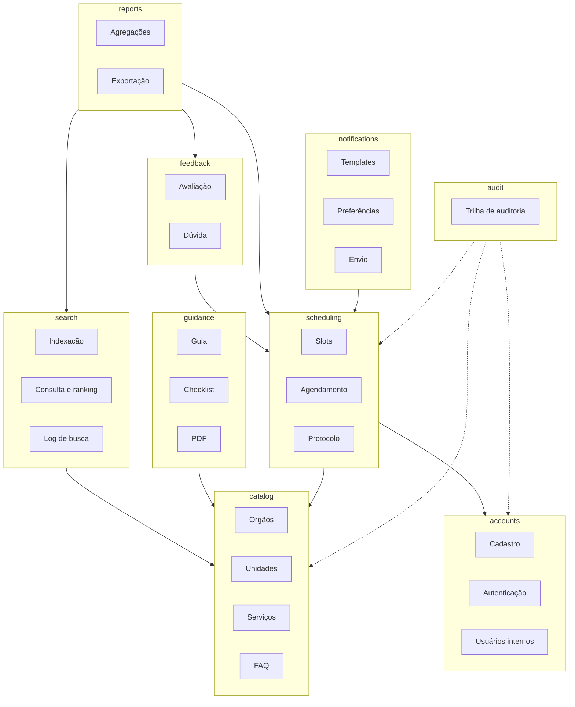
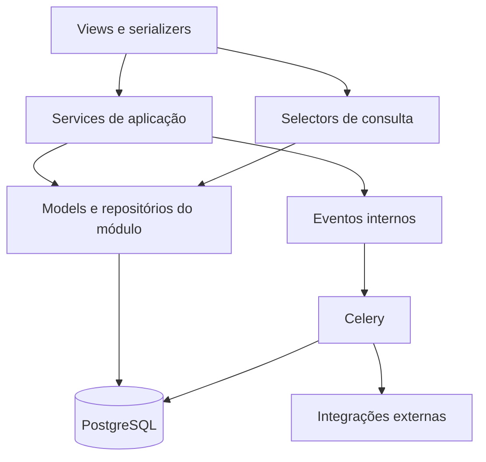
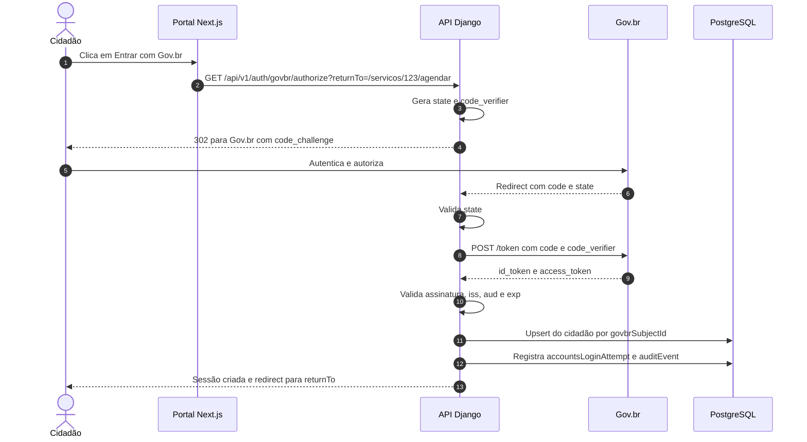
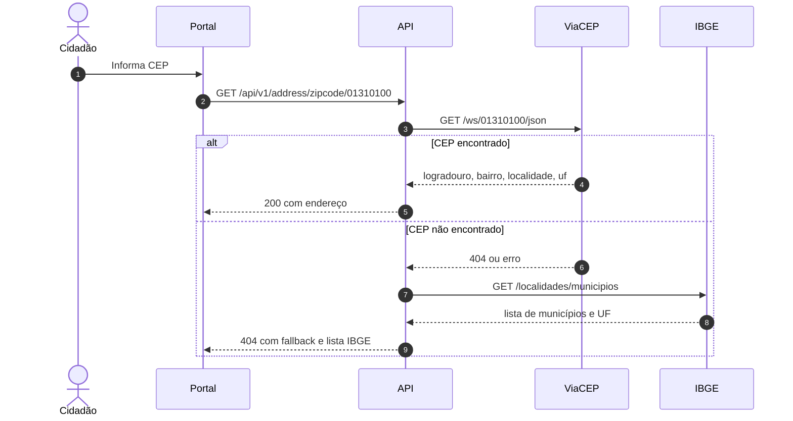
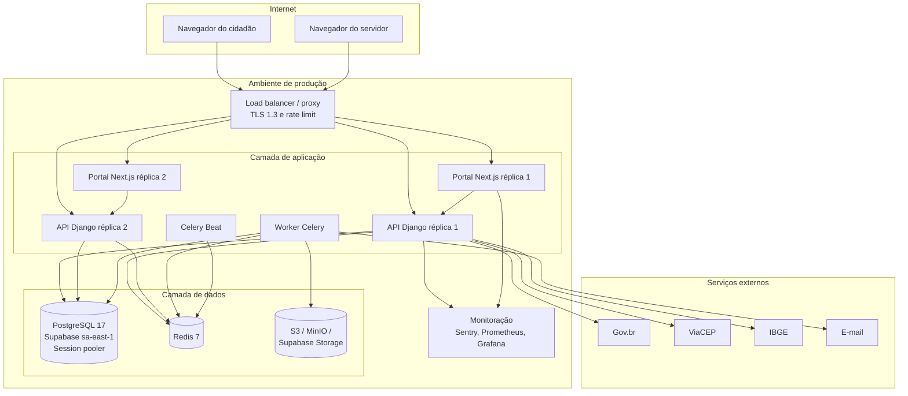

# Pilar 3 — Arquitetura de Software

> **Projeto:** SOSP — Sistema de Orientação para Serviços Públicos
> **Versão:** 1.1.0 · **Data:** 31/10/2026 · **Status:** Em revisão
> **Autores:** Equipe de Engenharia de Software — CESMAC
> **Documentos irmãos:** [Pilar 1](01-product-specs.md) · [Pilar 2](02-design-ux.md) · [Pilar 4](04-data-api.md) · [Pilar 5](05-engineering-devops.md)
> **Documentos complementares:** [Casos de uso](use-cases/README.md) · [Índice de telas](design/README.md) · [Gestão do projeto](06-project-management.md) · [Protótipo Figma](https://www.figma.com/design/P8Pf9aZiagXQulJpP2guqz/SOSP?node-id=0-1)

---

## Sumário

1. [Visão geral e princípios](#1-visão-geral-e-princípios)
2. [C4 Nível 1 — Contexto do sistema](#2-c4-nível-1--contexto-do-sistema)
3. [C4 Nível 2 — Containers](#3-c4-nível-2--containers)
4. [Módulos de domínio e fronteiras](#4-módulos-de-domínio-e-fronteiras)
5. [Padrão arquitetural e camadas](#5-padrão-arquitetural-e-camadas)
6. [Portal do cidadão em Next.js](#6-portal-do-cidadão-em-nextjs)
7. [Comunicação assíncrona e integrações](#7-comunicação-assíncrona-e-integrações)
8. [Segurança na arquitetura](#8-segurança-na-arquitetura)
9. [Topologia de implantação](#9-topologia-de-implantação)
10. [ADRs](#10-adrs)
11. [Trade-offs e alternativas descartadas](#11-trade-offs-e-alternativas-descartadas)

---

## 1. Visão geral e princípios

O SOSP é um **monólito modular** com dois deployáveis — API Django e portal Next.js — um banco PostgreSQL e um contrato OpenAPI. A escolha não é uma preferência estética: é a consequência de um time pequeno, um domínio com forte consistência transacional e um volume inicial que não justifica a complexidade operacional de serviços distribuídos.

| Decisão | Consequência |
|---|---|
| Um banco transacional | Agendamento, protocolo e transição de status acontecem em uma única transação ACID |
| Dois deployáveis | Pipeline, escala e rollback independentes para API e portal |
| Um contrato OpenAPI | Portal e futuro aplicativo consomem a mesma API; tipos TypeScript são gerados do contrato |
| Back-office no Django Admin | CRUD, permissões e relatórios sem reconstruir uma SPA administrativa |
| Busca no PostgreSQL | Full-text em português + `pg_trgm` resolvem o MVP sem Elasticsearch |
| Efeitos colaterais em fila | PDF, e-mail e relatórios não bloqueiam a requisição do cidadão |

### 1.1 Atributos de qualidade priorizados

| Atributo | Meta | Tática |
|---|---|---|
| Desempenho | p95 ≤ 2,5 s na busca e na ficha | Índices GIN/trigram, cache de ficha, paginação |
| Disponibilidade | 99,0% na janela comercial | Duas réplicas, healthcheck, deploy sem downtime |
| Consistência | Nenhum agendamento duplicado | Transação + constraint única + lock por slot |
| Segurança | LGPD e menor privilégio | RBAC, auditoria, criptografia em trânsito e repouso |
| Manutenibilidade | Cobertura ≥ 80% no back-end | Camadas explícitas, testes por serviço |
| Evolução | Extrair módulo sem reescrever | Fronteiras por módulo e tabelas prefixadas |

---

## 2. C4 Nível 1 — Contexto do sistema



**Fronteira do sistema:** o SOSP não substitui os sistemas de protocolo dos órgãos. Ele orienta, agenda e acompanha o que ele mesmo criou. Um protocolo externo é referenciado por número e link, nunca replicado.

---

## 3. C4 Nível 2 — Containers



### 3.1 Responsabilidades por container

| Container | Responsabilidade | Não faz |
|---|---|---|
| Proxy | TLS, HTTP/2, compressão, rate limit, roteamento same-origin | Regra de negócio |
| Portal | Renderização, navegação, estado de UI, acessibilidade | Acesso direto ao banco, regra de negócio |
| API | Regras, transações, autorização, contrato REST; cadastro e autenticação local (CPF + senha) para cidadãos (MVP), Gov.br OIDC como v2.0 | Renderizar HTML do portal |
| Back-office | CRUD, permissões, relatórios operacionais | Atender o cidadão |
| Workers | PDF, e-mail, exportações, lembretes; push na v2.0 | Responder requisição HTTP |
| Banco | Persistência, integridade, busca textual | Lógica de aplicação |
| Redis | Cache, sessão e broker | Fonte de verdade |
| Storage | Arquivos com URL assinada | Servir conteúdo público direto |

**Nota sobre o banco:** o PostgreSQL 17 é gerenciado no Supabase (região `sa-east-1`) e o schema da aplicação fica em `public`. O Supabase não expõe Data API nem Auth para o portal: a API Django é a única porta de leitura e escrita. A decisão está no [ADR-008](adr/ADR-008-supabase-postgresql-gerenciado.md).

### 3.2 Protocolos

| Origem → destino | Protocolo | Autenticação | Timeout |
|---|---|---|---|
| Navegador → proxy | HTTPS/TLS 1.3, HTTP/2 | Sessão | 30 s |
| Portal → API | HTTPS/JSON | Cookie de sessão + CSRF | 10 s |
| API → PostgreSQL | TCP/SQL via Session pooler | Usuário dedicado + TLS | 5 s |
| Migração → PostgreSQL | TCP/SQL direto | Usuário dedicado | 60 s |
| API → Redis | RESP | Senha | 2 s |
| API → Gov.br (v2.0) | OIDC/HTTPS | Client secret + PKCE | 10 s |
| API → ViaCEP | HTTPS/JSON | Nenhuma | 3 s |
| API → IBGE | HTTPS/JSON | Nenhuma | 3 s |
| Worker → SMTP | SMTP/TLS | Usuário e senha | 15 s |
| API/Worker → S3 | S3 API | IAM ou chave | 10 s |

### 3.3 C4 Nível 3 — Componentes do módulo `scheduling`

O módulo `scheduling` concentra a transação mais sensível do sistema: transformar um horário livre em agendamento e protocolo sem duplicar slot. O diagrama abaixo mostra as peças internas e as dependências permitidas.



**Regras de fronteira**

| Regra | Consequência |
|---|---|
| `scheduling` lê `catalog` por serviço de aplicação, nunca por SQL direto em tabela de outro módulo | O contrato entre módulos é explícito e testável |
| A criação do agendamento e a ocupação do slot acontecem na mesma transação | Não existe janela para dois cidadãos confirmarem o mesmo horário |
| O protocolo é gerado na mesma transação do agendamento | Não existe agendamento sem protocolo |
| Eventos são publicados **após** o commit | Worker não consome evento de transação que falhou |
| `Idempotency-Key` é gravada no Redis antes da transação | Reenvio devolve o mesmo resultado, sem duplicar |
| A linha do tempo é append-only | Auditoria não reescreve histórico |

---

## 4. Módulos de domínio e fronteiras



### 4.1 Contratos entre módulos

| Módulo | Expõe | Consome | Nunca faz |
|---|---|---|---|
| `accounts` | `CitizenService`, `InternalUserService`, `SessionService` | — | Conhecer catálogo ou agenda |
| `catalog` | `AgencyService`, `UnitService`, `ServiceCatalogService` | `accounts` (auditoria) | Criar agendamento |
| `search` | `SearchService`, `SearchLogService` | `catalog` (somente leitura) | Gravar em tabelas de catálogo |
| `guidance` | `GuidanceService`, `ChecklistService` | `catalog`, `accounts` | Alterar etapas do catálogo |
| `scheduling` | `SlotService`, `AppointmentService`, `ProtocolService` | `catalog`, `accounts` | Enviar e-mail diretamente |
| `feedback` | `ReviewService`, `QuestionService` | `scheduling` | Moderar sem auditoria |
| `notifications` | `NotificationService` | evento de outros módulos | Decidir regra de negócio |
| `reports` | `ReportService` | `search`, `scheduling`, `feedback` | Escrever em tabelas de domínio |
| `audit` | `AuditService` | todos (via evento) | Ser editado por usuário |

### 4.2 Regras de modularidade

1. Cada módulo expõe serviços de aplicação (`services.py`) e consultas (`selectors.py`). Views e templates conversam com serviços, nunca com models de outro módulo.
2. É proibido importar models de outro módulo. Referências cruzadas usam identificadores e serviços; relacionamentos diretos só dentro do próprio módulo.
3. As tabelas levam o prefixo do módulo (`catalogservice`, `schedulingappointment`), o que preserva a fronteira e facilita uma extração futura.
4. Cada caso de uso roda em uma transação (`transaction.atomic`) na camada de serviço. Views não controlam transação.
5. Efeitos colaterais — e-mail, PDF — são publicados como eventos internos e processados pelo Celery, fora da transação, com idempotência. Push entra na v2.0, atrás de `FEATURE_PUSH_ENABLED` ([ADR-007](adr/ADR-007-feature-flags.md)).
6. Testes de contrato entre módulos e revisão de dependências no CI impedem acoplamento acidental.
7. O front-end consome apenas a API versionada; não importa código Python, não acessa o banco e não replica regra de negócio. Os tipos TypeScript são gerados a partir do OpenAPI.

### 4.3 Verificação automatizada das fronteiras

```python
# scripts/check_module_boundaries.py
"""Falha o CI se um módulo importar models de outro módulo."""
from __future__ import annotations

import ast
from pathlib import Path

MODULES = {
    "accounts", "catalog", "search", "guidance",
    "scheduling", "feedback", "notifications", "reports", "audit",
}
ROOT = Path("backend/apps")
violations: list[str] = []

for module in MODULES:
    for file in (ROOT / module).rglob("*.py"):
        tree = ast.parse(file.read_text(encoding="utf-8"))
        for node in ast.walk(tree):
            if isinstance(node, ast.ImportFrom) and node.module:
                parts = node.module.split(".")
                if len(parts) >= 3 and parts[0] == "apps" and parts[1] in MODULES:
                    if parts[1] != module and parts[-1] in {"models", "models_extra"}:
                        violations.append(f"{file}: importa {node.module}")

if violations:
    raise SystemExit("Fronteira de módulo violada:\n" + "\n".join(violations))
print("Fronteiras de módulo OK")
```

---

## 5. Padrão arquitetural e camadas

### 5.1 Camadas do back-end



| Camada | Responsabilidade | Pode importar | Não pode |
|---|---|---|---|
| Views / serializers | Validar entrada HTTP, autorizar, serializar | Services, Selectors, serializers | Model de outro módulo |
| Services | Caso de uso, transação, regra de negócio | Models do próprio módulo, serviços de outros módulos | Request, response, template |
| Selectors | Consulta otimizada e reutilizável | Models do próprio módulo | Escrever dados |
| Models | Estrutura e invariantes locais | Campos e validações locais | Chamar serviço de outro módulo |
| Eventos | Publicar fato de domínio | Contratos de evento | Executar efeito colateral inline |

### 5.2 Exemplo de serviço transacional

```python
# apps/scheduling/services.py
from __future__ import annotations

from datetime import date, time
from uuid import UUID

from django.db import transaction
from django.utils import timezone

from apps.accounts.selectors import get_citizen_by_id
from apps.catalog.selectors import get_active_service, get_active_unit
from apps.scheduling.models import Appointment, Protocol, Slot
from apps.scheduling.protocols import generate_protocol_number


class SlotUnavailableError(Exception):
    """Levantado quando o slot foi ocupado entre a leitura e a confirmação."""


class DuplicateAppointmentError(Exception):
    """Levantado quando o cidadão já tem agendamento ativo para o serviço."""


@transaction.atomic
def create_appointment(
    *,
    citizen_id: UUID,
    service_id: UUID,
    unit_id: UUID,
    scheduled_date: date,
    scheduled_time: time,
) -> Appointment:
    citizen = get_citizen_by_id(citizen_id, for_update=True)
    service = get_active_service(service_id)
    unit = get_active_unit(unit_id)

    if scheduled_date < timezone.localdate():
        raise ValueError("Não é possível agendar em data passada.")

    if Appointment.objects.filter(
        citizen=citizen,
        service=service,
        status__in=["scheduled", "confirmed"],
    ).exists():
        raise DuplicateAppointmentError(
            "Você já tem um agendamento ativo para este serviço."
        )

    slot = (
        Slot.objects.select_for_update()
        .filter(unit=unit, slot_date=scheduled_date, starts_at=scheduled_time)
        .first()
    )
    if slot is None or slot.booked_count >= slot.capacity:
        raise SlotUnavailableError("Este horário acabou de ser preenchido.")

    slot.booked_count += 1
    slot.save(update_fields=["booked_count", "updated_at"])

    protocol_number = generate_protocol_number(scheduled_date)

    appointment = Appointment.objects.create(
        protocol_number=protocol_number,
        citizen=citizen,
        service=service,
        unit=unit,
        scheduled_date=scheduled_date,
        scheduled_time=scheduled_time,
        status="scheduled",
    )

    Protocol.objects.create(
        protocol_number=protocol_number,
        protocol_type="appointment",
        citizen=citizen,
        appointment=appointment,
        status="received",
    )
    return appointment
```

**Por que o `select_for_update` importa:** duas requisições simultâneas para o último slot precisam serializar. Sem o lock, ambas leem `booked_count = 29` e gravam `30`, produzindo overbooking.

### 5.3 Idempotência

| Operação | Chave | Janela | Comportamento |
|---|---|---|---|
| Criar agendamento | `Idempotency-Key` do cliente | 24 h | Retorna o mesmo agendamento e protocolo |
| Criar avaliação | `protocolNumber` | permanente | Segunda tentativa retorna 409 |
| Gerar PDF | `serviceId + citizenId + hash(checklist)` | 1 h | Reaproveita o arquivo existente |
| Exportar relatório | `hash(filtros) + userId` | 1 h | Reaproveita o job em andamento |

### 5.4 Estrutura de diretórios do back-end

```text
backend/
├── config/
│   ├── settings/
│   │   ├── base.py
│   │   ├── development.py
│   │   ├── staging.py
│   │   └── production.py
│   ├── urls.py
│   ├── asgi.py
│   └── wsgi.py
├── apps/
│   ├── accounts/
│   │   ├── models.py
│   │   ├── selectors.py
│   │   ├── services.py
│   │   ├── serializers.py
│   │   ├── views.py
│   │   ├── urls.py
│   │   ├── admin.py
│   │   └── tests/
│   ├── catalog/
│   ├── search/
│   ├── guidance/
│   ├── scheduling/
│   ├── feedback/
│   ├── notifications/
│   ├── reports/
│   └── audit/
├── common/
│   ├── models.py
│   ├── pagination.py
│   ├── problem_details.py
│   ├── permissions.py
│   └── events.py
├── scripts/
│   ├── check_module_boundaries.py
│   └── check_identifiers.py
├── manage.py
├── pyproject.toml
└── Dockerfile
```

---

## 6. Portal do cidadão em Next.js

### 6.1 Estrutura de rotas

```text
portal/
├── app/
│   ├── layout.tsx
│   ├── page.tsx                      # home com busca
│   ├── busca/
│   │   └── page.tsx                  # lista com filtros
│   ├── servicos/
│   │   └── [serviceId]/
│   │       ├── page.tsx              # ficha
│   │       ├── passo-a-passo/
│   │       │   └── page.tsx          # guia
│   │       └── agendar/
│   │           └── page.tsx          # agendamento
│   ├── meus-pedidos/
│   │   ├── page.tsx
│   │   └── [protocolNumber]/
│   │       └── page.tsx
│   ├── perfil/
│   │   └── page.tsx
│   └── api/
│       └── health/route.ts
├── components/
│   ├── ui/                           # Design System
│   └── features/                     # busca, ficha, guia, agenda
├── lib/
│   ├── api-client.ts                 # gerado do OpenAPI
│   ├── session.ts
│   └── formatting.ts
└── next.config.ts
```

### 6.2 Server e client components

| Tipo | Uso | Exemplo |
|---|---|---|
| Server component | Buscar dados, renderizar conteúdo, SEO | Lista de serviços, ficha |
| Client component | Interação, estado local, eventos | Filtros, checklist, seletor de slot |

**Regra:** o portal não replica regra de negócio. Cálculo de prazo, elegibilidade, status e preço vêm da API. O front-end formata e apresenta.

**Login:** no MVP, o cidadão autentica-se com CPF + senha via `POST /auth/login`. O botão "Entrar com Gov.br" existe na interface e exibe um modal informativo sobre implementação futura (v2.0) quando clicado.

### 6.3 Estratégia de dados e cache

| Dado | Estratégia | TTL | Invalidação |
|---|---|---|---|
| Lista de serviços | Server-side com `revalidate` | 60 s | Tag `services` |
| Ficha do serviço | ISR + cache Redis na API | 300 s | Tag `service:{id}` |
| Categorias e órgãos | Estático com revalidação | 1 h | Tag `catalog` |
| Slots | Sem cache | 0 | Sempre fresco |
| Protocolo | Sem cache | 0 | Sempre fresco |
| FAQ | Cache | 1 h | Tag `faq` |

### 6.4 Tratamento de erro no portal

```ts
// lib/api-client.ts
export class ApiProblem extends Error {
  constructor(
    readonly status: number,
    readonly title: string,
    readonly detail: string,
    readonly traceId?: string,
  ) {
    super(detail);
  }
}

export async function apiFetch<T>(
  path: string,
  init: RequestInit = {},
): Promise<T> {
  const response = await fetch(`${process.env.NEXT_PUBLIC_API_BASE_URL}${path}`, {
    ...init,
    headers: {
      "Content-Type": "application/json",
      ...init.headers,
    },
    credentials: "include",
  });

  if (!response.ok) {
    const problem = await response.json().catch(() => null);
    throw new ApiProblem(
      response.status,
      problem?.title ?? "Erro inesperado",
      problem?.detail ?? "Não foi possível concluir a operação.",
      problem?.traceId,
    );
  }

  return response.json() as Promise<T>;
}
```

---

## 7. Comunicação assíncrona e integrações

### 7.1 Tarefas assíncronas

| Tarefa | Fila | Gatilho | Retry | Idempotência |
|---|---|---|---|---|
| `generate_guidance_pdf` | `pdf` | Botão "Baixar PDF" | 3× com backoff exponencial | Hash do checklist |
| `send_transactional_email` | `email` | Evento de domínio | 5× | `deliveryId` |
| `send_web_push` (v2.0) | `push` | Evento de domínio | 3× | `deliveryId` |
| `send_appointment_reminder` | `reminders` | Celery Beat diário | 3× | `appointmentId + date` |
| `export_report` | `reports` | Solicitação do gestor | 2× | Hash dos filtros |
| `purge_expired_sessions` | `maintenance` | Celery Beat diário | 1× | Data de execução |
| `reindex_service` | `search` | Publicação de serviço | 3× | `serviceId + version` |

### 7.2 Eventos de domínio

| Evento | Publicado por | Consumido por | Efeito |
|---|---|---|---|
| `citizen.registered` | `accounts` | `notifications` | E-mail de boas-vindas |
| `appointment.created` | `scheduling` | `notifications` | E-mail de confirmação (push na v2.0) |
| `appointment.cancelled` | `scheduling` | `notifications`, `scheduling` | Aviso e liberação do slot |
| `protocol.status_changed` | `scheduling` | `notifications` | Aviso de mudança |
| `document.requested` | `scheduling` | `notifications` | E-mail com o documento solicitado |
| `review.created` | `feedback` | `reports` | Atualização de agregados |
| `service.published` | `catalog` | `search` | Reindexação |

### 7.3 Autenticação do cidadão

**MVP — CPF + senha (local)**

No MVP, o cidadão se autentica com CPF e senha, mesma interface e regras dos servidores:

1. CPF e senha são enviados via `POST /auth/login` (TLS 1.3).
2. O hash Argon2id + salt é verificado pelo módulo `accounts`.
3. A sessão dura 30 minutos de inatividade (`SESSION_IDLE_TIMEOUT_SECONDS=1800`).
4. Após 5 tentativas incorretas em 5 minutos, a conta é bloqueada temporariamente.
5. A senha é recuperada por código de 6 dígitos enviado ao e-mail cadastrado, válido por 15 minutos.
6. O botão "Entrar com Gov.br" existe na interface e exibe um modal informativo sobre implementação futura (v2.0) quando clicado.

**Futuro — Gov.br OIDC (v2.0)**

A integração com o Gov.br seguirá o fluxo OIDC com Authorization Code + PKCE:



**Regras de segurança do fluxo (v2.0)**

1. `state` é de uso único, assinado e expira em 10 minutos.
2. `code_verifier` nunca sai do servidor.
3. O `id_token` é validado contra o JWKS do Gov.br, com cache de chaves.
4. O vínculo é feito por `govbrSubjectId`, nunca por e-mail ou CPF.
5. Se o `sub` já existe com outro CPF, o login é recusado e um alerta de auditoria é gerado.

### 7.4 ViaCEP e IBGE



**Resiliência:** timeout de 3 s, 2 tentativas com backoff de 200 ms, cache de 30 dias por CEP e fallback manual sempre disponível. Indisponibilidade do ViaCEP não bloqueia o cadastro.

### 7.5 Busca full-text

```sql
-- A coluna searchVector, o índice GIN e o índice trigram são criados por
-- docs/database/schema.sql (tabela catalogservice). Não recrie aqui.
-- Consulta de referência do RF-06:
SELECT id, name
FROM catalogservice
WHERE searchVector @@ plainto_tsquery('sospPortuguese', 'certidao de nascimento')
  AND status = 'active';
```

**Ranking:** `ts_rank_cd(searchVector, query) * 0.7 + similarity(name, term) * 0.3`, com desempate por popularidade (contagem de acessos nos últimos 30 dias).

---

## 8. Segurança na arquitetura

### 8.1 Matriz RBAC

| Recurso | Anônimo | Cidadão | Servidor | Servidor autorizado | Administrador |
|---|---|---|---|---|---|
| Buscar serviços | ✅ | ✅ | ✅ | ✅ | ✅ |
| Ver ficha | ✅ | ✅ | ✅ | ✅ | ✅ |
| Ver FAQ | ✅ | ✅ | ✅ | ✅ | ✅ |
| Agendar | ❌ | ✅ | ❌ | ❌ | ❌ |
| Ver próprios protocolos | ❌ | ✅ | ❌ | ❌ | ❌ |
| Avaliar | ❌ | ✅ | ❌ | ❌ | ❌ |
| Gerenciar agenda da unidade | ❌ | ❌ | ✅ | ✅ | ✅ |
| Transicionar protocolo | ❌ | ❌ | ✅ | ✅ | ✅ |
| Gerenciar catálogo | ❌ | ❌ | ❌ | ✅ | ✅ |
| Gerenciar órgãos e unidades | ❌ | ❌ | ❌ | ❌ | ✅ |
| Gerenciar usuários internos | ❌ | ❌ | ❌ | ❌ | ✅ |
| Relatórios | ❌ | ❌ | ✅ (próprio órgão) | ✅ (próprio órgão) | ✅ (todos) |
| Auditoria | ❌ | ❌ | ❌ | ❌ | ✅ |

### 8.2 Sessão e tokens

| Item | Decisão |
|---|---|
| Sessão do cidadão | Cookie `HttpOnly`, `Secure`, `SameSite=Lax`, assinado, 30 min de inatividade |
| Sessão do servidor | Mesma política, com vínculo ao usuário interno |
| CSRF | Token por sessão em `X-CSRFToken`, validado em métodos mutáveis |
| Gov.br (v2.0) | Authorization Code + PKCE; tokens do provedor não são persistidos |
| Refresh | Renovação silenciosa enquanto houver atividade; após 30 min, novo login |
| Revogação | Logout invalida a sessão no servidor, não apenas o cookie |

### 8.3 Cabeçalhos de segurança

```text
Strict-Transport-Security: max-age=31536000; includeSubDomains; preload
Content-Security-Policy: default-src 'self'; img-src 'self' data: https:; style-src 'self' 'unsafe-inline'; script-src 'self'; connect-src 'self'; frame-ancestors 'none'
X-Content-Type-Options: nosniff
Referrer-Policy: strict-origin-when-cross-origin
Permissions-Policy: camera=(), microphone=(), geolocation=(self)
X-Frame-Options: DENY
```

### 8.4 Proteções de aplicação

| Vetor | Controle |
|---|---|
| SQL injection | ORM parametrizado; nenhuma query concatenada |
| XSS | Escape automático do template; CSP; sanitização de HTML rico |
| CSRF | Token + SameSite |
| Upload malicioso | Validação de MIME real, limite de 10 MB, ClamAV, storage privado |
| Enumeração de protocolo | 404 para recurso de terceiro; rate limit por sessão |
| Força bruta | 5 tentativas/5 min; bloqueio por CPF + IP |
| SSRF | Nenhuma URL fornecida pelo usuário é buscada pelo servidor |
| Vazamento em log | Filtro de PII no logger; CPF mascarado |

---

## 9. Topologia de implantação



**Conexões com o banco.** A aplicação (API e workers) conecta pelo **Session pooler** do Supabase (`DATABASE_URL`, porta 5432, `sslmode=require`). Migrações, `pg_dump` e scripts operacionais usam a **conexão direta** (`DATABASE_DIRECT_URL`), porque o pooler em modo sessão não é indicado para DDL longo nem para dump consistente. O portal não tem string de conexão: ele fala apenas com a API Django. A decisão completa está no [ADR-008](adr/ADR-008-supabase-postgresql-gerenciado.md).

**Por que não há réplica no diagrama.** O plano usado no projeto entrega um primário gerenciado com backup automático, não uma réplica de leitura sob controle do time. Leitura escalável é resolvida por cache (Redis e ISR do portal) antes de se considerar réplica. Se o plano mudar, a réplica entra como decisão de capacidade, não como requisito do MVP.

### 9.1 Dimensionamento inicial

| Componente | Réplicas | vCPU | RAM | Observação |
|---|---|---|---|---|
| Portal Next.js | 2 | 1 | 1 GB | Escala horizontal por CPU |
| API Django | 2 | 2 | 4 GB | Gunicorn com 4 workers |
| Worker Celery | 2 | 1 | 2 GB | Filas separadas por tipo |
| Celery Beat | 1 | 0,5 | 512 MB | Instância única com lock |
| PostgreSQL | 1 primário gerenciado (Supabase) | 4 | 16 GB | Backup automático; conexão via Session pooler |
| Redis | 1 | 1 | 2 GB | Persistência AOF |
| Proxy | 2 | 1 | 1 GB | Healthcheck ativo |

**Nota:** o dimensionamento do PostgreSQL é uma referência de plano, não um servidor provisionado pelo time. O limite real é o plano contratado no Supabase — conexões simultâneas, storage e janela de backup. O monitoramento de conexões é obrigatório antes da demonstração; se o pooler esgotar, a API degrada antes do banco.

### 9.2 Estratégia de deploy

| Etapa | Ação | Critério de sucesso |
|---|---|---|
| 1 | Build de imagens imutáveis com tag do commit | Imagem publicada no registry |
| 2 | Migração compatível (expand) | `migrate` sem lock longo |
| 3 | Deploy canário de 10% | Erro < 1% e latência estável por 5 min |
| 4 | Deploy completo | Duas réplicas saudáveis |
| 5 | Migração de contração (dias depois) | Nenhum código antigo em uso |
| 6 | Rollback | Imagem anterior + migração reversa quando aplicável |

---

## 10. ADRs

| ADR | Decisão | Status |
|---|---|---|
| [ADR-001](adr/ADR-001-monolito-modular-django-nextjs.md) | Monólito modular Django + portal Next.js | Aceito |
| [ADR-002](adr/ADR-002-postgresql-camelcase.md) | PostgreSQL 17 e convenção `camelCase` sem aspas | Aceito |
| [ADR-003](adr/ADR-003-autenticacao-govbr-rbac.md) | Autenticação local CPF + senha para cidadãos (MVP) e Gov.br OIDC como v2.0, login interno e RBAC | Aceito |
| [ADR-004](adr/ADR-004-git-flow-simplificado.md) | Git Flow simplificado em monorepo | Aceito |
| [ADR-005](adr/ADR-005-processamento-assincrono-dlq.md) | Processamento assíncrono com Celery, retry e DLQ | Aceito |
| [ADR-006](adr/ADR-006-armazenamento-s3-minio.md) | Storage compatível com S3: MinIO local, S3/Supabase Storage em produção | Aceito |
| [ADR-007](adr/ADR-007-feature-flags.md) | Feature flags de ambiente para escopo incompleto | Aceito |
| [ADR-008](adr/ADR-008-supabase-postgresql-gerenciado.md) | Supabase somente como PostgreSQL 17 gerenciado | Aceito |

### 10.1 Resumo das decisões

| ADR | Contexto em uma frase | Decisão em uma frase | Trade-off principal |
|---|---|---|---|
| 001 | Time pequeno, domínio transacional, prazo de disciplina | Monólito modular com dois deployáveis | Escala acoplada ao processo, sem independência por módulo |
| 002 | Necessidade de consistência e busca textual sem Elasticsearch | PostgreSQL 17 com full-text e `pg_trgm` | Nomes físicos em minúsculas, convenção documentada |
| 003 | Cidadão precisa de autenticação segura; servidor precisa de login local | CPF + senha (Argon2id) para cidadão no MVP, Gov.br OIDC como v2.0; senha para interno, RBAC | Cidadão gerencia mais uma senha; integração Gov.br postergada |
| 004 | Duas frentes no mesmo monorepo e uma demo que precisa ficar estável | `main` (produção) + `develop` (staging), branches curtas por área | Uma branch de integração a mais e merges em duas etapas |
| 005 | Tarefas lentas (PDF, e-mail, relatório) não podem travar a requisição | Celery com retry exponencial, idempotência e DLQ | Mais uma peça de infraestrutura e um lugar a monitorar |
| 006 | Binário no banco engorda o backup; disco local quebra o deploy horizontal | Interface S3 única, bucket privado e URL assinada de 300 s | Upload passa pela API e storage vira dependência externa |
| 007 | Contrato e schema preveem v2.0, mas o MVP não pode exibir o comportamento | Flags de ambiente avaliadas no servidor e declaradas no OpenAPI | Código morto temporário e teste em duas configurações |
| 008 | Time sem plantão de banco, mas com exigência de backup e latência no Brasil | Supabase só como PostgreSQL 17 em `sa-east-1`; Django é a única porta de escrita | Dependência de provedor e limites do plano gratuito |

---

## 11. Trade-offs e alternativas descartadas

| Alternativa | Por que foi descartada | O que perdemos |
|---|---|---|
| Microsserviços | N deploys, sagas, tracing distribuído e custo operacional desproporcional ao time | Escala independente por serviço |
| SPA React pura com Vite | Sem SSR, perde SEO e primeira renderização; duplica autenticação | Simplicidade de um único deploy estático |
| Back-office em React | Reconstruir CRUD, permissões e relatórios que o Django Admin entrega | Consistência visual total entre portal e back-office |
| Elasticsearch na v1 | Custo e operação de mais um cluster para um catálogo inicial pequeno | Busca semântica e tuning avançado de relevância |
| Serverless | Cold start em PDF, limites de execução e estado distribuído | Escala automática a custo zero |
| Banco NoSQL | Perda de integridade referencial e transações multi-entidade | Flexibilidade de schema |
| App nativo no MVP | Pipeline, lojas e ciclo de release sem demanda validada | Notificação push nativa e acesso a recursos do dispositivo |

### 11.1 Riscos arquiteturais

| Risco | Probabilidade | Impacto | Mitigação |
|---|---|---|---|
| Acoplamento entre módulos | Média | Alto | Script de fronteira no CI + revisão |
| Busca com relevância ruim | Média | Alto | Sinônimos, log de busca sem resultado, revisão mensal |
| Dependência do Gov.br | Baixa | Alto | Página de indisponibilidade e retry; login interno para servidores |
| Crescimento do banco de auditoria | Alta | Médio | Particionamento por mês e retenção de 5 anos |
| Fila de PDF travada | Média | Médio | Dead-letter queue, alerta e reprocessamento |
| Migração longa em tabela grande | Média | Alto | Migração expand/contract e janela de manutenção |
| Limite de conexões do Supabase | Média | Alto | Session pooler, `CONN_MAX_AGE` calibrado e alerta de conexões antes da demo |
| Indisponibilidade do Supabase | Baixa | Alto | Backup lógico externo semanal e restore ensaiado ([ADR-008](adr/ADR-008-supabase-postgresql-gerenciado.md)) |
| Segunda porta de escrita via Supabase | Baixa | Alto | Data API desabilitada, RLS como defesa em profundidade e varredura por `@supabase/*` no CI |

---

**Anterior:** [Pilar 2 — Design e Experiência do Usuário](02-design-ux.md) · **Próximo:** [Pilar 4 — Modelagem de Dados e Contratos de API](04-data-api.md)
