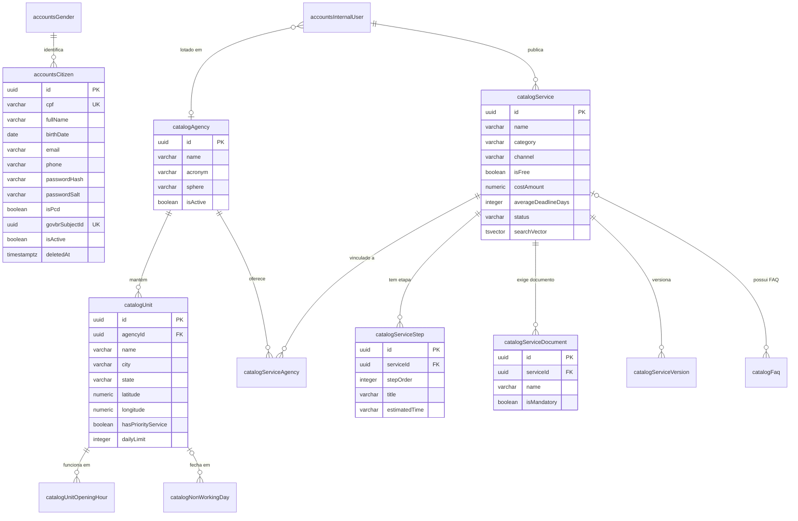
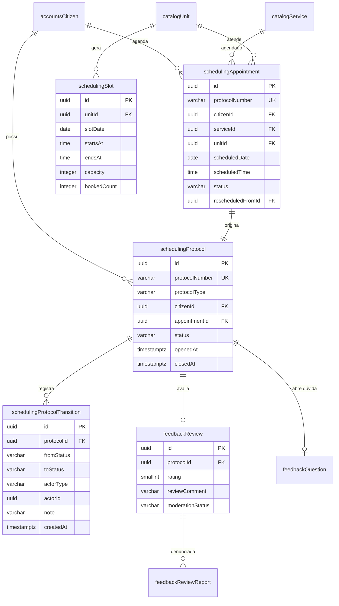
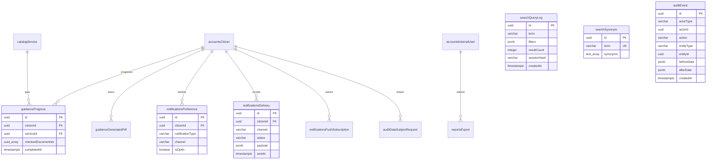

# Pilar 4 — Modelagem de Dados e Contratos de API

> **Projeto:** SOSP — Sistema de Orientação para Serviços Públicos
> **Versão:** 1.1.0 · **Data:** 31/10/2026 · **Status:** Em revisão
> **Autores:** Arthur Franco e Luiz Gustavo — CESMAC
> **Documentos irmãos:** [Pilar 1](01-product-specs.md) · [Pilar 2](02-design-ux.md) · [Pilar 3](03-architecture.md) · [Pilar 5](05-engineering-devops.md)
> **Documentos complementares:** [Casos de uso](use-cases/README.md) · [Índice de telas](design/README.md) · [ADR-007 — Feature flags](adr/ADR-007-feature-flags.md) · [ADR-008 — Supabase](adr/ADR-008-supabase-postgresql-gerenciado.md)
> **Artefatos executáveis:** [`schema.sql`](database/schema.sql) · [`openapi.yaml`](api/openapi.yaml)

---

## Sumário

1. [Convenções de modelagem](#1-convenções-de-modelagem)
2. [Modelo entidade-relacionamento](#2-modelo-entidade-relacionamento)
3. [Catálogo de tabelas](#3-catálogo-de-tabelas)
4. [Dicionário das entidades centrais](#4-dicionário-das-entidades-centrais)
5. [Schema SQL DDL](#5-schema-sql-ddl)
6. [Contrato de API](#6-contrato-de-api)
7. [Comunicação assíncrona e resiliência](#7-comunicação-assíncrona-e-resiliência)
8. [Migrações e evolução do schema](#8-migrações-e-evolução-do-schema)

---

## 1. Convenções de modelagem

| Convenção | Regra | Motivo |
|---|---|---|
| Nomenclatura | `camelCase` com prefixo do módulo, sem aspas duplas | ADR-002; o PostgreSQL dobra para minúsculas |
| Chave primária | `uuid` com `gen_random_uuid()` (v4); `uuidv7()` quando o ambiente migrar para PG 18 | Distribuição e não sequencialidade |
| Tempo | `timestamptz`, sempre UTC | Evita ambiguidade de fuso |
| Dinheiro | `numeric(10,2)` com `CHECK` de faixa | Nunca `float` para valor monetário |
| Exclusão | Lógica (`isActive`, `deletedAt`), nunca `DELETE` físico | Histórico e LGPD |
| Unicidade | Índice único parcial `WHERE deletedAt IS NULL` | Permite recadastro após exclusão lógica |
| Enums | `varchar` + `CHECK` | Migração de valor sem `ALTER TYPE` |
| Texto livre | `text` sem limite quando a regra é de conteúdo | Evita truncamento silencioso |
| Auditoria | `auditEvent` com antes/depois em `jsonb` | Rastreabilidade |
| Busca | `tsvector` gerado + GIN; `pg_trgm` para similaridade | RF-06 |

**Segurança de senhas.** A senha do cidadão é armazenada com hash Argon2id + salt. O código de recuperação tem 6 dígitos, hash SHA-256 e expira em 15 minutos.

**Onde o schema vive.** O schema da aplicação é criado em **`public`** por [`schema.sql`](database/schema.sql) e evoluído por migrações do Django. Em desenvolvimento, o PostgreSQL 17 roda no Docker; em staging e produção, o PostgreSQL 17 é gerenciado no Supabase (`sa-east-1`). O Supabase é usado **somente como banco**: Auth, Data API e Realtime ficam desabilitados, e a API Django é a única porta de leitura e escrita. As tabelas com dado pessoal têm RLS habilitada como defesa em profundidade — a autorização principal continua no Django. Ver [ADR-008](adr/ADR-008-supabase-postgresql-gerenciado.md).

**Consequência para o contrato:** nenhum cliente fala com o banco. O portal consome `openapi.yaml`; a Data API do Supabase não é uma segunda API do produto. Uma tabela nova só existe depois de migração versionada, nunca de edição manual no painel.

### 1.1 Mapa de módulos e tabelas

| Módulo | Tabelas | Prefixo |
|---|---|---|
| `accounts` | 6 | `accounts*` |
| `catalog` | 10 | `catalog*` |
| `search` | 2 | `search*` |
| `guidance` | 2 | `guidance*` |
| `scheduling` | 4 | `scheduling*` |
| `feedback` | 3 | `feedback*` |
| `notifications` | 4 | `notifications*` |
| `reports` | 1 | `reports*` |
| `audit` | 2 | `audit*` |

**Total:** 34 tabelas.

---

## 2. Modelo entidade-relacionamento

O modelo é apresentado em três recortes para permanecer legível. O recorte não é uma divisão de banco: é o mesmo schema, visto por domínio.

### 2.1 Núcleo — cidadão, órgão, unidade e serviço



### 2.2 Agendamento, protocolo e avaliação



### 2.3 Busca, orientação, notificações e auditoria



### 2.4 Cardinalidades que importam

| Relação | Cardinalidade | Regra de negócio |
|---|---|---|
| Cidadão × Agendamento | 1:N | Um cidadão pode ter vários agendamentos, mas só um ativo por serviço (índice parcial) |
| Agendamento × Protocolo | 1:1 | Todo agendamento gera exatamente um protocolo |
| Protocolo × Transição | 1:N | Cada mudança de status é uma linha imutável |
| Protocolo × Avaliação | 1:0..1 | Só protocolo concluído e uma única avaliação |
| Serviço × Órgão | N:N | Um serviço pode ser oferecido por mais de um órgão |
| Unidade × Horário | 1:N | Um registro por dia da semana; ausência = fechado |
| Serviço × Etapa | 1:N | Ordem única por serviço |
| Serviço × Documento | 1:N | Nome único por serviço |
| Cidadão × Progresso | 1:N | Um progresso por serviço |

---

## 3. Catálogo de tabelas

| Tabela | Propósito | PK | FKs | Unicidade | Índices |
|---|---|---|---|---|---|
| `accountsGender` | Lista auxiliar de gênero | `id` | — | `name` | — |
| `accountsCitizen` | Conta do cidadão | `id` | `genderId` | `cpf`, `email` (lower), `govbrSubjectId` | `city,state` |
| `accountsInternalUser` | Servidor e administrador | `id` | `agencyId` | `cpf`, `email` (lower), `registrationNumber` | `agencyId` |
| `accountsSession` | Sessão ativa | `id` | — | `tokenHash` | `subjectType,subjectId`; `expiresAt` |
| `accountsLoginAttempt` | Tentativas de login | `id` | — | — | `cpf,attemptedAt` |
| `accountsPasswordReset` | Código de recuperação | `id` | `internalUserId` | — | `internalUserId,expiresAt` |
| `catalogAgency` | Órgão público | `id` | — | `acronym,sphere` | GIN `name` |
| `catalogUnit` | Unidade de atendimento | `id` | `agencyId` | `agencyId,name,city` | `city,state`; `agencyId` |
| `catalogUnitOpeningHour` | Horário por dia | `id` | `unitId` | `unitId,weekday` | — |
| `catalogNonWorkingDay` | Feriado ou dia sem atendimento | `id` | `unitId` | — | `dayDate`; `unitId` |
| `catalogService` | Serviço do catálogo | `id` | `createdBy` | — | GIN `searchVector`; GIN `name`; `category`; `channel` |
| `catalogServiceAgency` | Vínculo serviço-órgão | `serviceId,agencyId` | ambos | PK composta | `agencyId` |
| `catalogServiceStep` | Etapa do guia | `id` | `serviceId` | `serviceId,stepOrder` | — |
| `catalogServiceDocument` | Documento exigido | `id` | `serviceId` | `serviceId,name` | — |
| `catalogFaq` | Pergunta frequente | `id` | `serviceId` | — | `serviceId`; `category`; GIN `question` |
| `catalogServiceVersion` | Histórico versionado | `id` | `serviceId`,`createdBy` | `serviceId,version` | — |
| `searchQueryLog` | Log anônimo de busca | `id` | — | — | `createdAt`; GIN `term`; parcial `resultCount=0` |
| `searchSynonym` | Sinônimos de busca | `id` | — | `term` | — |
| `guidanceProgress` | Checklist por cidadão | `id` | `citizenId`,`serviceId` | `citizenId,serviceId` | — |
| `guidanceGeneratedPdf` | PDF gerado | `id` | `citizenId`,`serviceId` | — | `citizenId,serviceId,createdAt` |
| `schedulingSlot` | Slot de 30 min | `id` | `unitId` | `unitId,slotDate,startsAt` | `unitId,slotDate` |
| `schedulingAppointment` | Agendamento | `id` | `citizenId`,`serviceId`,`unitId`,`rescheduledFromId` | `protocolNumber`; parcial ativo | `citizenId,scheduledDate`; `unitId,scheduledDate` |
| `schedulingProtocol` | Protocolo | `id` | `citizenId`,`appointmentId` | `protocolNumber`; `appointmentId` | `citizenId,openedAt`; `status,openedAt` |
| `schedulingProtocolTransition` | Transição de status | `id` | `protocolId` | — | `protocolId,createdAt` |
| `feedbackReview` | Avaliação | `id` | `protocolId`,`citizenId`,`serviceId`,`unitId` | `protocolId` | `serviceId,createdAt` |
| `feedbackReviewReport` | Denúncia de comentário | `id` | `reviewId`,`reportedBy` | — | — |
| `feedbackQuestion` | Dúvida do cidadão | `id` | `protocolId`,`citizenId`,`serviceId`,`answeredBy` | `protocolId` | — |
| `notificationsTemplate` | Template de mensagem | `id` | — | `code` | — |
| `notificationsPreference` | Opt-in/opt-out | `id` | `citizenId` | `citizenId,notificationType,channel` | — |
| `notificationsDelivery` | Log de envio | `id` | `citizenId` | — | `status,createdAt` |
| `notificationsPushSubscription` | Assinatura Web Push (v2.0) | `id` | `citizenId` | `endpoint` | — |
| `reportsExport` | Exportação assíncrona | `id` | `requestedBy` | — | `requestedBy,createdAt` |
| `auditEvent` | Trilha de auditoria | `id` | — | — | `entityType,entityId`; `createdAt`; `actorType,actorId` |
| `auditDataSubjectRequest` | Pedido LGPD | `id` | `citizenId` | — | — |

---

## 4. Dicionário das entidades centrais

### 4.1 `accountsCitizen`

| Coluna | Tipo | Nulo | Default | Regra |
|---|---|---|---|---|
| `id` | uuid | Não | `gen_random_uuid()` | PK |
| `cpf` | varchar(11) | Não | — | 11 dígitos, único entre ativos, imutável |
| `fullName` | varchar(120) | Não | — | Mínimo 3 caracteres |
| `birthDate` | date | Não | — | Idade ≥ 12 (validada na aplicação) |
| `email` | varchar(200) | Não | — | Formato válido, único por `lower(email)` |
| `phone` | varchar(11) | Não | — | 10 ou 11 dígitos |
| `passwordHash` | varchar(255) | Não | — | Argon2id |
| `passwordSalt` | varchar(255) | Não | — | Salt do Argon2id |
| `genderId` | uuid | Não | — | FK `accountsGender` |
| `isPcd` | boolean | Não | `false` | Se verdadeiro, exige `disabilityDescription` |
| `disabilityDescription` | varchar(120) | Sim | — | Dado sensível; acesso restrito |
| `motherName` | varchar(120) | Não | — | — |
| `fatherName` | varchar(120) | Sim | — | — |
| `zipCode` | varchar(8) | Não | — | 8 dígitos |
| `street` | varchar(120) | Não | — | — |
| `neighborhood` | varchar(80) | Não | — | — |
| `city` | varchar(80) | Não | — | — |
| `state` | varchar(2) | Não | — | UF maiúscula |
| `addressNumber` | varchar(10) | Não | — | Aceita `S/N` |
| `addressComplement` | varchar(60) | Sim | — | — |
| `avatarUrl` | varchar(500) | Sim | — | URL assinada |
| `govbrSubjectId` | varchar(255) | Não | — | `sub` do Gov.br, único — opcional (v2.0) |
| `emailVerifiedAt` | timestamptz | Sim | — | Confirmação de e-mail |
| `lastLoginAt` | timestamptz | Sim | — | — |
| `isActive` | boolean | Não | `true` | Exclusão lógica |
| `createdAt` | timestamptz | Não | `now()` | — |
| `updatedAt` | timestamptz | Não | `now()` | Trigger |
| `deletedAt` | timestamptz | Sim | — | Exclusão lógica |

### 4.2 `catalogService`

| Coluna | Tipo | Nulo | Default | Regra |
|---|---|---|---|---|
| `id` | uuid | Não | `gen_random_uuid()` | PK |
| `name` | varchar(150) | Não | — | — |
| `category` | varchar(30) | Não | — | 7 valores |
| `detailedDescription` | text | Não | — | Bloco "O que é" |
| `eligibility` | text | Não | — | Bloco "Quem tem direito" |
| `prerequisites` | text | Sim | — | — |
| `isFree` | boolean | Não | `true` | — |
| `costAmount` | numeric(10,2) | Sim | — | 0,01 a 99.999,99; nulo se gratuito |
| `averageDeadlineDays` | integer | Não | — | 0 a 365 |
| `channel` | varchar(20) | Não | — | `online`, `inPerson`, `hybrid` |
| `externalUrl` | varchar(300) | Sim | — | Obrigatório se online/híbrido; `https://` |
| `status` | varchar(20) | Não | `draft` | `draft`, `active`, `inactive` |
| `currentVersion` | integer | Não | `1` | Incrementado a cada publicação |
| `createdBy` | uuid | Sim | — | FK `accountsInternalUser` |
| `createdAt` | timestamptz | Não | `now()` | — |
| `updatedAt` | timestamptz | Não | `now()` | Trigger |
| `deletedAt` | timestamptz | Sim | — | Exclusão lógica |
| `searchVector` | tsvector | Gerado | — | `to_tsvector('sospPortuguese', coalesce(name, '') || ' ' || coalesce(detailedDescription, '') || ' ' || coalesce(eligibility, ''))` |

### 4.3 `schedulingAppointment`

| Coluna | Tipo | Nulo | Default | Regra |
|---|---|---|---|---|
| `id` | uuid | Não | `gen_random_uuid()` | PK |
| `protocolNumber` | varchar(13) | Não | — | `AAAAMMDD-XXXX`, único |
| `citizenId` | uuid | Não | — | FK `accountsCitizen` |
| `serviceId` | uuid | Não | — | FK `catalogService` |
| `unitId` | uuid | Não | — | FK `catalogUnit` |
| `scheduledDate` | date | Não | — | Não pode ser passada |
| `scheduledTime` | time | Não | — | Múltiplo de 30 min |
| `status` | varchar(20) | Não | `scheduled` | 5 estados |
| `cancellationReason` | varchar(500) | Sim | — | Obrigatório se cancelado |
| `rescheduledFromId` | uuid | Sim | — | Auto-FK |
| `createdAt` | timestamptz | Não | `now()` | — |
| `updatedAt` | timestamptz | Não | `now()` | Trigger |

**Índice parcial crítico:**

```sql
CREATE UNIQUE INDEX uqSchedulingAppointmentActive
  ON schedulingAppointment (citizenId, serviceId)
  WHERE status IN ('scheduled', 'confirmed');
```

### 4.4 `schedulingProtocol`

| Coluna | Tipo | Nulo | Default | Regra |
|---|---|---|---|---|
| `id` | uuid | Não | `gen_random_uuid()` | PK |
| `protocolNumber` | varchar(13) | Não | — | Único |
| `protocolType` | varchar(20) | Não | — | `appointment`, `question` |
| `citizenId` | uuid | Não | — | FK |
| `appointmentId` | uuid | Sim | — | Obrigatório se `appointment`; único |
| `status` | varchar(30) | Não | `received` | 6 estados |
| `openedAt` | timestamptz | Não | `now()` | — |
| `closedAt` | timestamptz | Sim | — | Preenchido em estado final |
| `createdAt` | timestamptz | Não | `now()` | — |
| `updatedAt` | timestamptz | Não | `now()` | Trigger |

---

## 5. Schema SQL DDL

O script abaixo é a cópia fiel de [`schema.sql`](database/schema.sql), validado em PostgreSQL 17 com `ON_ERROR_STOP=1` e compatível com PostgreSQL 18. O alvo de produção é **PostgreSQL 17** (Supabase, região `sa-east-1`); os recursos usados (`gen_random_uuid`, `pg_trgm`, `unaccent`, coluna gerada com `to_tsvector` de configuração explícita) existem desde a versão 13. `uuidv7()` não é usado porque só existe a partir do PostgreSQL 18; o default permanece `gen_random_uuid()`.

**Resultado da validação:** 34 tabelas criadas, 0 identificadores com maiúscula, busca sem acento funcional (`certidão` e `certidao` produzem o mesmo lexema).

**Segurança de senhas:** A senha do cidadão é armazenada com hash Argon2id + salt (`passwordHash`, `passwordSalt`). O código de recuperação tem 6 dígitos, hash SHA-256 e expira em 15 minutos.

```sql
-- =============================================================================
-- SOSP — Sistema de Orientação para Serviços Públicos
-- Schema DDL — PostgreSQL 17+
--
-- Convenção: identificadores em camelCase, SEM aspas duplas.
-- O PostgreSQL dobra identificadores não citados para minúsculas; portanto o
-- nome físico no catálogo é a versão minúscula (catalogservice, userid).
-- Ver ADR-002. Nunca crie identificador com aspas.
--
-- Produção: PostgreSQL 17 gerenciado no Supabase (região sa-east-1), schema
-- `public`. O Supabase é usado SOMENTE como banco: Auth, Data API e Realtime
-- ficam desabilitados e o Django é a única porta de escrita (ADR-008). A RLS
-- é defesa em profundidade, não o mecanismo principal de autorização.
--
-- Execução:
--   createdb sosp
--   psql -d sosp -v ON_ERROR_STOP=1 -f docs/database/schema.sql
-- =============================================================================

BEGIN;

CREATE EXTENSION IF NOT EXISTS pg_trgm;
CREATE EXTENSION IF NOT EXISTS unaccent;

-- Configuração de busca em português sem acento.
-- "certidão" e "certidao" passam a produzir o mesmo lexema.
DROP TEXT SEARCH CONFIGURATION IF EXISTS sospPortuguese;
CREATE TEXT SEARCH CONFIGURATION sospPortuguese (COPY = portuguese);
ALTER TEXT SEARCH CONFIGURATION sospPortuguese
  ALTER MAPPING FOR hword, hword_part, word
  WITH unaccent, portuguese_stem;

-- -----------------------------------------------------------------------------
-- Função de atualização de updatedAt
-- -----------------------------------------------------------------------------
CREATE OR REPLACE FUNCTION setUpdatedAt()
RETURNS trigger
LANGUAGE plpgsql
AS $$
BEGIN
  NEW.updatedAt = now();
  RETURN NEW;
END;
$$;

-- =============================================================================
-- MÓDULO accounts
-- =============================================================================

CREATE TABLE accountsGender (
  id          uuid PRIMARY KEY DEFAULT gen_random_uuid(),
  name        varchar(40) NOT NULL,
  sortOrder   smallint NOT NULL DEFAULT 0,
  isActive    boolean NOT NULL DEFAULT true,
  createdAt   timestamptz NOT NULL DEFAULT now(),
  updatedAt   timestamptz NOT NULL DEFAULT now(),
  CONSTRAINT uqAccountsGenderName UNIQUE (name)
);

CREATE TABLE accountsCitizen (
  id                    uuid PRIMARY KEY DEFAULT gen_random_uuid(),
  cpf                   varchar(11) NOT NULL,
  fullName              varchar(120) NOT NULL,
  birthDate             date NOT NULL,
  email                 varchar(200) NOT NULL,
  phone                 varchar(11) NOT NULL,
  passwordHash          varchar(255) NOT NULL,
  passwordSalt          varchar(255) NOT NULL,
  recoveryCodeHash      varchar(255),
  recoveryCodeExpiresAt timestamptz,
  loginAttempts         integer NOT NULL DEFAULT 0,
  blockedUntil          timestamptz,
  genderId              uuid NOT NULL,
  isPcd                 boolean NOT NULL DEFAULT false,
  disabilityDescription varchar(120),
  motherName            varchar(120) NOT NULL,
  fatherName            varchar(120),
  zipCode               varchar(8) NOT NULL,
  street                varchar(120) NOT NULL,
  neighborhood          varchar(80) NOT NULL,
  city                  varchar(80) NOT NULL,
  state                 varchar(2) NOT NULL,
  addressNumber         varchar(10) NOT NULL,
  addressComplement     varchar(60),
  avatarUrl             varchar(500),
  govbrSubjectId        varchar(255),
  emailVerifiedAt       timestamptz,
  lastLoginAt           timestamptz,
  isActive              boolean NOT NULL DEFAULT true,
  createdAt             timestamptz NOT NULL DEFAULT now(),
  updatedAt             timestamptz NOT NULL DEFAULT now(),
  deletedAt             timestamptz,
  CONSTRAINT fkAccountsCitizenGender FOREIGN KEY (genderId) REFERENCES accountsGender (id),
  CONSTRAINT chkAccountsCitizenCpf CHECK (cpf ~ '^[0-9]{11}$'),
  CONSTRAINT chkAccountsCitizenZip CHECK (zipCode ~ '^[0-9]{8}$'),
  CONSTRAINT chkAccountsCitizenState CHECK (state ~ '^[A-Z]{2}$'),
  CONSTRAINT chkAccountsCitizenPhone CHECK (phone ~ '^[0-9]{10,11}$'),
  CONSTRAINT chkAccountsCitizenEmail CHECK (email ~* '^[^@[:space:]]+@[^@[:space:]]+\.[^@[:space:]]+$'),
  CONSTRAINT chkAccountsCitizenPcd CHECK (isPcd = false OR disabilityDescription IS NOT NULL),
  CONSTRAINT chkAccountsCitizenName CHECK (char_length(fullName) >= 3)
);

CREATE UNIQUE INDEX uqAccountsCitizenCpf ON accountsCitizen (cpf) WHERE deletedAt IS NULL;
CREATE UNIQUE INDEX uqAccountsCitizenEmail ON accountsCitizen (lower(email)) WHERE deletedAt IS NULL;
-- CREATE UNIQUE INDEX uqAccountsCitizenGovbr ON accountsCitizen (govbrSubjectId) WHERE govbrSubjectId IS NOT NULL;
CREATE INDEX idxAccountsCitizenCity ON accountsCitizen (city, state);

CREATE TABLE accountsInternalUser (
  id                  uuid PRIMARY KEY DEFAULT gen_random_uuid(),
  cpf                 varchar(11) NOT NULL,
  fullName            varchar(120) NOT NULL,
  email               varchar(200) NOT NULL,
  registrationNumber  varchar(20) NOT NULL,
  agencyId            uuid,
  role                varchar(20) NOT NULL,
  canManageCatalog    boolean NOT NULL DEFAULT false,
  passwordHash        varchar(255) NOT NULL,
  mustChangePassword  boolean NOT NULL DEFAULT true,
  isActive            boolean NOT NULL DEFAULT true,
  lastLoginAt         timestamptz,
  createdAt           timestamptz NOT NULL DEFAULT now(),
  updatedAt           timestamptz NOT NULL DEFAULT now(),
  deletedAt           timestamptz,
  CONSTRAINT chkAccountsInternalUserRole CHECK (role IN ('administrator', 'servant')),
  CONSTRAINT chkAccountsInternalUserCpf CHECK (cpf ~ '^[0-9]{11}$'),
  CONSTRAINT chkAccountsInternalUserRegistration CHECK (registrationNumber ~ '^[A-Za-z0-9]{1,20}$')
);

CREATE UNIQUE INDEX uqAccountsInternalUserCpf ON accountsInternalUser (cpf) WHERE deletedAt IS NULL;
CREATE UNIQUE INDEX uqAccountsInternalUserEmail ON accountsInternalUser (lower(email)) WHERE deletedAt IS NULL;
CREATE UNIQUE INDEX uqAccountsInternalUserRegistration ON accountsInternalUser (registrationNumber) WHERE deletedAt IS NULL;
CREATE INDEX idxAccountsInternalUserAgency ON accountsInternalUser (agencyId);

CREATE TABLE accountsSession (
  id           uuid PRIMARY KEY DEFAULT gen_random_uuid(),
  subjectType  varchar(20) NOT NULL,
  subjectId    uuid NOT NULL,
  tokenHash    varchar(64) NOT NULL,
  ipAddress    inet,
  userAgent    varchar(500),
  expiresAt    timestamptz NOT NULL,
  revokedAt    timestamptz,
  createdAt    timestamptz NOT NULL DEFAULT now(),
  CONSTRAINT chkAccountsSessionSubjectType CHECK (subjectType IN ('citizen', 'internal')),
  CONSTRAINT uqAccountsSessionToken UNIQUE (tokenHash)
);

CREATE INDEX idxAccountsSessionSubject ON accountsSession (subjectType, subjectId);
CREATE INDEX idxAccountsSessionExpiresAt ON accountsSession (expiresAt) WHERE revokedAt IS NULL;

CREATE TABLE accountsLoginAttempt (
  id            uuid PRIMARY KEY DEFAULT gen_random_uuid(),
  cpf           varchar(11) NOT NULL,
  ipAddress     inet,
  wasSuccessful boolean NOT NULL DEFAULT false,
  attemptedAt   timestamptz NOT NULL DEFAULT now(),
  CONSTRAINT chkAccountsLoginAttemptCpf CHECK (cpf ~ '^[0-9]{11}$')
);

CREATE INDEX idxAccountsLoginAttemptCpf ON accountsLoginAttempt (cpf, attemptedAt DESC);

CREATE TABLE accountsPasswordReset (
  id             uuid PRIMARY KEY DEFAULT gen_random_uuid(),
  internalUserId uuid NOT NULL,
  codeHash       varchar(255) NOT NULL,
  expiresAt      timestamptz NOT NULL,
  usedAt         timestamptz,
  createdAt      timestamptz NOT NULL DEFAULT now(),
  CONSTRAINT fkAccountsPasswordResetUser FOREIGN KEY (internalUserId) REFERENCES accountsInternalUser (id) ON DELETE CASCADE
);

CREATE INDEX idxAccountsPasswordResetUser ON accountsPasswordReset (internalUserId, expiresAt DESC);

-- =============================================================================
-- MÓDULO catalog
-- =============================================================================

CREATE TABLE catalogAgency (
  id          uuid PRIMARY KEY DEFAULT gen_random_uuid(),
  name        varchar(120) NOT NULL,
  acronym     varchar(10) NOT NULL,
  sphere      varchar(20) NOT NULL,
  description varchar(500),
  isActive    boolean NOT NULL DEFAULT true,
  createdAt   timestamptz NOT NULL DEFAULT now(),
  updatedAt   timestamptz NOT NULL DEFAULT now(),
  deletedAt   timestamptz,
  CONSTRAINT chkCatalogAgencySphere CHECK (sphere IN ('municipal', 'state', 'federal'))
);

CREATE UNIQUE INDEX uqCatalogAgencyAcronymSphere ON catalogAgency (acronym, sphere) WHERE deletedAt IS NULL;
CREATE INDEX idxCatalogAgencyNameTrgm ON catalogAgency USING GIN (name gin_trgm_ops);

CREATE TABLE catalogUnit (
  id                  uuid PRIMARY KEY DEFAULT gen_random_uuid(),
  agencyId            uuid NOT NULL,
  name                varchar(120) NOT NULL,
  zipCode             varchar(8) NOT NULL,
  street              varchar(120) NOT NULL,
  neighborhood        varchar(80) NOT NULL,
  city                varchar(80) NOT NULL,
  state               varchar(2) NOT NULL,
  addressNumber       varchar(10) NOT NULL,
  phone               varchar(11),
  email               varchar(200),
  latitude            numeric(9,6),
  longitude           numeric(9,6),
  isAccessible        boolean NOT NULL DEFAULT false,
  hasPriorityService  boolean NOT NULL DEFAULT false,
  dailyLimit          integer NOT NULL DEFAULT 40,
  isActive            boolean NOT NULL DEFAULT true,
  createdAt           timestamptz NOT NULL DEFAULT now(),
  updatedAt           timestamptz NOT NULL DEFAULT now(),
  deletedAt           timestamptz,
  CONSTRAINT fkCatalogUnitAgency FOREIGN KEY (agencyId) REFERENCES catalogAgency (id),
  CONSTRAINT chkCatalogUnitZip CHECK (zipCode ~ '^[0-9]{8}$'),
  CONSTRAINT chkCatalogUnitState CHECK (state ~ '^[A-Z]{2}$'),
  CONSTRAINT chkCatalogUnitLatitude CHECK (latitude IS NULL OR latitude BETWEEN -90 AND 90),
  CONSTRAINT chkCatalogUnitLongitude CHECK (longitude IS NULL OR longitude BETWEEN -180 AND 180),
  CONSTRAINT chkCatalogUnitDailyLimit CHECK (dailyLimit > 0)
);

CREATE UNIQUE INDEX uqCatalogUnitNameCity ON catalogUnit (agencyId, name, city) WHERE deletedAt IS NULL;
CREATE INDEX idxCatalogUnitCity ON catalogUnit (city, state);
CREATE INDEX idxCatalogUnitAgency ON catalogUnit (agencyId);

CREATE TABLE catalogUnitOpeningHour (
  id        uuid PRIMARY KEY DEFAULT gen_random_uuid(),
  unitId    uuid NOT NULL,
  weekday   smallint NOT NULL,
  opensAt   time NOT NULL,
  closesAt  time NOT NULL,
  CONSTRAINT fkCatalogUnitOpeningHourUnit FOREIGN KEY (unitId) REFERENCES catalogUnit (id) ON DELETE CASCADE,
  CONSTRAINT chkCatalogUnitOpeningHourWeekday CHECK (weekday BETWEEN 0 AND 6),
  CONSTRAINT chkCatalogUnitOpeningHourRange CHECK (opensAt < closesAt),
  CONSTRAINT uqCatalogUnitOpeningHour UNIQUE (unitId, weekday)
);

CREATE TABLE catalogNonWorkingDay (
  id          uuid PRIMARY KEY DEFAULT gen_random_uuid(),
  unitId      uuid,
  dayDate     date NOT NULL,
  description varchar(120) NOT NULL,
  scope       varchar(20) NOT NULL,
  createdAt   timestamptz NOT NULL DEFAULT now(),
  CONSTRAINT fkCatalogNonWorkingDayUnit FOREIGN KEY (unitId) REFERENCES catalogUnit (id) ON DELETE CASCADE,
  CONSTRAINT chkCatalogNonWorkingDayScope CHECK (scope IN ('national', 'state', 'municipal', 'unit')),
  CONSTRAINT chkCatalogNonWorkingDayUnit CHECK (scope <> 'unit' OR unitId IS NOT NULL)
);

CREATE INDEX idxCatalogNonWorkingDayDate ON catalogNonWorkingDay (dayDate);
CREATE INDEX idxCatalogNonWorkingDayUnit ON catalogNonWorkingDay (unitId);

CREATE TABLE catalogService (
  id                  uuid PRIMARY KEY DEFAULT gen_random_uuid(),
  name                varchar(150) NOT NULL,
  category            varchar(30) NOT NULL,
  detailedDescription text NOT NULL,
  eligibility         text NOT NULL,
  prerequisites       text,
  isFree              boolean NOT NULL DEFAULT true,
  costAmount          numeric(10,2),
  averageDeadlineDays integer NOT NULL,
  channel             varchar(20) NOT NULL,
  externalUrl         varchar(300),
  status              varchar(20) NOT NULL DEFAULT 'draft',
  currentVersion      integer NOT NULL DEFAULT 1,
  createdBy           uuid,
  createdAt           timestamptz NOT NULL DEFAULT now(),
  updatedAt           timestamptz NOT NULL DEFAULT now(),
  deletedAt           timestamptz,
  searchVector        tsvector GENERATED ALWAYS AS (
    to_tsvector(
      'sospPortuguese',
      coalesce(name, '') || ' ' ||
      coalesce(detailedDescription, '') || ' ' ||
      coalesce(eligibility, '')
    )
  ) STORED,
  CONSTRAINT fkCatalogServiceCreatedBy FOREIGN KEY (createdBy) REFERENCES accountsInternalUser (id),
  CONSTRAINT chkCatalogServiceCategory CHECK (
    category IN ('health', 'education', 'documents', 'transport', 'socialAssistance', 'taxes', 'work')
  ),
  CONSTRAINT chkCatalogServiceChannel CHECK (channel IN ('online', 'inPerson', 'hybrid')),
  CONSTRAINT chkCatalogServiceStatus CHECK (status IN ('draft', 'active', 'inactive')),
  CONSTRAINT chkCatalogServiceCost CHECK (
    (isFree = true AND costAmount IS NULL)
    OR (isFree = false AND costAmount BETWEEN 0.01 AND 99999.99)
  ),
  CONSTRAINT chkCatalogServiceDeadline CHECK (averageDeadlineDays BETWEEN 0 AND 365),
  CONSTRAINT chkCatalogServiceExternalUrl CHECK (
    channel = 'inPerson' OR (externalUrl IS NOT NULL AND externalUrl LIKE 'https://%')
  )
);

CREATE INDEX idxCatalogServiceSearchVector ON catalogService USING GIN (searchVector);
CREATE INDEX idxCatalogServiceNameTrgm ON catalogService USING GIN (name gin_trgm_ops);
CREATE INDEX idxCatalogServiceCategory ON catalogService (category) WHERE status = 'active';
CREATE INDEX idxCatalogServiceChannel ON catalogService (channel) WHERE status = 'active';

CREATE TABLE catalogServiceAgency (
  serviceId uuid NOT NULL,
  agencyId  uuid NOT NULL,
  PRIMARY KEY (serviceId, agencyId),
  CONSTRAINT fkCatalogServiceAgencyService FOREIGN KEY (serviceId) REFERENCES catalogService (id) ON DELETE CASCADE,
  CONSTRAINT fkCatalogServiceAgencyAgency FOREIGN KEY (agencyId) REFERENCES catalogAgency (id) ON DELETE CASCADE
);

CREATE INDEX idxCatalogServiceAgencyAgency ON catalogServiceAgency (agencyId);

CREATE TABLE catalogServiceStep (
  id            uuid PRIMARY KEY DEFAULT gen_random_uuid(),
  serviceId     uuid NOT NULL,
  stepOrder     integer NOT NULL,
  title         varchar(100) NOT NULL,
  description   varchar(1000) NOT NULL,
  estimatedTime varchar(30),
  createdAt     timestamptz NOT NULL DEFAULT now(),
  CONSTRAINT fkCatalogServiceStepService FOREIGN KEY (serviceId) REFERENCES catalogService (id) ON DELETE CASCADE,
  CONSTRAINT chkCatalogServiceStepOrder CHECK (stepOrder > 0),
  CONSTRAINT uqCatalogServiceStepOrder UNIQUE (serviceId, stepOrder)
);

CREATE TABLE catalogServiceDocument (
  id           uuid PRIMARY KEY DEFAULT gen_random_uuid(),
  serviceId    uuid NOT NULL,
  name         varchar(120) NOT NULL,
  isMandatory  boolean NOT NULL DEFAULT true,
  templateUrl  varchar(500),
  createdAt    timestamptz NOT NULL DEFAULT now(),
  CONSTRAINT fkCatalogServiceDocumentService FOREIGN KEY (serviceId) REFERENCES catalogService (id) ON DELETE CASCADE,
  CONSTRAINT uqCatalogServiceDocumentName UNIQUE (serviceId, name)
);

CREATE TABLE catalogFaq (
  id         uuid PRIMARY KEY DEFAULT gen_random_uuid(),
  question   varchar(300) NOT NULL,
  answer     varchar(2000) NOT NULL,
  serviceId  uuid,
  category   varchar(30),
  isActive   boolean NOT NULL DEFAULT true,
  createdAt  timestamptz NOT NULL DEFAULT now(),
  updatedAt  timestamptz NOT NULL DEFAULT now(),
  CONSTRAINT fkCatalogFaqService FOREIGN KEY (serviceId) REFERENCES catalogService (id) ON DELETE CASCADE,
  CONSTRAINT chkCatalogFaqLink CHECK (serviceId IS NOT NULL OR category IS NOT NULL),
  CONSTRAINT chkCatalogFaqCategory CHECK (
    category IS NULL OR category IN ('health', 'education', 'documents', 'transport', 'socialAssistance', 'taxes', 'work')
  )
);

CREATE INDEX idxCatalogFaqService ON catalogFaq (serviceId) WHERE isActive = true;
CREATE INDEX idxCatalogFaqCategory ON catalogFaq (category) WHERE isActive = true;
CREATE INDEX idxCatalogFaqQuestionTrgm ON catalogFaq USING GIN (question gin_trgm_ops);

CREATE TABLE catalogServiceVersion (
  id         uuid PRIMARY KEY DEFAULT gen_random_uuid(),
  serviceId  uuid NOT NULL,
  version    integer NOT NULL,
  snapshot   jsonb NOT NULL,
  createdBy  uuid,
  createdAt  timestamptz NOT NULL DEFAULT now(),
  CONSTRAINT fkCatalogServiceVersionService FOREIGN KEY (serviceId) REFERENCES catalogService (id) ON DELETE CASCADE,
  CONSTRAINT fkCatalogServiceVersionCreatedBy FOREIGN KEY (createdBy) REFERENCES accountsInternalUser (id),
  CONSTRAINT uqCatalogServiceVersion UNIQUE (serviceId, version),
  CONSTRAINT chkCatalogServiceVersionNumber CHECK (version > 0)
);

-- =============================================================================
-- MÓDULO search
-- =============================================================================

CREATE TABLE searchQueryLog (
  id           uuid PRIMARY KEY DEFAULT gen_random_uuid(),
  term         varchar(200) NOT NULL,
  filters      jsonb NOT NULL DEFAULT '{}'::jsonb,
  resultCount  integer NOT NULL DEFAULT 0,
  sessionHash  varchar(64),
  createdAt    timestamptz NOT NULL DEFAULT now(),
  CONSTRAINT chkSearchQueryLogCount CHECK (resultCount >= 0)
);

CREATE INDEX idxSearchQueryLogCreatedAt ON searchQueryLog (createdAt DESC);
CREATE INDEX idxSearchQueryLogTermTrgm ON searchQueryLog USING GIN (term gin_trgm_ops);
CREATE INDEX idxSearchQueryLogZero ON searchQueryLog (createdAt DESC) WHERE resultCount = 0;

CREATE TABLE searchSynonym (
  id        uuid PRIMARY KEY DEFAULT gen_random_uuid(),
  term      varchar(100) NOT NULL,
  synonyms  text[] NOT NULL,
  isActive  boolean NOT NULL DEFAULT true,
  createdAt timestamptz NOT NULL DEFAULT now(),
  CONSTRAINT uqSearchSynonymTerm UNIQUE (term),
  CONSTRAINT chkSearchSynonymNotEmpty CHECK (array_length(synonyms, 1) >= 1)
);

-- =============================================================================
-- MÓDULO guidance
-- =============================================================================

CREATE TABLE guidanceProgress (
  id                 uuid PRIMARY KEY DEFAULT gen_random_uuid(),
  citizenId          uuid NOT NULL,
  serviceId          uuid NOT NULL,
  checkedDocumentIds uuid[] NOT NULL DEFAULT '{}'::uuid[],
  startedAt          timestamptz NOT NULL DEFAULT now(),
  completedAt        timestamptz,
  updatedAt          timestamptz NOT NULL DEFAULT now(),
  CONSTRAINT fkGuidanceProgressCitizen FOREIGN KEY (citizenId) REFERENCES accountsCitizen (id) ON DELETE CASCADE,
  CONSTRAINT fkGuidanceProgressService FOREIGN KEY (serviceId) REFERENCES catalogService (id) ON DELETE CASCADE,
  CONSTRAINT uqGuidanceProgress UNIQUE (citizenId, serviceId)
);

CREATE TABLE guidanceGeneratedPdf (
  id            uuid PRIMARY KEY DEFAULT gen_random_uuid(),
  citizenId     uuid NOT NULL,
  serviceId     uuid NOT NULL,
  fileUrl       varchar(500) NOT NULL,
  checklistHash varchar(64) NOT NULL,
  createdAt     timestamptz NOT NULL DEFAULT now(),
  expiresAt     timestamptz NOT NULL,
  CONSTRAINT fkGuidancePdfCitizen FOREIGN KEY (citizenId) REFERENCES accountsCitizen (id) ON DELETE CASCADE,
  CONSTRAINT fkGuidancePdfService FOREIGN KEY (serviceId) REFERENCES catalogService (id) ON DELETE CASCADE
);

CREATE INDEX idxGuidancePdfCitizen ON guidanceGeneratedPdf (citizenId, serviceId, createdAt DESC);

-- =============================================================================
-- MÓDULO scheduling
-- =============================================================================

CREATE TABLE schedulingSlot (
  id          uuid PRIMARY KEY DEFAULT gen_random_uuid(),
  unitId      uuid NOT NULL,
  slotDate    date NOT NULL,
  startsAt    time NOT NULL,
  endsAt      time NOT NULL,
  capacity    integer NOT NULL DEFAULT 1,
  bookedCount integer NOT NULL DEFAULT 0,
  createdAt   timestamptz NOT NULL DEFAULT now(),
  updatedAt   timestamptz NOT NULL DEFAULT now(),
  CONSTRAINT fkSchedulingSlotUnit FOREIGN KEY (unitId) REFERENCES catalogUnit (id) ON DELETE CASCADE,
  CONSTRAINT uqSchedulingSlot UNIQUE (unitId, slotDate, startsAt),
  CONSTRAINT chkSchedulingSlotRange CHECK (startsAt < endsAt),
  CONSTRAINT chkSchedulingSlotCapacity CHECK (capacity > 0),
  CONSTRAINT chkSchedulingSlotBooked CHECK (bookedCount >= 0 AND bookedCount <= capacity)
);

CREATE INDEX idxSchedulingSlotUnitDate ON schedulingSlot (unitId, slotDate);

CREATE TABLE schedulingAppointment (
  id                 uuid PRIMARY KEY DEFAULT gen_random_uuid(),
  protocolNumber     varchar(13) NOT NULL,
  citizenId          uuid NOT NULL,
  serviceId          uuid NOT NULL,
  unitId             uuid NOT NULL,
  scheduledDate      date NOT NULL,
  scheduledTime      time NOT NULL,
  status             varchar(20) NOT NULL DEFAULT 'scheduled',
  cancellationReason varchar(500),
  rescheduledFromId  uuid,
  createdAt          timestamptz NOT NULL DEFAULT now(),
  updatedAt          timestamptz NOT NULL DEFAULT now(),
  CONSTRAINT fkSchedulingAppointmentCitizen FOREIGN KEY (citizenId) REFERENCES accountsCitizen (id),
  CONSTRAINT fkSchedulingAppointmentService FOREIGN KEY (serviceId) REFERENCES catalogService (id),
  CONSTRAINT fkSchedulingAppointmentUnit FOREIGN KEY (unitId) REFERENCES catalogUnit (id),
  CONSTRAINT fkSchedulingAppointmentRescheduled FOREIGN KEY (rescheduledFromId) REFERENCES schedulingAppointment (id),
  CONSTRAINT uqSchedulingAppointmentProtocol UNIQUE (protocolNumber),
  CONSTRAINT chkSchedulingAppointmentProtocol CHECK (protocolNumber ~ '^[0-9]{8}-[0-9]{4}$'),
  CONSTRAINT chkSchedulingAppointmentStatus CHECK (
    status IN ('scheduled', 'confirmed', 'completed', 'cancelled', 'noShow')
  ),
  CONSTRAINT chkSchedulingAppointmentCancel CHECK (
    status <> 'cancelled' OR cancellationReason IS NOT NULL
  )
);

CREATE UNIQUE INDEX uqSchedulingAppointmentActive
  ON schedulingAppointment (citizenId, serviceId)
  WHERE status IN ('scheduled', 'confirmed');

CREATE INDEX idxSchedulingAppointmentCitizen ON schedulingAppointment (citizenId, scheduledDate DESC);
CREATE INDEX idxSchedulingAppointmentUnitDate ON schedulingAppointment (unitId, scheduledDate);

CREATE TABLE schedulingProtocol (
  id             uuid PRIMARY KEY DEFAULT gen_random_uuid(),
  protocolNumber varchar(13) NOT NULL,
  protocolType   varchar(20) NOT NULL,
  citizenId      uuid NOT NULL,
  appointmentId  uuid,
  status         varchar(30) NOT NULL DEFAULT 'received',
  openedAt       timestamptz NOT NULL DEFAULT now(),
  closedAt       timestamptz,
  createdAt      timestamptz NOT NULL DEFAULT now(),
  updatedAt      timestamptz NOT NULL DEFAULT now(),
  CONSTRAINT fkSchedulingProtocolCitizen FOREIGN KEY (citizenId) REFERENCES accountsCitizen (id),
  CONSTRAINT fkSchedulingProtocolAppointment FOREIGN KEY (appointmentId) REFERENCES schedulingAppointment (id),
  CONSTRAINT uqSchedulingProtocolNumber UNIQUE (protocolNumber),
  CONSTRAINT uqSchedulingProtocolAppointment UNIQUE (appointmentId),
  CONSTRAINT chkSchedulingProtocolType CHECK (protocolType IN ('appointment', 'question')),
  CONSTRAINT chkSchedulingProtocolStatus CHECK (
    status IN ('received', 'inReview', 'waitingDocument', 'scheduled', 'completed', 'cancelled')
  ),
  CONSTRAINT chkSchedulingProtocolLink CHECK (
    (protocolType = 'appointment' AND appointmentId IS NOT NULL)
    OR (protocolType = 'question' AND appointmentId IS NULL)
  )
);

CREATE INDEX idxSchedulingProtocolCitizen ON schedulingProtocol (citizenId, openedAt DESC);
CREATE INDEX idxSchedulingProtocolStatus ON schedulingProtocol (status, openedAt DESC);

CREATE TABLE schedulingProtocolTransition (
  id         uuid PRIMARY KEY DEFAULT gen_random_uuid(),
  protocolId uuid NOT NULL,
  fromStatus varchar(30),
  toStatus   varchar(30) NOT NULL,
  actorType  varchar(20) NOT NULL,
  actorId    uuid,
  note       varchar(1000),
  createdAt  timestamptz NOT NULL DEFAULT now(),
  CONSTRAINT fkSchedulingTransitionProtocol FOREIGN KEY (protocolId) REFERENCES schedulingProtocol (id) ON DELETE CASCADE,
  CONSTRAINT chkSchedulingTransitionActor CHECK (actorType IN ('citizen', 'servant', 'system')),
  CONSTRAINT chkSchedulingTransitionStatus CHECK (
    toStatus IN ('received', 'inReview', 'waitingDocument', 'scheduled', 'completed', 'cancelled')
  )
);

CREATE INDEX idxSchedulingTransitionProtocol ON schedulingProtocolTransition (protocolId, createdAt);

-- =============================================================================
-- MÓDULO feedback
-- =============================================================================

CREATE TABLE feedbackReview (
  id               uuid PRIMARY KEY DEFAULT gen_random_uuid(),
  protocolId       uuid NOT NULL,
  citizenId        uuid NOT NULL,
  serviceId        uuid NOT NULL,
  unitId           uuid NOT NULL,
  rating           smallint NOT NULL,
  reviewComment    varchar(500),
  moderationStatus varchar(20) NOT NULL DEFAULT 'pending',
  createdAt        timestamptz NOT NULL DEFAULT now(),
  updatedAt        timestamptz NOT NULL DEFAULT now(),
  CONSTRAINT fkFeedbackReviewProtocol FOREIGN KEY (protocolId) REFERENCES schedulingProtocol (id),
  CONSTRAINT fkFeedbackReviewCitizen FOREIGN KEY (citizenId) REFERENCES accountsCitizen (id),
  CONSTRAINT fkFeedbackReviewService FOREIGN KEY (serviceId) REFERENCES catalogService (id),
  CONSTRAINT fkFeedbackReviewUnit FOREIGN KEY (unitId) REFERENCES catalogUnit (id),
  CONSTRAINT uqFeedbackReviewProtocol UNIQUE (protocolId),
  CONSTRAINT chkFeedbackReviewRating CHECK (rating BETWEEN 1 AND 5),
  CONSTRAINT chkFeedbackReviewModeration CHECK (moderationStatus IN ('pending', 'approved', 'rejected'))
);

CREATE INDEX idxFeedbackReviewService ON feedbackReview (serviceId, createdAt DESC);

CREATE TABLE feedbackReviewReport (
  id         uuid PRIMARY KEY DEFAULT gen_random_uuid(),
  reviewId   uuid NOT NULL,
  reportedBy uuid NOT NULL,
  reason     varchar(500) NOT NULL,
  status     varchar(20) NOT NULL DEFAULT 'pending',
  createdAt  timestamptz NOT NULL DEFAULT now(),
  resolvedAt timestamptz,
  CONSTRAINT fkFeedbackReportReview FOREIGN KEY (reviewId) REFERENCES feedbackReview (id) ON DELETE CASCADE,
  CONSTRAINT fkFeedbackReportUser FOREIGN KEY (reportedBy) REFERENCES accountsInternalUser (id),
  CONSTRAINT chkFeedbackReportStatus CHECK (status IN ('pending', 'accepted', 'rejected'))
);

CREATE TABLE feedbackQuestion (
  id            uuid PRIMARY KEY DEFAULT gen_random_uuid(),
  protocolId    uuid NOT NULL,
  citizenId     uuid NOT NULL,
  serviceId     uuid,
  subject       varchar(200) NOT NULL,
  message       varchar(2000) NOT NULL,
  attachmentUrl varchar(500),
  answer        varchar(2000),
  answeredBy    uuid,
  answeredAt    timestamptz,
  createdAt     timestamptz NOT NULL DEFAULT now(),
  CONSTRAINT fkFeedbackQuestionProtocol FOREIGN KEY (protocolId) REFERENCES schedulingProtocol (id),
  CONSTRAINT fkFeedbackQuestionCitizen FOREIGN KEY (citizenId) REFERENCES accountsCitizen (id),
  CONSTRAINT fkFeedbackQuestionService FOREIGN KEY (serviceId) REFERENCES catalogService (id),
  CONSTRAINT fkFeedbackQuestionAnsweredBy FOREIGN KEY (answeredBy) REFERENCES accountsInternalUser (id),
  CONSTRAINT uqFeedbackQuestionProtocol UNIQUE (protocolId)
);

-- =============================================================================
-- MÓDULO notifications
-- =============================================================================

CREATE TABLE notificationsTemplate (
  id        uuid PRIMARY KEY DEFAULT gen_random_uuid(),
  code      varchar(60) NOT NULL,
  channel   varchar(20) NOT NULL,
  subject   varchar(200),
  body      text NOT NULL,
  isActive  boolean NOT NULL DEFAULT true,
  createdAt timestamptz NOT NULL DEFAULT now(),
  updatedAt timestamptz NOT NULL DEFAULT now(),
  CONSTRAINT uqNotificationsTemplateCode UNIQUE (code),
  CONSTRAINT chkNotificationsTemplateChannel CHECK (channel IN ('email', 'push', 'sms', 'whatsapp'))
);

CREATE TABLE notificationsPreference (
  id               uuid PRIMARY KEY DEFAULT gen_random_uuid(),
  citizenId        uuid NOT NULL,
  notificationType varchar(40) NOT NULL,
  channel          varchar(20) NOT NULL,
  isOptIn          boolean NOT NULL DEFAULT true,
  updatedAt        timestamptz NOT NULL DEFAULT now(),
  CONSTRAINT fkNotificationsPreferenceCitizen FOREIGN KEY (citizenId) REFERENCES accountsCitizen (id) ON DELETE CASCADE,
  CONSTRAINT uqNotificationsPreference UNIQUE (citizenId, notificationType, channel),
  CONSTRAINT chkNotificationsPreferenceChannel CHECK (channel IN ('email', 'push', 'sms', 'whatsapp'))
);

CREATE TABLE notificationsDelivery (
  id           uuid PRIMARY KEY DEFAULT gen_random_uuid(),
  citizenId    uuid NOT NULL,
  channel      varchar(20) NOT NULL,
  templateCode varchar(60) NOT NULL,
  status       varchar(20) NOT NULL DEFAULT 'queued',
  payload      jsonb NOT NULL DEFAULT '{}'::jsonb,
  errorMessage varchar(500),
  sentAt       timestamptz,
  createdAt    timestamptz NOT NULL DEFAULT now(),
  CONSTRAINT fkNotificationsDeliveryCitizen FOREIGN KEY (citizenId) REFERENCES accountsCitizen (id) ON DELETE CASCADE,
  CONSTRAINT chkNotificationsDeliveryChannel CHECK (channel IN ('email', 'push', 'sms', 'whatsapp')),
  CONSTRAINT chkNotificationsDeliveryStatus CHECK (status IN ('queued', 'sent', 'failed'))
);

CREATE INDEX idxNotificationsDeliveryStatus ON notificationsDelivery (status, createdAt);

CREATE TABLE notificationsPushSubscription (
  id         uuid PRIMARY KEY DEFAULT gen_random_uuid(),
  citizenId  uuid NOT NULL,
  endpoint   varchar(500) NOT NULL,
  p256dh     varchar(255) NOT NULL,
  auth       varchar(255) NOT NULL,
  createdAt  timestamptz NOT NULL DEFAULT now(),
  revokedAt  timestamptz,
  CONSTRAINT fkNotificationsPushCitizen FOREIGN KEY (citizenId) REFERENCES accountsCitizen (id) ON DELETE CASCADE,
  CONSTRAINT uqNotificationsPushEndpoint UNIQUE (endpoint)
);

-- =============================================================================
-- MÓDULO reports
-- =============================================================================

CREATE TABLE reportsExport (
  id          uuid PRIMARY KEY DEFAULT gen_random_uuid(),
  requestedBy uuid NOT NULL,
  reportType  varchar(40) NOT NULL,
  filters     jsonb NOT NULL DEFAULT '{}'::jsonb,
  status      varchar(20) NOT NULL DEFAULT 'queued',
  fileUrl     varchar(500),
  createdAt   timestamptz NOT NULL DEFAULT now(),
  completedAt timestamptz,
  CONSTRAINT fkReportsExportUser FOREIGN KEY (requestedBy) REFERENCES accountsInternalUser (id),
  CONSTRAINT chkReportsExportStatus CHECK (status IN ('queued', 'processing', 'done', 'failed'))
);

CREATE INDEX idxReportsExportUser ON reportsExport (requestedBy, createdAt DESC);

-- =============================================================================
-- MÓDULO audit
-- =============================================================================

CREATE TABLE auditEvent (
  id         uuid PRIMARY KEY DEFAULT gen_random_uuid(),
  actorType  varchar(20) NOT NULL,
  actorId    uuid,
  action     varchar(80) NOT NULL,
  entityType varchar(80) NOT NULL,
  entityId   uuid,
  beforeData jsonb,
  afterData  jsonb,
  ipAddress  inet,
  userAgent  varchar(500),
  createdAt  timestamptz NOT NULL DEFAULT now(),
  CONSTRAINT chkAuditEventActorType CHECK (actorType IN ('citizen', 'servant', 'system', 'anonymous'))
);

CREATE INDEX idxAuditEventEntity ON auditEvent (entityType, entityId, createdAt DESC);
CREATE INDEX idxAuditEventCreatedAt ON auditEvent (createdAt DESC);
CREATE INDEX idxAuditEventActor ON auditEvent (actorType, actorId, createdAt DESC);

CREATE TABLE auditDataSubjectRequest (
  id          uuid PRIMARY KEY DEFAULT gen_random_uuid(),
  citizenId   uuid NOT NULL,
  requestType varchar(20) NOT NULL,
  status      varchar(20) NOT NULL DEFAULT 'open',
  requestedAt timestamptz NOT NULL DEFAULT now(),
  completedAt timestamptz,
  notes       varchar(2000),
  CONSTRAINT fkAuditSubjectRequestCitizen FOREIGN KEY (citizenId) REFERENCES accountsCitizen (id),
  CONSTRAINT chkAuditSubjectRequestType CHECK (requestType IN ('access', 'correction', 'deletion', 'portability')),
  CONSTRAINT chkAuditSubjectRequestStatus CHECK (status IN ('open', 'inProgress', 'done', 'rejected'))
);

-- =============================================================================
-- CHAVES ESTRANGEIRAS ENTRE MÓDULOS
-- Declaradas após a criação de todas as tabelas para preservar a ordem de
-- dependência e deixar explícita a fronteira entre accounts e catalog.
-- =============================================================================

ALTER TABLE accountsInternalUser
  ADD CONSTRAINT fkAccountsInternalUserAgency
  FOREIGN KEY (agencyId) REFERENCES catalogAgency (id);

-- =============================================================================
-- TRIGGERS DE updatedAt
-- =============================================================================

CREATE TRIGGER trgAccountsCitizenUpdatedAt BEFORE UPDATE ON accountsCitizen
  FOR EACH ROW EXECUTE FUNCTION setUpdatedAt();
CREATE TRIGGER trgAccountsInternalUserUpdatedAt BEFORE UPDATE ON accountsInternalUser
  FOR EACH ROW EXECUTE FUNCTION setUpdatedAt();
CREATE TRIGGER trgCatalogAgencyUpdatedAt BEFORE UPDATE ON catalogAgency
  FOR EACH ROW EXECUTE FUNCTION setUpdatedAt();
CREATE TRIGGER trgCatalogUnitUpdatedAt BEFORE UPDATE ON catalogUnit
  FOR EACH ROW EXECUTE FUNCTION setUpdatedAt();
CREATE TRIGGER trgCatalogServiceUpdatedAt BEFORE UPDATE ON catalogService
  FOR EACH ROW EXECUTE FUNCTION setUpdatedAt();
CREATE TRIGGER trgCatalogFaqUpdatedAt BEFORE UPDATE ON catalogFaq
  FOR EACH ROW EXECUTE FUNCTION setUpdatedAt();
CREATE TRIGGER trgGuidanceProgressUpdatedAt BEFORE UPDATE ON guidanceProgress
  FOR EACH ROW EXECUTE FUNCTION setUpdatedAt();
CREATE TRIGGER trgSchedulingSlotUpdatedAt BEFORE UPDATE ON schedulingSlot
  FOR EACH ROW EXECUTE FUNCTION setUpdatedAt();
CREATE TRIGGER trgSchedulingAppointmentUpdatedAt BEFORE UPDATE ON schedulingAppointment
  FOR EACH ROW EXECUTE FUNCTION setUpdatedAt();
CREATE TRIGGER trgSchedulingProtocolUpdatedAt BEFORE UPDATE ON schedulingProtocol
  FOR EACH ROW EXECUTE FUNCTION setUpdatedAt();
CREATE TRIGGER trgFeedbackReviewUpdatedAt BEFORE UPDATE ON feedbackReview
  FOR EACH ROW EXECUTE FUNCTION setUpdatedAt();
CREATE TRIGGER trgNotificationsTemplateUpdatedAt BEFORE UPDATE ON notificationsTemplate
  FOR EACH ROW EXECUTE FUNCTION setUpdatedAt();
CREATE TRIGGER trgNotificationsPreferenceUpdatedAt BEFORE UPDATE ON notificationsPreference
  FOR EACH ROW EXECUTE FUNCTION setUpdatedAt();

-- =============================================================================
-- DADOS INICIAIS
-- =============================================================================

INSERT INTO accountsGender (name, sortOrder) VALUES
  ('Feminino', 1),
  ('Masculino', 2),
  ('Não binário', 3),
  ('Outro', 4),
  ('Prefiro não informar', 5);

INSERT INTO notificationsTemplate (code, channel, subject, body) VALUES
  ('accountCreated', 'email', 'Sua conta no SOSP foi criada',
   'Olá, {nome}! Seu cadastro foi realizado com sucesso. Use seu CPF e senha para acessar o sistema.'),
  ('appointmentCreated', 'email', 'Agendamento confirmado',
   'Agendamento confirmado! Protocolo {protocolo}: {serviço}, em {unidade}, no dia {data} às {hora}. Leve os documentos originais.'),
  ('appointmentReminder', 'email', 'Lembrete do seu atendimento',
   'Lembrete: seu atendimento ({serviço}) é amanhã, {data} às {hora}, em {unidade}. Protocolo {protocolo}.'),
  ('protocolStatusChanged', 'email', 'Seu protocolo foi atualizado',
   'Seu protocolo {protocolo} mudou para: {status}. Acesse o sistema para ver os detalhes.'),
  ('questionAnswered', 'email', 'Sua dúvida foi respondida',
   'Sua dúvida (protocolo {protocolo}) foi respondida. Acesse o sistema para ler a resposta.');

INSERT INTO searchSynonym (term, synonyms) VALUES
  ('rg', ARRAY['carteira de identidade', 'documento de identidade', 'identidade']),
  ('cpf', ARRAY['cadastro de pessoa física', 'documento cpf']),
  ('sus', ARRAY['sistema único de saúde', 'saúde pública']),
  ('inss', ARRAY['instituto nacional do seguro social', 'aposentadoria', 'benefício']),
  ('detran', ARRAY['departamento estadual de trânsito', 'habilitação', 'cnh']),
  ('crás', ARRAY['centro de referência de assistência social', 'assistência social']),
  ('certidão', ARRAY['certidao', 'nascimento', 'casamento', 'óbito']);

COMMIT;

-- =============================================================================
-- VERIFICAÇÃO DE CONVENÇÃO (deve retornar zero linhas)
-- =============================================================================
-- SELECT table_schema, table_name, column_name
-- FROM information_schema.columns
-- WHERE table_schema = 'public'
--   AND (table_name ~ '[A-Z]' OR column_name ~ '[A-Z]');
```

### 5.1 Consultas de verificação

```sql
-- 1. Nenhum identificador criado com aspas (deve retornar 0)
SELECT count(*) AS violacoes
FROM information_schema.columns
WHERE table_schema = 'public'
  AND (table_name ~ '[A-Z]' OR column_name ~ '[A-Z]');

-- 2. Busca sem acento (deve retornar true)
SELECT to_tsvector('sospPortuguese', 'Certidão de nascimento')
       @@ plainto_tsquery('sospPortuguese', 'certidao') AS encontrou;

-- 3. Índice de busca em uso (deve mostrar Bitmap Index Scan)
EXPLAIN (ANALYZE, BUFFERS)
SELECT id, name
FROM catalogService
WHERE searchVector @@ plainto_tsquery('sospPortuguese', 'carteira de identidade')
  AND status = 'active';
```

---

## 6. Contrato de API

### 6.1 Convenções

| Item | Regra |
|---|---|
| Base URL | `https://sosp.gov.br/api/v1` |
| Versionamento | Prefixo de rota `/v1`; quebra de contrato exige `/v2` |
| Formato | `application/json; charset=utf-8` |
| Erro | `application/problem+json` (RFC 7807) |
| Autenticação | Cookie `sessionid` (`HttpOnly`, `Secure`, `SameSite=Lax`) |
| CSRF | `X-CSRFToken` em `POST`, `PUT`, `PATCH`, `DELETE` |
| Correlação | `X-Request-Id` aceito e ecoado; `traceId` no corpo do erro |
| Paginação | `page` (1-based) e `pageSize` (1–50, padrão 10) |
| Ordenação | Definida por rota; nunca aceita coluna arbitrária |
| Idempotência | `Idempotency-Key` em criação de agendamento |
| Feature flag | `x-feature-flag: <NOME>` no OpenAPI; avaliação no servidor; flag desligada responde `404` ou `403` conforme o recurso |
| Rate limit | Por IP e por sessão; resposta `429` com `Retry-After` |

### 6.2 Matriz de endpoints

| Verbo | Path | Autenticação | Requisito | Descrição |
|---|---|---|---|---|
| POST | `/auth/register` | Nenhuma | RF-01 | Cria conta do cidadão |
| POST | `/auth/login` | Nenhuma | RF-02 | Login CPF + senha |
| POST | `/auth/logout` | Sessão | RF-02 | Logout |
| POST | `/auth/recover-password` | Nenhuma | RF-02 | Solicita código |
| POST | `/auth/reset-password` | Nenhuma | RF-02 | Redefine senha |
| GET | `/auth/govbr/authorize` | Nenhuma | RF-02 (v2.0) | Redireciona ao Gov.br — flag `FEATURE_GOVBR_INTEGRATION_ENABLED` |
| GET | `/auth/govbr/callback` | Nenhuma | RF-02 (v2.0) | Callback OIDC — flag `FEATURE_GOVBR_INTEGRATION_ENABLED` |
| GET | `/citizens/me` | Sessão | RF-01 | Perfil do cidadão |
| PATCH | `/citizens/me` | Sessão | RF-01 | Atualiza contato e endereço |
| GET | `/services` | Pública | RF-06 | Busca paginada |
| GET | `/services/{serviceId}` | Pública | RF-06 | Ficha completa |
| GET | `/services/{serviceId}/steps` | Pública | RF-07 | Etapas do guia |
| GET | `/services/{serviceId}/documents` | Pública | RF-07 | Documentos |
| GET | `/services/{serviceId}/faq` | Pública | RF-11 | FAQ do serviço |
| GET | `/agencies` | Pública | RF-03 | Órgãos ativos |
| GET | `/units` | Pública | RF-04 | Unidades |
| GET | `/units/{unitId}/slots` | Pública | RF-08 | Slots livres |
| GET | `/categories` | Pública | RF-06 | Categorias |
| GET | `/address/zipcode/{zipCode}` | Pública | RF-01 | CEP com fallback |
| GET | `/services/{serviceId}/guidance` | Sessão | RF-07 | Guia + progresso |
| PUT | `/services/{serviceId}/guidance/checklist` | Sessão | RF-07 | Atualiza checklist |
| POST | `/services/{serviceId}/guidance/pdf` | Sessão | RF-07 | Enfileira PDF |
| GET | `/guidance/pdf/{jobId}` | Sessão | RF-07 | Status do PDF |
| POST | `/appointments` | Sessão | RF-08 | Cria agendamento |
| GET | `/appointments/{appointmentId}` | Sessão | RF-08 | Consulta agendamento |
| PATCH | `/appointments/{appointmentId}` | Sessão | RF-08 | Remarca/cancela |
| GET | `/protocols` | Sessão | RF-09 | Meus pedidos |
| GET | `/protocols/{protocolNumber}` | Sessão | RF-09 | Linha do tempo |
| POST | `/protocols/{protocolNumber}/documents` | Sessão | RF-09 | Anexa documento |
| POST | `/protocols/{protocolNumber}/review` | Sessão | RF-10 | Avalia — flag `FEATURE_REVIEWS_ENABLED` |
| POST | `/questions` | Sessão | RF-11 | Abre dúvida |
| GET | `/notifications/preferences` | Sessão | RF-13 | Preferências — flags `FEATURE_NOTIFICATION_CENTER_ENABLED` e `FEATURE_PUSH_ENABLED` |
| PUT | `/notifications/preferences` | Sessão | RF-13 | Atualiza preferências — mesmas flags |
| GET | `/reports/appointments` | Servidor | RF-14 | Agendamentos por status |
| POST | `/reports/exports` | Servidor | RF-14 | Exportação — flag `FEATURE_REPORTS_EXPORT` |
| POST | `/webhooks/email` | HMAC | Integração | Eventos do provedor de e-mail |

**Cobertura do contrato:** 31 paths e 34 operações, todas descritas em [`openapi.yaml`](api/openapi.yaml). O CRUD de órgãos, unidades, serviços e usuários internos é feito no Django Admin e não é exposto na API pública; a API expõe as leituras que o portal consome. O webhook usa autenticação HMAC, não sessão de cidadão.

**Endpoints condicionados por flag.** Os quatro endpoints de RF-10/RF-13 e a exportação de relatórios carregam `x-feature-flag` no contrato. A flag é avaliada **antes** do RBAC, para não revelar a existência de um recurso desabilitado; o log registra as duas decisões. O portal pode esconder o botão, mas a rota também recusa. A regra completa está no [ADR-007](adr/ADR-007-feature-flags.md).

### 6.3 Exemplo — busca do RF-06

**Requisição**

```http
GET /api/v1/services?q=tirar%20rg&category=documents&channel=inPerson&city=Macei%C3%B3&page=1&pageSize=10 HTTP/1.1
Host: sosp.gov.br
Accept: application/json
```

**Resposta `200`**

```json
{
  "items": [
    {
      "id": "7f3c2a10-0f6e-4a7b-9c1d-2e3f4a5b6c7d",
      "name": "Emitir Carteira de Identidade",
      "agency": {
        "id": "0b6f9a2e-3c4d-4e5f-8a9b-1c2d3e4f5a6b",
        "name": "Departamento Estadual de Trânsito",
        "acronym": "DETRAN",
        "sphere": "state"
      },
      "category": "documents",
      "channel": "inPerson",
      "isFree": true,
      "costAmount": null,
      "averageDeadlineDays": 10,
      "unitCount": 3,
      "summary": "Emissão da carteira de identidade para residentes no estado.",
      "href": "/servicos/7f3c2a10-0f6e-4a7b-9c1d-2e3f4a5b6c7d"
    }
  ],
  "pagination": {
    "page": 1,
    "pageSize": 10,
    "total": 148,
    "totalPages": 15
  }
}
```

**Resposta `200` sem resultados**

```json
{
  "items": [],
  "pagination": {
    "page": 1,
    "pageSize": 10,
    "total": 0,
    "totalPages": 0
  }
}
```

> A mensagem "Nenhum serviço encontrado. Tente outro termo ou categoria." é renderizada pelo portal, não pela API. O contrato entrega o vazio; a interface entrega a explicação.

### 6.4 Exemplo — ficha do serviço

```json
{
  "id": "7f3c2a10-0f6e-4a7b-9c1d-2e3f4a5b6c7d",
  "name": "Emitir Carteira de Identidade",
  "agency": {
    "id": "0b6f9a2e-3c4d-4e5f-8a9b-1c2d3e4f5a6b",
    "name": "Departamento Estadual de Trânsito",
    "acronym": "DETRAN",
    "sphere": "state"
  },
  "category": "documents",
  "channel": "inPerson",
  "isFree": true,
  "costAmount": null,
  "averageDeadlineDays": 10,
  "unitCount": 3,
  "summary": "Emissão da carteira de identidade para residentes no estado.",
  "href": "/servicos/7f3c2a10-0f6e-4a7b-9c1d-2e3f4a5b6c7d",
  "description": "A carteira de identidade é o documento oficial de identificação civil.",
  "eligibility": "Todo cidadão residente no estado, a partir de 12 anos.",
  "prerequisites": "Ter o registro civil atualizado.",
  "documents": [
    {
      "id": "a1b2c3d4-e5f6-4a7b-8c9d-0e1f2a3b4c5d",
      "name": "Comprovante de residência",
      "isMandatory": true,
      "templateUrl": null
    }
  ],
  "steps": [
    {
      "id": "b2c3d4e5-f6a7-4b8c-9d0e-1f2a3b4c5d6e",
      "order": 1,
      "title": "Separe os documentos",
      "description": "RG anterior e comprovante de residência.",
      "estimatedTime": "10 minutos"
    }
  ],
  "units": [],
  "faq": [],
  "externalUrl": null,
  "updatedAt": "2026-10-29T14:00:00Z"
}
```

### 6.5 Exemplo — criação de agendamento

**Requisição**

```http
POST /api/v1/appointments HTTP/1.1
Host: sosp.gov.br
Content-Type: application/json
X-CSRFToken: 8f2c9a1b7d4e6f3a5c8b2d9e1f4a7c6b
Idempotency-Key: 5c1d9e7a-2b3f-4a6c-8d0e-1f2a3b4c5d6e

{
  "serviceId": "7f3c2a10-0f6e-4a7b-9c1d-2e3f4a5b6c7d",
  "unitId": "c3d4e5f6-a7b8-4c9d-0e1f-2a3b4c5d6e7f",
  "scheduledDate": "2026-11-12",
  "scheduledTime": "09:00"
}
```

**Resposta `201`**

```json
{
  "id": "d4e5f6a7-b8c9-4d0e-1f2a-3b4c5d6e7f80",
  "protocolNumber": "20261112-0001",
  "serviceId": "7f3c2a10-0f6e-4a7b-9c1d-2e3f4a5b6c7d",
  "unitId": "c3d4e5f6-a7b8-4c9d-0e1f-2a3b4c5d6e7f",
  "scheduledDate": "2026-11-12",
  "scheduledTime": "09:00",
  "status": "scheduled",
  "cancellationReason": null,
  "createdAt": "2026-10-29T14:05:00Z"
}
```

**Resposta `409` — slot ocupado**

```json
{
  "type": "https://sosp.gov.br/errors/slot-unavailable",
  "title": "Horário indisponível",
  "status": 409,
  "detail": "Este horário acabou de ser preenchido. Escolha outro.",
  "instance": "/api/v1/appointments",
  "traceId": "4bf92f3577b34da6a3ce929d0e0e4736"
}
```

### 6.6 Catálogo de erros

| HTTP | `type` | Quando ocorre | `detail` típico |
|---|---|---|---|
| 400 | `bad-request` | Parâmetro malformado | "O parâmetro pageSize deve ser um inteiro." |
| 401 | `unauthorized` | Sessão ausente ou expirada | "Entre novamente para continuar." |
| 403 | `forbidden` | Perfil sem permissão | "Seu perfil não permite acessar este recurso." |
| 404 | `not-found` | Recurso inexistente ou de terceiro | "Recurso não encontrado." |
| 409 | `conflict` | Slot ocupado, duplicidade, prazo violado | "Você já tem um agendamento ativo para este serviço." |
| 415 | `unsupported-media-type` | Upload fora do formato | "Envie jpg, png ou pdf." |
| 422 | `validation` | Regra de negócio falhou | "O campo rating deve estar entre 1 e 5." |
| 429 | `rate-limited` | Limite excedido | "Muitas tentativas. Tente em 60 segundos." |
| 500 | `internal-error` | Falha inesperada | "Não foi possível concluir. Tente novamente." |

**Formato completo**

```json
{
  "type": "https://sosp.gov.br/errors/validation",
  "title": "Requisição inválida",
  "status": 422,
  "detail": "Um ou mais campos não passaram na validação.",
  "instance": "/api/v1/appointments",
  "traceId": "4bf92f3577b34da6a3ce929d0e0e4736",
  "errors": [
    { "field": "scheduledTime", "message": "deve ser um múltiplo de 30 minutos" },
    { "field": "scheduledDate", "message": "não pode ser uma data passada" }
  ]
}
```

### 6.7 Limites de requisição

| Rota | Limite | Janela | Chave | Resposta |
|---|---|---|---|---|
| `GET /services` | 60 | 1 min | IP | 429 + `Retry-After` |
| `GET /services/{id}` | 120 | 1 min | IP | 429 |
| `POST /auth/internal/login` | 5 | 5 min | CPF + IP | 429 + bloqueio |
| `POST /appointments` | 10 | 1 h | Cidadão | 429 |
| `POST /protocols/{n}/documents` | 20 | 1 h | Cidadão | 429 |
| `POST /reports/exports` | 5 | 1 h | Usuário interno | 429 |
| Demais rotas autenticadas | 120 | 1 min | Sessão | 429 |

---

## 7. Comunicação assíncrona e resiliência

### 7.1 Paginação

| Contexto | Estratégia | Justificativa |
|---|---|---|
| Busca e listas administrativas | Offset (`page`, `pageSize`) | Permite ir à página 7 e exibir total |
| Linha do tempo do protocolo | Ordenação por `createdAt` com `before` | Estável mesmo com novas transições |
| Exportações | Job assíncrono com cursor interno | Não bloqueia a requisição |

**Regra:** `pageSize` máximo de 50. Acima disso, a API responde `400` — não trunca silenciosamente.

### 7.2 Idempotência

| Operação | Chave | Armazenamento | Janela | Resposta repetida |
|---|---|---|---|---|
| Criar agendamento | `Idempotency-Key` | Redis + `schedulingAppointment` | 24 h | `201` com o mesmo corpo |
| Criar avaliação | `protocolNumber` | Constraint única | Permanente | `409` |
| Gerar PDF | Hash do checklist | `guidanceGeneratedPdf` | 1 h | `202` com o mesmo `jobId` |
| Exportar relatório | Hash dos filtros + usuário | `reportsExport` | 1 h | `202` com o mesmo `jobId` |

**Implementação:** a chave é gravada com o `requestHash`; se a mesma chave chegar com corpo diferente, a resposta é `409 idempotency-key-reuse`.

### 7.3 Retry, backoff e circuit breaker

| Integração | Timeout | Tentativas | Backoff | Circuit breaker |
|---|---|---|---|---|
| Gov.br (token) | 10 s | 2 | 200 ms, 400 ms | 50% de falha em 30 s; abre por 60 s |
| Gov.br (JWKS) | 5 s | 3 | 300 ms exponencial | Cache de 1 h |
| ViaCEP | 3 s | 2 | 200 ms | Abre por 30 s; fallback manual |
| IBGE | 3 s | 2 | 200 ms | Abre por 60 s; lista em cache |
| SMTP | 15 s | 5 | 1 s, 2 s, 4 s, 8 s, 16 s | Abre por 5 min |
| Web Push (v2.0) | 5 s | 3 | 500 ms exponencial | Abre por 2 min |
| S3/MinIO/Supabase Storage | 10 s | 3 | 200 ms exponencial | Abre por 30 s |

**Dead-letter queue:** após esgotar as tentativas, a mensagem vai para `dlq.<fila>` com o erro e o payload. O runbook de reprocessamento está no [Pilar 5](05-engineering-devops.md#7-runbook-de-operação).

### 7.4 Webhooks

O SOSP recebe webhooks do provedor de e-mail para atualizar o status de entrega.

| Item | Definição |
|---|---|
| Endpoint | `POST /api/v1/webhooks/email` |
| Autenticação | HMAC-SHA256 no header `X-Signature`, segredo rotativo |
| Eventos | `delivered`, `bounced`, `complained`, `opened` |
| Idempotência | `eventId` único; repetição retorna `200` sem reprocessar |
| SLA de resposta | `2xx` em até 5 s; processamento pesado vai para fila |
| Retry do provedor | 5 tentativas em 15 min |
| Segurança | Janela de timestamp de 5 min para evitar replay |

```json
{
  "eventId": "evt_01J9Z8K3M4",
  "type": "bounced",
  "occurredAt": "2026-10-29T14:10:00Z",
  "recipient": "maria@example.com",
  "deliveryId": "5c1d9e7a-2b3f-4a6c-8d0e-1f2a3b4c5d6e",
  "reason": "mailbox_full"
}
```

### 7.5 Contrato de eventos internos

| Evento | Payload mínimo | Consumidor | Garantia |
|---|---|---|---|
| `appointment.created` | `appointmentId`, `protocolNumber`, `citizenId` | `notifications` | Ao menos uma vez; idempotente por `deliveryId` |
| `protocol.status_changed` | `protocolId`, `fromStatus`, `toStatus`, `actorType` | `notifications` | Ao menos uma vez |
| `service.published` | `serviceId`, `version` | `search` | Ao menos uma vez; reindexação idempotente |
| `review.created` | `reviewId`, `serviceId`, `rating` | `reports` | Ao menos uma vez; agregado recalculado |

**Regra:** eventos são publicados **depois** do commit (`transaction.on_commit`). Publicar dentro da transação cria o risco de avisar o cidadão sobre um agendamento que sofreu rollback.

---

## 8. Migrações e evolução do schema

### 8.1 Estratégia expand/contract

| Fase | O que acontece | Exemplo |
|---|---|---|
| Expand | Adiciona coluna/tabela compatível, sem remover nada | `ADD COLUMN preferredName varchar(120)` |
| Migrate | Backfill em lotes, com job idempotente | `UPDATE accountsCitizen SET emailVerifiedAt = createdAt WHERE emailVerifiedAt IS NULL LIMIT 1000` |
| Switch | Código passa a ler a nova coluna | Deploy da API |
| Contract | Remove a coluna antiga em release posterior | `DROP COLUMN name` |

**Regra:** nenhuma migração pode travar a tabela por mais de 5 s. Índices em tabelas grandes usam `CREATE INDEX CONCURRENTLY` fora da transação.

### 8.2 Regras de migração

1. Toda migração tem `forward` e `reverse` testados.
2. `NOT NULL` só entra depois do backfill e com `DEFAULT` temporário.
3. Renomeação de coluna é precedida de coluna nova + backfill + switch.
4. `DROP` só depois de duas releases sem uso.
5. Migração de dados pesada não roda no deploy: vira tarefa Celery com checkpoint.
6. O CI executa `migrate` em banco vazio e em snapshot de produção anonimizado.

### 8.3 Versionamento da API

| Mudança | Compatível | Ação |
|---|---|---|
| Adicionar campo opcional na resposta | Sim | Minor |
| Adicionar endpoint | Sim | Minor |
| Adicionar valor a enum de resposta | Sim, se o cliente tolerar desconhecido | Minor + aviso |
| Remover campo | Não | `/v2` |
| Tornar campo obrigatório no request | Não | `/v2` |
| Mudar semântica de status | Não | `/v2` |

**Política de depreciação:** mínimo de 6 meses, header `Deprecation` e `Sunset`, changelog e comunicação aos consumidores.

### 8.4 Feature flags no contrato

Os endpoints condicionados carregam `x-feature-flag` no [`openapi.yaml`](api/openapi.yaml). A flag não altera a versão da API: ela muda o **escopo do ambiente**, não o formato. Um cliente que recebe `404` ou `403` por flag desligada não deve tratar como contrato quebrado.

| Flag | Endpoint | Padrão | Resposta quando desligada |
|---|---|---|---|
| `FEATURE_REVIEWS_ENABLED` | `POST /protocols/{protocolNumber}/review` | `false` | `404` (recurso não existe no escopo) |
| `FEATURE_NOTIFICATION_CENTER_ENABLED` | `GET` e `PUT /notifications/preferences` | `false` | `403` (operação desabilitada) |
| `FEATURE_PUSH_ENABLED` | Preferências de push | `false` | `403` |
| `FEATURE_REPORTS_EXPORT` | `POST /reports/exports` | `true` | `403` |

**Regra de validação:** o CI compara o `x-feature-flag` do OpenAPI com as flags declaradas no [`.env.example`](../../.env.example). Endpoint com flag não declarada falha o build. A decisão e o ciclo de vida estão no [ADR-007](adr/ADR-007-feature-flags.md).

---

**Anterior:** [Pilar 3 — Arquitetura de Software](03-architecture.md) · **Próximo:** [Pilar 5 — Engenharia, DevOps e Operação](05-engineering-devops.md)
