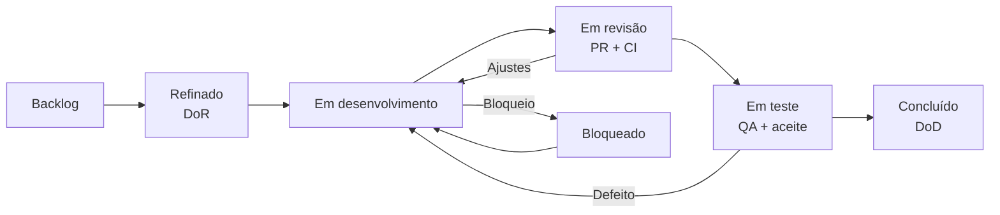
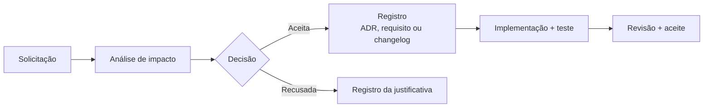

# Pilar 6 — Gestão do Projeto

> **Projeto:** SOSP — Sistema de Orientação para Serviços Públicos
> **Versão:** 1.1.0 · **Data:** 31/10/2026 · **Status:** Em revisão
> **Autores:** Equipe de Engenharia de Software — CESMAC
> **Documentos irmãos:** [Pilar 0](README.md) · [Pilar 1](01-product-specs.md) · [Pilar 2](02-design-ux.md) · [Pilar 3](03-architecture.md) · [Pilar 4](04-data-api.md) · [Pilar 5](05-engineering-devops.md)

---

## Sumário

1. [Objetivo deste pilar](#1-objetivo-deste-pilar)
2. [Partes interessadas](#2-partes-interessadas)
3. [Escopo e critérios de sucesso do projeto](#3-escopo-e-critérios-de-sucesso-do-projeto)
4. [Organização do time](#4-organização-do-time)
5. [Metodologia](#5-metodologia)
6. [Cronograma e marcos](#6-cronograma-e-marcos)
7. [Cerimônias](#7-cerimônias)
8. [Backlog e priorização](#8-backlog-e-priorização)
9. [Riscos](#9-riscos)
10. [Comunicação](#10-comunicação)
11. [Métricas do projeto](#11-métricas-do-projeto)
12. [Gestão de mudanças](#12-gestão-de-mudanças)
13. [Definition of Ready](#13-definition-of-ready)
14. [Encerramento e entrega](#14-encerramento-e-entrega)

---

## 1. Objetivo deste pilar

Os Pilares 1 a 5 respondem **o que** o SOSP faz, **como** é desenhado, **onde** os dados vivem e **como** é operado. Este pilar responde **como o trabalho é organizado para chegar lá**: quem decide, em que ordem, com qual cadência, com quais riscos e com qual critério de pronto.

A gestão é leve de propósito. O projeto tem um time pequeno, um semestre e um escopo de MVP já recortado. Processo demais consome o tempo que deveria ser gasto em requisito, código e teste; processo de menos produz retrabalho e demonstração frágil. O equilíbrio adotado é **Scrum enxuto com fluxo Kanban visível**.

**Princípios de gestão**

| # | Princípio | Consequência prática |
|---|---|---|
| 1 | **Escopo do MVP é contrato** | RF-10 e RF-13 ficam fora; entrar com eles exige remover outro item de mesmo tamanho |
| 2 | **Uma prioridade por vez** | O time puxa a próxima história só quando há capacidade, não quando há pressão |
| 3 | **Pronto é verificável** | Nenhuma história entra em "Concluído" sem evidência no pipeline ou na demonstração |
| 4 | **Decisão registrada** | Toda decisão que muda requisito, arquitetura ou contrato vira ADR, changelog ou entrada na matriz de divergências |
| 5 | **Demonstração ensaiada** | A demo de 7 minutos é um artefato do projeto, não uma improvisação da véspera |

---

## 2. Partes interessadas

| Parte interessada | Interesse principal | Influência | Expectativa | Como é atendida |
|---|---|---|---|---|
| **Professor / avaliador** | Ver domínio de engenharia de software, coerência entre artefatos e execução | Alta | Documentação rastreável, demo funcional e defesa técnica | Apresentação, ADRs, este pilar e [roteiro da demo](demo-7-minutos.md) |
| **Product Owner (PO)** | Entregar o MVP com escopo controlado | Alta | Backlog priorizado, decisões de escopo rápidas | Planning, review e matriz de divergências |
| **Tech Lead** | Manter arquitetura, contrato e qualidade técnica | Alta | Decisões registradas e dívida técnica visível | ADRs, revisão de PR e gate de contrato |
| **Time de desenvolvimento** | Trabalhar com histórias claras e ambiente estável | Média | DoR, DoD e blockers resolvidos | Refinamento, daily e Pilar 5 |
| **Cidadão** | Resolver a necessidade sem ir ao balcão | Baixa (direta) | Busca simples, ficha completa e agendamento confiável | Testes de usabilidade e critérios de aceite |
| **Servidor de atendimento** | Reduzir retrabalho e fila | Média | Protocolo claro, fila organizada e relatório útil | Back-office, UC-11 e UC-17 |
| **Servidor autorizado** | Manter o catálogo do seu órgão atualizado | Média | Publicação com versionamento e validação | UC-05 e RBAC |
| **Administrador** | Governar catálogo, usuários e permissões | Média | Auditoria e menor privilégio | UC-03, UC-04, UC-15 e `auditEvent` |
| **Órgãos públicos parceiros** | Divulgar serviços com informação correta | Média | Ficha sem promessa que o órgão não cumpre | Validação de conteúdo e versionamento |
| **Gov.br** | Prover identidade conforme OIDC (v2.0) | Baixa (MVP usa CPF+senha) | Integração segura no futuro | ADR-003 e UC-02 |
| **CESMAC** | Projeto acadêmico com integridade e autoria | Alta (institucional) | Entrega no prazo e sem plágio | Cronograma, checklist de entrega e referências |
| **Encarregado de dados / LGPD** | Tratar dados pessoais com base legal e retenção | Baixa (consultiva) | Mapa de dados e exclusão lógica | Pilar 1 §6.2 e Pilar 4 |

**Matriz de poder × interesse**

| | Baixo interesse | Alto interesse |
|---|---|---|
| **Alto poder** | CESMAC — manter informada por marco | Professor, PO, Tech Lead — gerenciar de perto |
| **Baixo poder** | Órgãos parceiros — monitorar | Cidadão, servidores, administradores — manter informados e consultar |

---

## 3. Escopo e critérios de sucesso do projeto

### 3.1 Escopo comprometido

| Bloco | Entregas | RF |
|---|---|---|
| **Orientação** | Busca, ficha, guia, checklist e PDF | RF-06, RF-07 |
| **Conta** | Cadastro manual CPF+senha, login, sessão e recuperação de senha | RF-01, RF-02 |
| **Catálogo** | Órgãos, unidades, serviços versionados, usuários internos | RF-03, RF-04, RF-05, RF-12 |
| **Transação** | Slots, agendamento, protocolo, anexo e linha do tempo | RF-08, RF-09 |
| **Apoio** | FAQ e dúvida | RF-11 |
| **Gestão** | Relatórios do MVP, com painel de avaliações oculto por flag | RF-14 |
| **Fora do MVP** | Avaliação, push/SMS/WhatsApp | RF-10, RF-13 |

### 3.2 Critérios de sucesso

| Dimensão | Critério | Evidência |
|---|---|---|
| **Produto** | Jornada completa "buscar → entender → agendar → acompanhar" demonstrável sem intervenção manual | Demo de 7 minutos |
| **Qualidade** | 100% dos CA do MVP cobertos por teste automatizado ou roteiro de aceite | Matriz de rastreabilidade + pipeline |
| **Engenharia** | Cobertura ≥ 80% no back-end e ≥ 70% no portal; contrato OpenAPI válido | CI |
| **Acessibilidade** | 0 violações críticas no axe-core nas telas críticas | Relatório de auditoria |
| **Operação** | Ambiente de staging sobe do zero com um comando; restore de backup testado | Runbook + evidência |
| **Documentação** | Nenhum link relativo quebrado; toda decisão relevante registrada | Validação de links + ADRs |
| **Prazo** | Entrega dentro do calendário acadêmico, com margem de uma semana para imprevisto | Cronograma |

### 3.3 Não objetivos

- Competir com o portal oficial do órgão ou substituir seu sistema de protocolo.
- Integrar-se a todos os órgãos no MVP; o catálogo é povoado com massa de demonstração.
- Ter aplicativo nativo iOS/Android; o portal é responsivo (PWA é evolução).
- Fazer analytics de terceiros ou rastreamento publicitário.
- Operar 24×7 com SLA contratual; a disponibilidade alvo é acadêmica e documentada (RNF-05).

---

## 4. Organização do time

| Papel | Quantidade | Dedicação esperada | Responsabilidade de entrega |
|---|---|---|---|
| Product Owner | 1 | 20% | Backlog, escopo, aceite, divergências |
| Tech Lead | 1 | 50% | Arquitetura, ADRs, revisão, desbloqueio técnico |
| Back-end | 2 | 80% | API, workers, schema, migrações, testes de integração |
| Front-end | 2 | 80% | Portal, acessibilidade, design system, E2E |
| Design | 1 | 40% | Figma, fluxos, tokens, microcopy, usabilidade |
| QA | 1 | 60% | Plano de testes, casos de uso, regressão, evidências |
| DevOps / plantão | 1 (acumulado com Tech Lead) | 20% | CI/CD, ambientes, observabilidade, backup |

**Regras de decisão**

| Decisão | Quem decide | Quem é consultado | Registro |
|---|---|---|---|
| Escopo do MVP | PO | Tech Lead e time | Pilar 1 + CHANGELOG |
| Arquitetura e tecnologia | Tech Lead | Time | ADR |
| Contrato OpenAPI | Tech Lead | 1 back-end + 1 front-end | `openapi.yaml` + PR |
| Migração de banco | Tech Lead | 1 back-end | `schema.sql` + PR |
| Divergência de requisito | PO | Requisitos + Design | Matriz D1–D13 |
| Aceite de história | PO | QA | Board + evidência |
| Release | Tech Lead + QA | PO | Checklist de release (Pilar 5 §5.8) |

**Capacidade e foco:** cada pessoa tem no máximo **duas frentes ativas** ao mesmo tempo. O Tech Lead não é o único revisor: todo PR de contrato exige revisão cruzada de back-end e front-end.

---

## 5. Metodologia

### 5.1 Scrum enxuto + Kanban

| Elemento | Escolha | Motivo |
|---|---|---|
| **Cadência** | Sprints de 1 semana | Feedback rápido; o semestre cabe em 12–16 ciclos |
| **Fluxo** | Kanban com WIP limit | Evita começar mais do que se termina |
| **Estimativa** | Story points (Fibonacci) | Relativo, não horas; reduz discussão de precisão falsa |
| **Priorização** | MoSCoW + valor para a demo | O que não é Must não entra antes do Must |
| **Board** | Backlog → Refinado → Em desenvolvimento → Em revisão → Em teste → Concluído | Espelha o pipeline real |
| **Bloqueio** | Coluna "Bloqueado" com dono e prazo | Bloqueio sem dono não é gerenciado |

**WIP limits sugeridos**

| Coluna | Limite | Regra |
|---|---|---|
| Em desenvolvimento | 4 (2 back + 2 front) | Cada pessoa puxa uma história; a segunda só se a primeira estiver em revisão |
| Em revisão | 3 | PR aberto há mais de 1 dia útil sobe para a daily |
| Em teste | 3 | QA não testa história sem CA e evidência de build |
| Bloqueado | Sem limite | Exige dono, causa e próxima ação na daily |

### 5.2 Fluxo de uma história

**Regra de puxada:** ninguém começa uma história sem DoR cumprido; ninguém fecha uma história sem DoD cumprido. "Quase pronto" não existe no board.

### 5.3 Papéis no fluxo

| Etapa | Responsável | Critério de saída |
|---|---|---|
| Refinamento | PO + Tech Lead + QA | DoR completo e dúvidas resolvidas |
| Desenvolvimento | Back-end / Front-end | Código + teste + contrato atualizado |
| Revisão | Par do time | Aprovação + CI verde |
| Teste | QA | CA verificado + evidência anexada |
| Aceite | PO | História aceita e demonstrada |

---

## 6. Cronograma e marcos

O cronograma é **relativo ao calendário acadêmico**. A data oficial da apresentação está pendente de confirmação (`<preencher>`); os marcos abaixo usam semanas, não datas, para não criar compromisso falso.

| Marco | Semana | Entrega | Gate de saída |
|---|---|---|---|
| **M0 — Kickoff** | S1 | Time formado, escopo do MVP acordado, repositório e board criados | Pilar 1 aprovado pelo PO |
| **M1 — Fundação** | S2–S3 | Ambiente local, CI, esqueleto Django/Next, schema inicial, ADR-001 a ADR-003 | `make up` funciona; pipeline verde |
| **M2 — Catálogo e busca** | S4–S6 | RF-03, RF-04, RF-05, RF-06; ficha e busca navegáveis | Busca e ficha com CA-01 a CA-10 verdes |
| **M3 — Conta e orientação** | S7–S8 | RF-01, RF-02, RF-07; Gov.br em staging; guia e PDF | Login ponta a ponta; PDF assíncrono |
| **M4 — Transação** | S9–S11 | RF-08, RF-09, RF-11; agendamento, protocolo, anexo e FAQ | Jornada completa em staging |
| **M5 — Gestão e relatórios** | S12 | RF-12, RF-14; back-office e exportações | Relatórios com escopo por órgão |
| **M6 — Endurecimento** | S13 | Acessibilidade, carga, segurança, backup/restore, observabilidade | RNF-04, RNF-06, RNF-07 e RNF-09 evidenciados |
| **M7 — Release candidate** | S14 | Congelamento de escopo, correção de defeitos, ensaio da demo | Checklist de release completo |
| **M8 — Apresentação** | S15 | Demo de 7 minutos + defesa técnica | Roteiro ensaiado; plano B pronto |
| **M9 — Encerramento** | S16 | Retrospectiva, postmortem do projeto, arquivo de evidências | Lições registradas; repositório limpo |

**Marcos de decisão (go/no-go)**

| Marco | Pergunta | Se "não" |
|---|---|---|
| M2 | A busca e a ficha estão demonstráveis? | Cortar filtros não essenciais e priorizar a ficha |
| M4 | A jornada completa funciona em staging? | Congelar itens Could e corrigir a integração |
| M6 | Os RNFs críticos têm evidência? | Reduzir escopo de relatórios e focar em estabilidade |
| M7 | A demo cabe em 7 minutos sem improviso? | Ensaiar novamente e cortar telas de apoio |

**Margem:** uma semana de folga entre M7 e M8 é reservada para imprevisto. Ela não é usada para adicionar escopo.

---

## 7. Cerimônias

| Cerimônia | Frequência | Duração | Participantes | Saída |
|---|---|---|---|---|
| **Daily** | Diária, horário fixo | 15 min | Time todo | Impedimentos e plano do dia |
| **Refinamento** | Semanal | 60 min | PO, Tech Lead, QA, devs | Histórias com DoR e estimativa |
| **Planning** | Semanal, início da sprint | 45 min | Time todo | Meta da sprint e histórias puxadas |
| **Review** | Semanal, fim da sprint | 30 min | Time + PO (+ professor, quando aplicável) | Incremento aceito ou devolvido |
| **Retrospectiva** | Semanal | 30 min | Time todo | 1 a 2 ações com dono e prazo |
| **Office hours técnico** | 2× por semana | 30 min | Tech Lead + quem precisar | Bloqueios técnicos resolvidos |
| **Ensaio da demo** | Semanal a partir de S10 | 20 min | PO, Design, quem apresenta | Roteiro cronometrado e plano B |

**Regras das cerimônias**

1. Daily não é status report: cada pessoa responde "o que fiz, o que vou fazer, o que me impede".
2. Planning não estima história sem DoR; história sem DoR volta para refinamento.
3. Review demonstra **software rodando**, não slide. Se não roda, não está pronto.
4. Retrospectiva termina com ação, dono e prazo — não com lista de reclamações.
5. Cerimônia que não produz decisão é candidata a ser reduzida ou extinta.

---

## 8. Backlog e priorização

### 8.1 Épicos

| Épico | Tema | RF | Valor para o MVP |
|---|---|---|---|
| **A** | Descoberta | RF-06 | Núcleo da proposta: encontrar o serviço |
| **B** | Orientação | RF-07 | Ficha → guia → PDF; reduz deslocamento errado |
| **C** | Agendamento e acompanhamento | RF-08, RF-09 | Transação e prova do pedido |
| **D** | Conta e identidade | RF-01, RF-02 | Personalização e segurança |
| **E** | Catálogo e gestão | RF-03, RF-04, RF-05, RF-12 | Sustentação do conteúdo |
| **F** | Apoio e qualidade | RF-11, RF-14 | Dúvida e gestão |
| **G** | Fora do MVP | RF-10, RF-13 | v2.0; flags desligadas |

### 8.2 Ordem de entrega

1. **Fundação técnica** — ambiente, CI, schema, contrato, ADRs.
2. **Catálogo e busca** — sem catálogo não há ficha; sem ficha não há demo.
3. **Orientação** — guia, checklist e PDF.
4. **Conta** — Cadastro manual CPF+senha, perfil e login; depende do catálogo para o retorno pós-login.
5. **Transação** — slots, agendamento, protocolo e anexo.
6. **Apoio** — FAQ e relatórios.
7. **Endurecimento** — acessibilidade, carga, segurança e operação.

**Dependências críticas**

| Item | Depende de | Risco se atrasar |
|---|---|---|
| RF-06 | RF-04, RF-05 | Sem catálogo, a busca não tem o que mostrar |
| RF-07 | RF-05, RF-06 | Guia sem ficha perde o contexto |
| RF-08 | RF-04, RF-05, RF-01, RF-02 | Sem conta não há agendamento |
| RF-09 | RF-08 | Sem agendamento não há protocolo |
| RF-14 | RF-06, RF-08, RF-09 | Sem dados não há relatório |
| Demo | RF-06, RF-07, RF-08, RF-09 | É a jornada mínima demonstrável |

### 8.3 Critério de priorização

Uma história entra na sprint se, e somente se:

1. É **Must** ou destrava um **Must**.
2. Tem DoR completo.
3. Cabe na capacidade da sprint com margem de 20%.
4. Tem evidência de aceite definida.
5. Não depende de decisão pendente sem data.

**Regra de troca:** para adicionar algo, é preciso remover algo de tamanho equivalente. O escopo não cresce por acreção silenciosa.

---

## 9. Riscos

Escala: probabilidade e impacto de 1 (baixo) a 5 (alto); exposição = probabilidade × impacto.

| ID | Risco | Prob. | Impacto | Exp. | Resposta | Dono | Gatilho |
|---|---|---|---|---|---|---|---|
| R-01 | Escopo cresce e o MVP não fecha | 4 | 5 | 20 | **Mitigar:** MoSCoW travado, regra de troca, revisão semanal de escopo | PO | Nova história Must fora do Pilar 1 |
| R-02 | Integração com Gov.br atrasa ou falha em staging | 1 | 5 | 5 | **Mitigar:** a integração foi movida para a v2.0, eliminando a dependência externa no MVP; o login local com CPF + senha é o fluxo padrão | Tech Lead | Decisão de retomar a integração na v2.0 |
| R-03 | Busca não atinge p95 de 2,5 s | 3 | 4 | 12 | **Mitigar:** índice full-text + `pg_trgm`, teste de carga em S10 | Back-end | p95 > 3 s no ensaio |
| R-04 | Time sem experiência em Next.js/Django suficiente | 3 | 4 | 12 | **Mitigar:** pareamento, spike de 2 dias, escopo técnico mais simples | Tech Lead | História travada > 2 dias |
| R-05 | Ambiente local instável (Docker, versões) | 3 | 3 | 9 | **Mitigar:** `make up`, versões fixadas, Pilar 5 §1.9 | DevOps | "Na minha máquina funciona" |
| R-06 | Perda de dados ou backup não testado | 2 | 5 | 10 | **Mitigar:** backup diário, ensaio de restore mensal, RPO/RTO | DevOps | Restore falha no ensaio |
| R-07 | Falha de acessibilidade na demo | 3 | 4 | 12 | **Mitigar:** axe-core no CI, teste de teclado semanal | Front-end + QA | Violação crítica no CI |
| R-08 | Divergência entre Figma, requisito e código | 4 | 3 | 12 | **Mitigar:** hierarquia de fontes, matriz D1–D13, revisão de design | PO + Design | Divergência sem ID |
| R-09 | Dependência de pessoa única (bus factor) | 3 | 4 | 12 | **Mitigar:** revisão cruzada, documentação, ninguém sozinho em módulo crítico | Tech Lead | Só uma pessoa toca o módulo |
| R-10 | Atraso na massa de demonstração | 3 | 3 | 9 | **Mitigar:** fixtures versionadas, seed idempotente, dados realistas | QA | Seed falha ou dados vazios |
| R-11 | Vazamento de segredo ou dado pessoal | 2 | 5 | 10 | **Mitigar:** `.env` fora do repo, varredura de segredos, LGPD por padrão | Tech Lead | Segredo em commit ou log |
| R-12 | Indisponibilidade do Supabase/PostgreSQL em staging | 2 | 4 | 8 | **Mitigar:** pooler, retry, healthcheck, plano de restore | DevOps | Conexões esgotadas ou 5xx |
| R-13 | Demo não cabe em 7 minutos | 3 | 3 | 9 | **Mitigar:** roteiro cronometrado, ensaio semanal, plano B gravado | PO | Ensaio passa de 8 min |
| R-14 | Membros sobrecarregados em outras disciplinas | 4 | 3 | 12 | **Mitigar:** capacidade real no planning, WIP limit, escopo por valor | PO | Duas semanas sem entrega |

**Riscos aceitos**

- R-15: o sistema não terá SLA contratual nem operação 24×7. Aceito porque o contexto é acadêmico; a disponibilidade alvo está documentada no RNF-05.
- R-16: o catálogo do MVP não cobre todos os serviços públicos. Aceito; a massa de demonstração é declarada como tal.

**Revisão de riscos:** semanalmente na review, com atualização de probabilidade, impacto e resposta. Risco com exposição ≥ 15 sobe para a daily.

---

## 10. Comunicação

| Canal | Uso | Frequência | Regra |
|---|---|---|---|
| **Board** | Fonte única do status | Contínua | Cartão atualizado antes da daily |
| **Chat do time** | Dúvida rápida e bloqueio | Contínua | Decisão tomada em chat é registrada no board ou em ADR |
| **PR** | Revisão técnica | Por entrega | Descrição com RF/UC, evidência e risco |
| **Issue** | Defeito, tarefa e decisão | Contínua | Template de backend, frontend ou fullstack |
| **Reunião de review** | Demonstração e aceite | Semanal | Ata curta com aceite ou devolução |
| **E-mail institucional** | Comunicação com professor/orientador | Por marco | Assunto com marco e prazo |

**Acordos de comunicação**

1. Bloqueio é declarado em até 2 horas; não se espera a daily.
2. PR sem revisão há mais de 1 dia útil é escalado ao Tech Lead.
3. Decisão que muda contrato ou escopo tem registro escrito antes da implementação.
4. Nenhuma decisão relevante vive apenas em conversa oral.
5. Feedback é sobre o artefato, não sobre a pessoa.

---

## 11. Métricas do projeto

| Métrica | Definição | Meta | Uso |
|---|---|---|---|
| **Velocity** | Story points aceitos por sprint | Estável após S4 | Previsibilidade, não cobrança |
| **Lead time** | Do "Refinado" ao "Concluído" | ≤ 5 dias úteis | Detectar fila e gargalo |
| **Cycle time** | Do "Em desenvolvimento" ao "Concluído" | ≤ 3 dias úteis | Saúde do fluxo |
| **Throughput** | Histórias concluídas por sprint | ≥ 4 após S4 | Capacidade real |
| **WIP** | Cartões em desenvolvimento + revisão + teste | ≤ 10 | Evitar multitarefa |
| **Defeitos escapados** | Defeito encontrado após aceite | ≤ 1 por sprint | Qualidade do teste |
| **Cobertura** | Back-end / portal | ≥ 80% / ≥ 70% | Gate de CI |
| **CA cobertos** | Critérios com evidência | 100% do MVP | Rastreabilidade |
| **Acessibilidade** | Violações críticas | 0 | Gate de release |
| **Burn-down** | Pontos restantes por dia | Tendência, não linha reta | Previsão de risco |

**Regra de leitura:** métrica é para o time se ajustar, não para punir pessoa. Velocity baixa por duas sprints seguidas dispara revisão de capacidade e escopo, não cobrança individual.

---

## 12. Gestão de mudanças

### 12.1 Tipos de mudança

| Tipo | Exemplo | Fluxo | Registro |
|---|---|---|---|
| **Correção** | Texto de erro divergente do requisito | PR direto com referência ao CA | CHANGELOG |
| **Ajuste de requisito** | Filtro novo ou mudança de regra | Análise de impacto + aprovação do PO | Pilar 1 + CHANGELOG |
| **Decisão arquitetural** | Troca de storage ou de provedor | ADR com contexto, alternativas e consequências | `adr/` |
| **Mudança de contrato** | Campo novo ou status HTTP diferente | PR no OpenAPI + revisão dupla + migração | `openapi.yaml` + Pilar 4 |
| **Mudança de escopo** | Entrar RF-10 no MVP | Regra de troca + aprovação do PO + atualização do cronograma | Pilar 1 + Pilar 6 + CHANGELOG |

### 12.2 Processo

**Perguntas obrigatórias na análise de impacto**

1. Qual requisito, UC ou CA é afetado?
2. Muda contrato, schema ou migração?
3. Muda prazo, escopo ou risco?
4. Quem precisa aprovar?
5. Como será verificado?
6. O que sai para caber?

**Regra de ouro:** mudança sem registro é dívida invisível. Se não está no requisito, no ADR, no contrato ou no changelog, não aconteceu.

---

## 13. Definition of Ready

Uma história só entra em desenvolvimento quando **todos** os itens abaixo são verdadeiros. A lista é binária.

| # | Critério | Evidência |
|---|---|---|
| 1 | Tem RF, UC e CA identificados | Cartão com links para o Pilar 1 e o UC |
| 2 | O comportamento feliz e os alternativos estão descritos | Fluxo principal + A\\* + E\\* |
| 3 | As regras de negócio aplicáveis estão citadas | RN no cartão |
| 4 | O contrato de API está definido ou explicitamente não se aplica | Operação no OpenAPI ou justificativa |
| 5 | O modelo de dados está definido ou não há mudança de schema | Tabela/coluna no Pilar 4 |
| 6 | A tela ou o componente existe no Figma, ou o UC é de back-office | Link do nó ou `Back-office` |
| 7 | Os estados de interface estão previstos (vazio, erro, loading, sucesso) | Checklist do Pilar 2 §4 |
| 8 | A acessibilidade está considerada (rótulo, foco, teclado, contraste) | Critério no cartão |
| 9 | A estimativa foi feita pelo time | Story points |
| 10 | As dependências estão resolvidas ou têm data | Nenhum bloqueio aberto |
| 11 | A massa de teste existe ou será criada na história | Fixture/seed |
| 12 | O critério de aceite é verificável por teste ou roteiro | CA + tipo de evidência |

**Sinais de que a história não está pronta**

- "Ainda vamos decidir o campo."
- "O design não fez essa tela."
- "Depende do RF-XX, que ainda não começou."
- "Não sabemos como testar."
- "É rápido, só um ajuste." (história sem critério de aceite)

**Exceção controlada:** spike técnico de até 2 dias pode entrar sem DoR completo, desde que tenha pergunta, timebox e saída esperada. Spike não entrega funcionalidade.

---

## 14. Encerramento e entrega

### 14.1 Checklist de encerramento

| # | Item | Evidência |
|---|---|---|
| 1 | Escopo do MVP entregue ou explicitamente cortado com justificativa | Pilar 1 + CHANGELOG |
| 2 | Todos os CA do MVP com evidência | Matriz de rastreabilidade |
| 3 | Pipeline verde em `main` e `develop` | GitHub Actions |
| 4 | Staging reproduzível do zero | Runbook do Pilar 5 |
| 5 | Backup e restore testados | Evidência datada |
| 6 | Acessibilidade auditada | axe-core + teste manual |
| 7 | Documentação sem links quebrados | Validação automática |
| 8 | ADRs atualizados | `adr/` |
| 9 | Demo ensaiada e cronometrada | Roteiro de 7 minutos |
| 10 | Repositório limpo (sem segredo, sem lixo, sem `node_modules`) | Varredura |
| 11 | Retrospectiva e lições registradas | Ata |
| 12 | Artefatos arquivados (PDF/PNG do Figma, evidências) | `docs/design/exports/` |

### 14.2 Retrospectiva final

Formato: **Start / Stop / Continue** + uma ação estrutural para o próximo projeto.

| Pergunta | Saída |
|---|---|
| O que funcionou e deve ser repetido? | Práticas a manter |
| O que atrapalhou e deve parar? | Práticas a eliminar |
| O que aprendemos sobre o domínio? | Conhecimento a registrar |
| O que faríamos diferente no próximo semestre? | Ação concreta |
| Qual dívida técnica fica documentada? | Lista com dono e prioridade |

### 14.3 Postmortem do projeto

O postmortem do projeto não é o postmortem de incidente do Pilar 5 §9. Ele responde:

1. O problema original foi resolvido?
2. Quais decisões envelheceram bem?
3. Quais decisões envelheceram mal e por quê?
4. O que o próximo time precisa saber antes de mexer?
5. O que fica fora do MVP e como seria retomado?

**Regra:** o encerramento não apaga o que deu errado. Um projeto que só documenta acertos não ensina nada.

---

*Este pilar é o elo entre o problema e a execução. Se o cronograma, o escopo ou os riscos mudarem, atualize este documento e o [CHANGELOG](../CHANGELOG.md) na mesma PR.*
