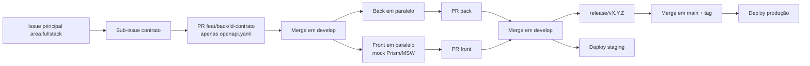

# ADR-004 — Git Flow simplificado em monorepo

- **Status:** Aceito
- **Data:** 30/10/2026
- **Decisores:** Arthur Franco e Luiz Gustavo — CESMAC
- **Substitui:** decisão implícita de Trunk-Based Development no Pilar 5 §3.1
- **Substituído por:** —

## Contexto

O SOSP é um monorepo com dois deployáveis (`backend/` e `portal/`), documentação viva (`docs/`), contrato OpenAPI e scripts operacionais. O time é pequeno, mas tem frentes de back-end e front-end trabalhando ao mesmo tempo, e a disciplina exige uma demonstração estável no fim do semestre.

O Pilar 5 descrevia Trunk-Based Development com branches de no máximo dois dias e deploy direto da `main`. Esse modelo funciona bem com times maduros, feature flags e deploy contínuo, mas cria dois problemas para o SOSP:

1. **Staging e produção compartilham a mesma branch.** Toda integração vai direto para a `main`, e uma alteração incompleta pode chegar ao ambiente de demonstração.
2. **Tarefas fullstack precisam de coordenação.** Contrato, back e front mudam em ritmos diferentes; sem uma branch de integração, o front fica bloqueado ou o contrato quebra o back.

A equipe adotou **`main` (produção) + `develop` (integração)** e um fluxo derivado do Git Flow, simplificado para o tamanho do projeto. A decisão não altera a arquitetura do monólito modular.

## Decisão

### Branches

| Branch | Origem | Destino | Uso |
|---|---|---|---|
| `main` | — | — | Produção; sempre estável; só recebe merge de `release/*` e `hotfix/*` |
| `develop` | `main` | — | Integração; deploy automático em staging |
| `feat/<área>/<id>-<descrição>` | `develop` | `develop` | Nova funcionalidade |
| `fix/<área>/<id>-<descrição>` | `develop` | `develop` | Correção não urgente |
| `docs/`, `chore/`, `test/`, `refactor/` | `develop` | `develop` | Demais tipos |
| `release/vX.Y.Z` | `develop` | `main` e `develop` | Estabilização da versão |
| `hotfix/<descrição>` | `main` | `main` e `develop` | Correção urgente em produção |

**Proibido:** commit direto e force push em `main` e `develop`; merge sem revisão e sem CI verde.

### Separação por área (`FE` / `BE` / `FULL`)

| Área | Sigla (Card/PR) | Caminho | Exemplo de título de Card / Issue / PR | Exemplo de branch no Git | Exemplo de commit |
|---|---|---|---|---|---|
| Back-end | `[BE]` | `backend/` | `[BE] [RF001] Cadastro Cidadão Manual, Hash Argon2id e CEP/IBGE (Essencial)` | `feat/be/rf001-cadastro-cidadao` | `feat(be/rf001): implementa cadastro manual e hash argon2id` |
| Front-end | `[FE]` | `portal/` | `[FE] [RF001] Cadastro Cidadão Manual (Essencial)` | `feat/fe/rf001-cadastro-cidadao` | `feat(fe/rf001): implementa tela de cadastro manual` |
| Fullstack | `[FULL]` | ambos | `[FULL] [RF008] Ajuste no Comprovante de Agendamento (Essencial)` | `feat/full/rf008-comprovante` | `feat(full/rf008): ajusta campo no comprovante` |

Etiquetas no GitHub: `area:backend` (`[BE]`), `area:frontend` (`[FE]`), `area:fullstack` (`[FULL]`), além de etiquetas por requisito (`RF001` a `RF014`) e prioridade (`Essencial`, `Importante`, `Desejável`).

### Padrão oficial de nomenclatura das Tasks (`[FE]` e `[BE]`) e Branches por Requisito

Para garantir rastreabilidade direta com o [Documento de Requisitos](../Documento_de_Requisitos_Modelo_RF_v10.pdf) e evitar conflitos no Git entre Front-end (`Luiz Gustavo`) e Back-end (`Arthur Franco`), cada requisito funcional é dividido em duas tasks pareadas:

- **Padrão do Título (Issue / Card no Board / Pull Request):**
  `[<ÁREA>] [<RFXXX>] <Descrição da entrega na camada> (<Prioridade>)`
- **Padrão da Branch no Git (sem espaços, colchetes ou acentos):**
  `feat/<fe|be>/rfxxx-<slug-curto>`

| Requisito | Título do Card / Issue / PR | Branch no Git | Responsável |
|---|---|---|---|
| **RF001** (FE) | `[FE] [RF001] Cadastro Cidadão Manual (Essencial)` | `feat/fe/rf001-cadastro-cidadao` | Luiz Gustavo |
| **RF001** (BE) | `[BE] [RF001] Cadastro Cidadão Manual, Hash Argon2id e CEP/IBGE (Essencial)` | `feat/be/rf001-cadastro-cidadao` | Arthur Franco |
| **RF002** (FE) | `[FE] [RF002] Autenticação Local, Recuperação de Senha e Modal Gov.br (Essencial)` | `feat/fe/rf002-autenticacao-local` | Luiz Gustavo |
| **RF002** (BE) | `[BE] [RF002] Autenticação Local, Bloqueio de Tentativas e Sessão (Essencial)` | `feat/be/rf002-autenticacao-local` | Arthur Franco |
| **RF003** (FE) | `[FE] [RF003] Gerenciar Órgãos no Painel Admin (Essencial)` | `feat/fe/rf003-gerenciar-orgaos` | Luiz Gustavo |
| **RF003** (BE) | `[BE] [RF003] CRUD Lógico de Órgãos e Regra de Duplicidade (Essencial)` | `feat/be/rf003-gerenciar-orgaos` | Arthur Franco |
| **RF004** (FE) | `[FE] [RF004] Gerenciar Unidades de Atendimento e Feriados (Essencial)` | `feat/fe/rf004-gerenciar-unidades` | Luiz Gustavo |
| **RF004** (BE) | `[BE] [RF004] Unidades, Expediente, Limite Diário e Feriados (Essencial)` | `feat/be/rf004-gerenciar-unidades` | Arthur Franco |
| **RF005** (FE) | `[FE] [RF005] Gerenciar Catálogo de Serviços e Etapas (Essencial)` | `feat/fe/rf005-catalogo-servicos` | Luiz Gustavo |
| **RF005** (BE) | `[BE] [RF005] Catálogo de Serviços, Versionamento e Anexos PDF (Essencial)` | `feat/be/rf005-catalogo-servicos` | Arthur Franco |
| **RF006** (FE) | `[FE] [RF006] Busca, Filtros, Variações e Ficha Orientativa (Essencial)` | `feat/fe/rf006-busca-ficha` | Luiz Gustavo |
| **RF006** (BE) | `[BE] [RF006] Busca Full-Text, Paginação e Log de Termos (Essencial)` | `feat/be/rf006-busca-ficha` | Arthur Franco |
| **RF007** (FE) | `[FE] [RF007] Guia Passo-a-Passo, Checklist e Alerta PCD/Idoso (Essencial)` | `feat/fe/rf007-guia-checklist` | Luiz Gustavo |
| **RF007** (BE) | `[BE] [RF007] Persistência de Checklist por CPF e Geração de PDF (Essencial)` | `feat/be/rf007-guia-checklist` | Arthur Franco |
| **RF008** (FE) | `[FE] [RF008] Agendamento de Atendimento 100% no SOSP (Essencial)` | `feat/fe/rf008-agendamento` | Luiz Gustavo |
| **RF008** (BE) | `[BE] [RF008] Motor de Slots 30min, Vagas, Protocolo e No-Show (Essencial)` | `feat/be/rf008-agendamento` | Arthur Franco |
| **RF009** (FE) | `[FE] [RF009] Acompanhar Protocolo, Linha do Tempo e Anexos (Importante)` | `feat/fe/rf009-acompanhar-protocolo` | Luiz Gustavo |
| **RF009** (BE) | `[BE] [RF009] Máquina de Estados do Protocolo e Upload S3 (Importante)` | `feat/be/rf009-acompanhar-protocolo` | Arthur Franco |
| **RF010** (FE) | `[FE] [RF010] Avaliação e Comentário do Atendimento (Desejável)` | `feat/fe/rf010-avaliacao` | Luiz Gustavo |
| **RF010** (BE) | `[BE] [RF010] Avaliação Única por Protocolo e Moderação (Desejável)` | `feat/be/rf010-avaliacao` | Arthur Franco |
| **RF011** (FE) | `[FE] [RF011] FAQ, Assistente de Busca e Abertura de Dúvida (Importante)` | `feat/fe/rf011-faq-assistente` | Luiz Gustavo |
| **RF011** (BE) | `[BE] [RF011] API de FAQ, Busca de 3 Principais e Protocolo Dúvida (Importante)` | `feat/be/rf011-faq-assistente` | Arthur Franco |
| **RF012** (FE) | `[FE] [RF012] Gerenciar Usuários Internos e Permissões (Essencial)` | `feat/fe/rf012-usuarios-internos` | Luiz Gustavo |
| **RF012** (BE) | `[BE] [RF012] Usuários Internos, Senha Temporária e RBAC (Essencial)` | `feat/be/rf012-usuarios-internos` | Arthur Franco |
| **RF013** (FE) | `[FE] [RF013] Preferências de Notificações Opt-in/Opt-out (Desejável)` | `feat/fe/rf013-notificacoes` | Luiz Gustavo |
| **RF013** (BE) | `[BE] [RF013] Envio de Avisos por E-mail/WhatsApp e Log de Envio (Desejável)` | `feat/be/rf013-notificacoes` | Arthur Franco |
| **RF014** (FE) | `[FE] [RF014] Relatórios Gerenciais, Gráficos e Exportação (Importante)` | `feat/fe/rf014-relatorios` | Luiz Gustavo |
| **RF014** (BE) | `[BE] [RF014] Agregações de Relatórios, Tempo Médio e CSV/PDF (Importante)` | `feat/be/rf014-relatorios` | Arthur Franco |

### Contract-first

1. Toda tarefa fullstack nasce como **issue principal** (`area:fullstack`) com três sub-issues: **contrato**, **back** e **front**.
2. O primeiro PR (`feat/back/<id>-contrato`) altera **apenas** `docs/api/openapi.yaml` e é revisado por um dev de cada área.
3. Após o merge do contrato em `develop`, back e front trabalham em paralelo em branches próprias. O front usa mock gerado do OpenAPI (Prism/MSW) até a API estar disponível.
4. A issue principal só fecha quando as três sub-issues estiverem concluídas.
5. **Exceção:** mudanças pequenas (≤ 1–2 dias e ≤ ~400 linhas somando os dois lados) podem usar uma única branch `feat/full/...`, exigindo um revisor de cada área.

### Release e hotfix

- `release/vX.Y.Z` nasce de `develop`, recebe apenas correções de estabilização, changelog e versão. Ao final, merge em `main` (com tag `vX.Y.Z`) e de volta em `develop`.
- `hotfix/*` nasce de `main`, recebe a correção mínima e testes, merge em `main` (com tag de patch) e de volta em `develop`.
- O merge em `develop` dispara staging; o merge em `main` dispara produção.

### CI/CD por caminho

| Evento | Pipeline | O que roda |
|---|---|---|
| PR para `develop` | `backend.yml` se `backend/**` ou `openapi.yaml` mudou | Lint, testes de back, validação do contrato |
| PR para `develop` | `frontend.yml` se `portal/**` ou `openapi.yaml` mudou | Lint, build, validação do contrato |
| Merge em `develop` | Ambos, conforme caminho | Deploy em staging |
| Merge de `release/*` em `main` | Ambos, conforme caminho | Deploy em produção + tag `vX.Y.Z` |

## Consequências positivas

| Consequência | Efeito |
|---|---|
| Staging e produção separados | `develop` pode receber integração sem expor a demonstração |
| Contrato explícito | Back e front não divergem; o mock permite paralelismo |
| Release previsível | Janela de estabilização antes da `main` |
| Hotfix sem bloquear release | Correção urgente nasce da `main` e volta para `develop` |
| Rastreabilidade | Branch, commit e PR carregam área e requisito |

## Consequências negativas e trade-offs

| Trade-off | Custo aceito | Mitigação |
|---|---|---|
| Duas branches principais | Merge de `main` de volta em `develop` pode ser esquecido | Checklist de release + automação de PR |
| Mais cerimônia que trunk-based | Overhead de release e hotfix | Fluxo simplificado, sem `release/*` para patches pequenos |
| Branches de vida mais longa | Risco de conflito | Recomendação de até 2 dias, não regra rígida; rebase frequente |
| Contract-first adiciona uma etapa | PR de contrato antes do código | Exceção para mudanças ≤ 1–2 dias |
| CI por caminho pode pular validação cruzada | Mudança de contrato sem teste de back | `openapi.yaml` dispara os dois pipelines |

## Alternativas descartadas

### Trunk-Based Development puro

Seria mais simples e reduziria o tempo de integração, mas exigiria feature flags maduras, deploy contínuo e disciplina de branches curtas que o time ainda não tem. A `main` deixaria de ser um ponto seguro para a demonstração. Pode ser adotado no futuro, com ADR próprio.

### GitHub Flow (`main` + branches curtas)

É mais simples que o Git Flow, mas não separa staging de produção. Para a disciplina, a `develop` funciona como colchão de integração e como ambiente de homologação.

### Git Flow completo com `release/*` longa e `support/*`

Adiciona branches que o time não usa (versões antigas, suporte a múltiplas releases). O SOSP tem uma versão em produção por vez; `support/*` seria custo sem benefício.

### Monorepo com permissões por diretório e times independentes

Não resolve o problema de contrato e coordenação; apenas esconde o acoplamento. O CODEOWNERS já direciona revisores por caminho.

## Critérios de verificação

| Critério | Como verificar |
|---|---|
| `main` só recebe release/hotfix | Branch protection + histórico de merges |
| `develop` é a base das branches de trabalho | Template de PR e checklist |
| Nenhum commit direto em `main`/`develop` | Branch protection no GitHub |
| PR full tem revisor de cada área | CODEOWNERS + revisão obrigatória |
| Contrato é o primeiro PR de tarefa fullstack | Sub-issues e ordem dos PRs |
| Tag `vX.Y.Z` é criada no merge em `main` | Workflow `backend.yml`, job `tag-release` |
| `develop` e `main` convergem após release | Merge de `main` em `develop` no checklist |

## Referências

- [Pilar 5 §3 — Padrões de código e Git](../05-engineering-devops.md#3-padrões-de-código-e-git)
- [Pilar 5 §5 — CI/CD](../05-engineering-devops.md#5-cicd)
- [CONTRIBUTING.md](../../CONTRIBUTING.md)
- [.github/CODEOWNERS](../../.github/CODEOWNERS)
- [ADR-001 — Monólito modular](ADR-001-monolito-modular-django-nextjs.md)
