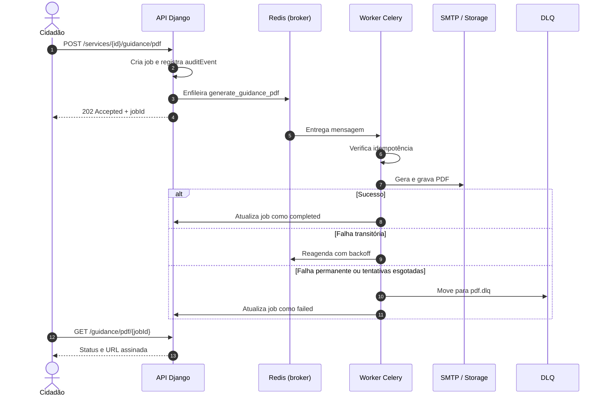

# ADR-005 — Processamento assíncrono com Redis, workers e DLQ

- **Status:** Aceito
- **Data:** 30/10/2026
- **Decisores:** Equipe de Engenharia de Software — CESMAC
- **Substitui:** —
- **Substituído por:** —

## Contexto

O SOSP tem operações que não podem bloquear a resposta HTTP: geração de PDF do guia, envio de e-mail transacional, lembrete de atendimento, exportação de relatório e reindexação de busca. Algumas são lentas (PDF, exportação), outras dependem de provedores externos (SMTP, push) e outras precisam de retentativa sem duplicar efeito.

O portal precisa responder rápido mesmo quando o provedor de e-mail está lento. Se o envio fosse síncrono, uma falha de SMTP aumentaria o tempo de criação do agendamento e poderia fazer o cidadão reenviar a operação, gerando duplicidade.

O projeto já usa Redis para cache e sessão. A decisão é como usá-lo também como broker, sem introduzir um serviço proprietário no núcleo (RNF-11).

## Decisão

Adotamos **Celery 5 com Redis 7** como infraestrutura de processamento assíncrono, com filas separadas por tipo de trabalho:

| Fila | Tarefa | Gatilho | Retry | Idempotência |
|---|---|---|---|---|
| `pdf` | `generate_guidance_pdf` | Botão "Baixar PDF" | 3× com backoff exponencial | Hash do checklist |
| `email` | `send_transactional_email` | Evento de domínio | 5× | `deliveryId` |
| `push` | `send_web_push` | Evento de domínio (v2.0) | 3× | `deliveryId` |
| `reminders` | `send_appointment_reminder` | Celery Beat diário | 3× | `appointmentId + date` |
| `reports` | `export_report` | Solicitação do gestor | 2× | Hash dos filtros |
| `maintenance` | `purge_expired_sessions` | Celery Beat diário | 1× | Data de execução |
| `search` | `reindex_service` | Publicação de serviço | 3× | `serviceId + version` |

### Regras de processamento

1. **A API só enfileira.** A resposta HTTP retorna `202 Accepted` com `jobId` quando a operação é assíncrona; o cliente consulta o status.
2. **Retry com backoff exponencial e jitter.** Erros transitórios (timeout, `5xx`, conexão recusada) são retentados; erros permanentes (validação, `4xx`) vão direto para a DLQ.
3. **DLQ explícita.** Cada fila tem uma dead-letter queue (`<fila>.dlq`). Mensagem que esgota as tentativas é movida para a DLQ com payload, exceção, trace ID e timestamp.
4. **Idempotência.** Toda tarefa recebe uma chave idempotente; o worker verifica se o efeito já foi aplicado antes de gravar ou enviar.
5. **Visibilidade.** Métricas de profundidade de fila, idade da mensagem mais antiga, taxa de falha e tamanho da DLQ. Alerta quando a fila passa de 100 mensagens ou a DLQ tem item novo.
6. **Reprocessamento controlado.** `scripts/reprocess_dlq.py` reenfileira mensagens após correção, com limite e registro de auditoria.
7. **Push fora do MVP.** A fila `push` existe, mas `send_web_push` só é registrada quando `FEATURE_PUSH_ENABLED=true` (v2.0). O MVP usa apenas e-mail transacional.
8. **Sem dado pessoal no payload.** O payload carrega IDs e referências; o worker busca o dado no banco. Exceção: e-mail e nome necessários para a mensagem, com retenção curta e sem log.

### Fluxo

## Consequências positivas

| Consequência | Efeito |
|---|---|
| Resposta rápida | PDF e e-mail não bloqueiam a requisição |
| Resiliência | Retry e DLQ evitam perda silenciosa |
| Escala independente | Workers de PDF podem escalar sem escalar a API |
| Observabilidade | Fila e DLQ são métricas acionáveis |
| Portabilidade | Redis e Celery são open source; funcionam em qualquer nuvem |

## Consequências negativas e trade-offs

| Trade-off | Custo aceito | Mitigação |
|---|---|---|
| Consistência eventual | O PDF não fica pronto no instante do clique | Status `202` + polling com timeout de 30 s |
| Mais um processo para operar | Workers, beat e DLQ precisam de plantão | Runbook 7.3.4 e alertas |
| Redis como broker | Perda de mensagem se o Redis cair sem persistência | AOF `appendonly yes`; retry e DLQ |
| Duplicidade de efeito | Retry pode reenviar e-mail | Chave idempotente e `deliveryId` |
| Complexidade de DLQ | Exige ferramenta de reprocessamento | Script versionado e teste mensal |

## Alternativas descartadas

### Processamento síncrono na requisição

Seria mais simples, mas acopla a latência do PDF e do SMTP ao tempo de resposta. Um pico de e-mails derrubaria a criação de agendamentos. O RNF-04 (PDF p95 ≤ 4 s) seria difícil de cumprir com o provedor lento.

### Fila gerenciada (SQS, Cloud Tasks)

Seria robusta, mas adiciona dependência proprietária e custo por mensagem. O RNF-11 pede que o núcleo rode em qualquer nuvem com Docker. Redis já está no stack.

### Banco como fila (`SELECT ... FOR UPDATE SKIP LOCKED`)

Funciona para volumes pequenos e evita um broker, mas adiciona carga ao PostgreSQL e exige um worker dedicado. Foi descartado para não competir com as consultas da API.

### Sem DLQ, apenas log de erro

Perderia a mensagem e exigiria intervenção manual no log. A DLQ mantém o payload e permite reprocessar depois da correção.

### Push no MVP

Aumentaria escopo, exigiria VAPID, consentimento e tratamento de inscrições expiradas. Fica para a v2.0, atrás de `FEATURE_PUSH_ENABLED=false`.

## Critérios de verificação

| Critério | Como verificar |
|---|---|
| Nenhuma tarefa longa no ciclo de requisição | Revisão de views + teste de latência |
| Retry e DLQ configurados | Inspeção do Celery + teste com falha forçada |
| Mensagem na DLQ tem payload e trace ID | Teste de integração |
| Reprocessamento não duplica efeito | Teste de idempotência |
| Alerta de fila > 100 mensagens | Painel + regra de alerta |
| Push desligado no MVP | `FEATURE_PUSH_ENABLED=false` e teste de rota |
| Nenhum dado pessoal em log de tarefa | Revisão de logs + teste |

## Referências

- [Pilar 3 §7 — Comunicação assíncrona](../03-architecture.md#7-comunicação-assíncrona-e-integrações)
- [Pilar 4 §7 — Comunicação assíncrona e resiliência](../04-data-api.md#7-comunicação-assíncrona-e-resiliência)
- [Pilar 5 §7.3.4 — Fila acumulada, PDF falhando ou DLQ](../05-engineering-devops.md#734-fila-acumulada-pdf-falhando-ou-dlq)
- [ADR-006 — Armazenamento S3/MinIO](ADR-006-armazenamento-s3-url-assinada.md)
