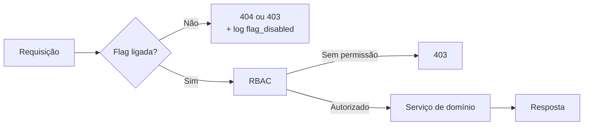

# ADR-007 — Feature flags para escopo incompleto e liberação gradual

- **Status:** Aceito
- **Data:** 31/10/2026
- **Decisores:** Equipe de Engenharia de Software — CESMAC
- **Substitui:** —
- **Substituído por:** —

## Contexto

O MVP do SOSP tem escopo recortado, mas o contrato e o schema já preveem funcionalidades da v2.0:

| Item | RF | Situação no MVP | O que existe no repositório |
|---|---|---|---|
| Avaliação do atendimento | RF-10 | Fora | Tabela `feedbackReview`, endpoint `POST /protocols/{protocolNumber}/review` |
| Push, SMS e WhatsApp | RF-13 | Fora | Tabela `notificationsPushSubscription`, endpoints de preferência |
| Relatórios com painel de avaliações | RF-14 | Parcial | Relatórios do MVP; painel de avaliações depende do RF-10 |
| Exportação CSV/PDF | RF-14 | Dentro | `POST /reports/exports` |

Três abordagens ingênuas foram consideradas e rejeitadas:

1. **Não escrever nada da v2.0.** O contrato e o schema teriam de ser refeitos depois, e a arquitetura perderia a visão do todo.
2. **Escrever tudo e esconder no CSS.** A rota continuaria acessível; esconder o botão não é controle de escopo.
3. **Manter branches de longa duração para a v2.0.** O código divergiria e o merge viraria um projeto à parte.

O projeto precisa de um mecanismo que permita **entregar o código sem ligar o comportamento**, com avaliação no servidor e rastreabilidade no contrato.

## Decisão

### Flags de ambiente, avaliadas no servidor

Adotamos **feature flags declaradas em variável de ambiente**, lidas no boot e avaliadas no servidor. A flag não é um controle de acesso: permissão continua sendo RBAC. A flag responde apenas "este comportamento está habilitado neste ambiente?".

```bash
FEATURE_REVIEWS_ENABLED=false
FEATURE_NOTIFICATION_CENTER_ENABLED=false
FEATURE_PUSH_ENABLED=false
FEATURE_SMS_ENABLED=false
FEATURE_WHATSAPP_ENABLED=false
FEATURE_REPORTS_EXPORT=true
FEATURE_GOVBR_INTEGRATION_ENABLED=false
```

| Flag | RF | Padrão | Quando ligar | Dono | Expiração |
|---|---|---|---|---|---|
| `FEATURE_REVIEWS_ENABLED` | RF-10 | `false` | v2.0, após o MVP | PO + Tech Lead | Revisão da v2.0 |
| `FEATURE_NOTIFICATION_CENTER_ENABLED` | RF-13 | `false` | v2.0 | PO + Tech Lead | Revisão da v2.0 |
| `FEATURE_PUSH_ENABLED` | RF-13 | `false` | v2.0 / Fase 3 | Tech Lead | Revisão da v2.0 |
| `FEATURE_SMS_ENABLED` | RF-13 | `false` | Fase 3 | PO | Revisão da Fase 3 |
| `FEATURE_WHATSAPP_ENABLED` | RF-13 | `false` | Fase 3 | PO | Revisão da Fase 3 |
| `FEATURE_REPORTS_EXPORT` | RF-14 | `true` | Já ligada no MVP | Tech Lead | Não expira (funcionalidade do MVP) |
| `FEATURE_GOVBR_INTEGRATION_ENABLED` | RF-02 | `false` | v2.0, quando o credenciamento Gov.br for obtido | PO + Tech Lead | Expira na v2.0 |

### Regras de implementação

1. **Padrão seguro:** toda flag nova nasce `false`, exceto quando a funcionalidade é parte do MVP (caso de `FEATURE_REPORTS_EXPORT`).
2. **Avaliação no servidor:** a API verifica a flag antes de executar a operação. O portal pode esconder o botão, mas a rota também recusa.
3. **Resposta padronizada:** flag desligada responde `404` para recurso inexistente no escopo (avaliação) e `403` para operação desabilitada em recurso existente (exportação). A escolha é documentada no OpenAPI.
4. **Contrato explícito:** todo endpoint condicionado carrega `x-feature-flag: <NOME>` no [`openapi.yaml`](../api/openapi.yaml). O validador do CI falha se a flag não estiver declarada no `.env.example`.
5. **Sem flag em código de domínio:** a flag é lida na borda (view/serializer) e passada como decisão explícita ao serviço. O serviço não consulta `settings` diretamente.
6. **Sem flag para esconder bug:** flag não substitui correção. Se o comportamento está quebrado, a correção é obrigatória; a flag só controla escopo.
7. **Observabilidade:** toda avaliação de flag registra nome e resultado em log estruturado, sem dado pessoal. Isso permite responder "por que o botão não apareceu?".
8. **Ciclo de vida:** flag temporária tem dono, motivo e data de revisão. Ao final da v2.0, a flag é removida com o código morto; a remoção é uma tarefa de backlog, não uma promessa. As flags da v2.0, como `FEATURE_GOVBR_INTEGRATION_ENABLED`, seguem este mesmo ciclo e devem ser removidas assim que a integração Gov.br for entregue.

### Como a flag aparece no fluxo



**Ordem:** flag antes de RBAC? Não. A flag é avaliada primeiro para não revelar a existência de um recurso desabilitado; o RBAC é avaliado em seguida para o recurso habilitado. O log registra as duas decisões.

### O que não é feature flag

| Não é flag | Por quê | Onde fica |
|---|---|---|
| Permissão de publicar serviço | É RBAC, não escopo | `catalog.manage` |
| Ambiente (dev/staging/prod) | É configuração de deploy | `DJANGO_SETTINGS_MODULE` |
| Limite de upload | É regra de negócio | `MAX_UPLOAD_SIZE_MB` |
| Manutenção programada | É operação | Proxy/healthcheck |
| Escolha de provedor de storage | É arquitetura | ADR-006 |

## Consequências positivas

| Consequência | Efeito |
|---|---|
| Código da v2.0 versionado sem risco | Schema e contrato evoluem junto, comportamento fica desligado |
| Escopo demonstrável | A demo mostra apenas o MVP; a flag impede surpresa |
| Contrato rastreável | `x-feature-flag` liga endpoint, requisito e decisão |
| Liberação gradual | É possível ligar para um usuário interno antes do público |
| Rollback rápido | Desligar a flag é mais rápido que reverter deploy |

## Consequências negativas e trade-offs

| Trade-off | Custo aceito | Mitigação |
|---|---|---|
| Duas leituras de configuração | Ambiente e banco podem divergir | Fonte única: `.env`/secret manager |
| Código morto temporário | Aumenta a superfície de manutenção | Dono, data de revisão e remoção planejada |
| Teste em duas configurações | Pipeline precisa rodar com flag on/off | Matriz de teste reduzida às flags críticas |
| Flag mal usada vira dívida | "Liga depois" sem dono | Checklist de PR exige dono e expiração |
| Não é controle de acesso | Alguém pode confundir | Regra explícita: RBAC separado |

## Alternativas descartadas

### Branch de longa duração para a v2.0

Manteria a `main` limpa, mas o merge final seria grande, tardio e arriscado. O time já adota Git Flow simplificado ([ADR-004](ADR-004-git-flow-simplificado.md)); uma branch de meses contraria a recomendação de branches curtas.

### Flags em banco com painel de administração

Permitiria ligar sem deploy e por usuário, mas adiciona tabela, cache, invalidação e auditoria. Para um time pequeno e um ambiente acadêmico, a variável de ambiente é suficiente. Se o produto crescer, a evolução natural é um provedor de flags (ver alternativas).

### Provedor de feature flags (LaunchDarkly, Unleash, GrowthBook)

Traz segmentação, experimentação e painel, mas adiciona dependência externa, custo e latência de avaliação. Não há necessidade de experimentação no MVP.

### Flags em tempo de build (`NEXT_PUBLIC_*`)

O portal seria congelado no build; trocar a flag exigiria rebuild. Além disso, `NEXT_PUBLIC_*` fica visível no navegador — aceitável para "mostrar botão", inaceitável para autorização. A decisão real precisa estar no servidor.

## Critérios de verificação

| Critério | Como verificar |
|---|---|
| Flag desligada bloqueia a rota | Teste de integração: `POST /protocols/{n}/review` → `404` |
| Flag ligada permite a rota | Teste com `override_settings(FEATURE_REVIEWS_ENABLED=True)` |
| Portal não renderiza botão | Teste de componente com flag falsa |
| Contrato declara a flag | `x-feature-flag` presente nos endpoints condicionados |
| CI valida flag declarada | Script compara OpenAPI com `.env.example` |
| Log registra avaliação | Busca por `flag_disabled` no log de staging |
| Nenhuma flag é usada como RBAC | Revisão de PR: permissão sempre separada |

## Referências

- [Pilar 1 — Visão de Produto e Requisitos](../01-product-specs.md)
- [Pilar 4 — Modelagem de Dados e Contratos de API](../04-data-api.md)
- [Pilar 5 — Engenharia, DevOps e Operação](../05-engineering-devops.md)
- [Casos de uso — §10](../use-cases/README.md#10-casos-de-uso-e-feature-flags)
- [`.env.example`](../../.env.example)
- [ADR-004 — Git Flow simplificado](ADR-004-git-flow-simplificado.md)
