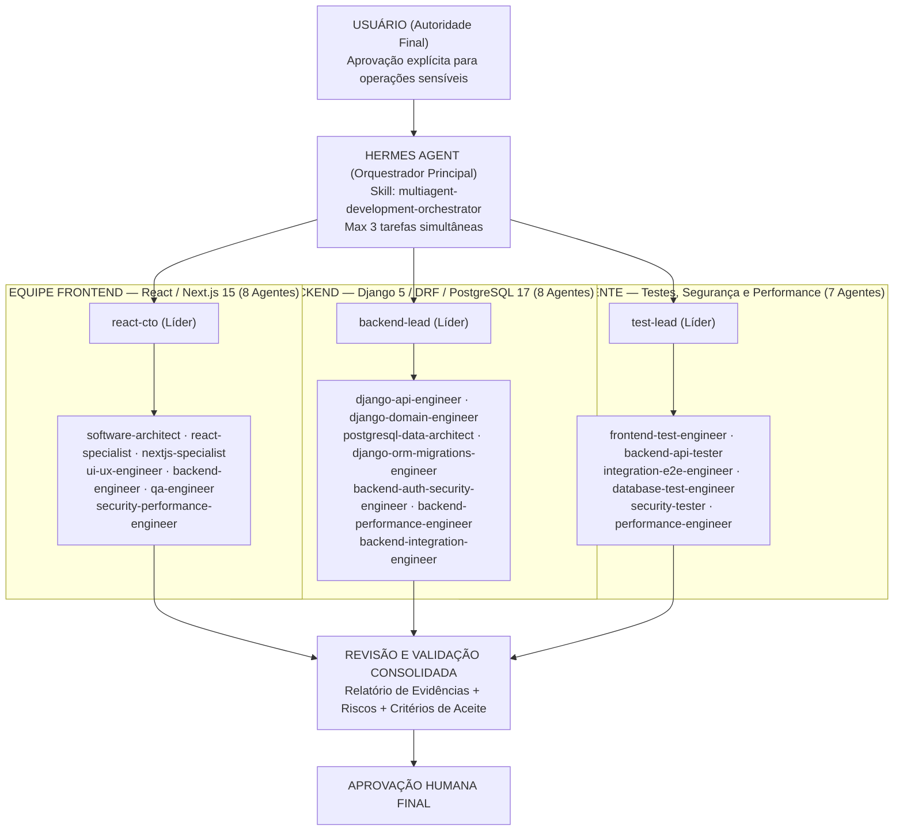

# Arquitetura Multiagente — SOSP (Hermes + Antigravity + OpenCode)

> **Projeto:** SOSP — Sistema de Orientação para Serviços Públicos
> **Versão:** 1.0.0 · **Data:** 05/11/2026 · **Modo Operacional:** Supervisionado (`Supervised Execution`)

---

## 1. Visão Geral da Arquitetura

O ambiente de engenharia do **SOSP** integra três ferramentas reais instaladas no macOS (`arm64`) sob governança humana estrita:

1. **Hermes Agent (`v0.21.7+758.gd97007c` — NousResearch):** Orquestrador principal, responsável pelo recebimento de demandas, planejamento de tarefas, seleção de especialistas, delegação controlada (limite inicial de até 3 subagentes paralelos), consolidação de resultados e submissão para aprovação humana.
2. **Google Antigravity IDE (`Antigravity IDE.app`):** Ambiente integrado de desenvolvimento assistido por agentes, carregando automaticamente `AGENTS.md`, `.agents/rules/*.md` (9 regras), `.agents/skills/*/SKILL.md` (14 skills) e as definições dos 23 agentes em `.agents/agents/*.md`.
3. **OpenCode (`v2.0.15` CLI e Desktop App):** Executor de agentes pelo terminal e servidor local, com os **23 agentes convertidos, configurados com modelos individuais e reconhecidos nativamente** em `.opencode/agents/*.md` e `opencode.json`.

---

## 2. Fronteiras Técnicas Reais entre Hermes, Antigravity e OpenCode

Conforme auditado no ambiente local, **Hermes, Antigravity e OpenCode não compartilham memória de sessão nem processos internos automaticamente**. A interoperabilidade real ocorre por meio de três canais verificados:

| Canal de Integração | Como Funciona na Prática | Status no Ambiente |
|---|---|---|
| **1. Fontes de Verdade Compartilhadas no Repositório (`AGENTS.md` + `.agents/`)** | Os três sistemas leem o mesmo repositório Git (`SOSP/`), seguindo as mesmas regras de negócio, contratos (`docs/api/openapi.yaml`, `docs/database/schema.sql`) e restrições de supervisão. | **Verificado e Ativo** |
| **2. Hermes → OpenCode CLI (`terminal` + `opencode run --agent <id>`)** | O Hermes possui a skill nativa `opencode` e a skill `multiagent-development-orchestrator`, permitindo invocar qualquer um dos 23 agentes registrados em `.opencode/agents/` via linha de comando (`opencode run --agent <nome> ...`). | **Verificado (37 agentes listados em `opencode debug agents`, incluindo todos os 23 do projeto)** |
| **3. Hermes → Subagentes Nativos (`delegate_task`)** | O Hermes pode instanciar até 3 subagentes paralelos (`max_concurrent_children: 3`) injetando o arquivo `.agents/agents/<nome>.md` como contexto especializado. | **Verificado na configuração do Hermes** |
| **4. Antigravity IDE (`invoke_subagent` + Rules + Skills)** | No Antigravity IDE, `AGENTS.md` e `.agents/rules/*.md` ficam sempre ativos, as 14 skills em `.agents/skills/` aparecem sob demanda e os agentes em `.agents/agents/` servem de especificação para subagentes. | **Verificado no workspace** |

---

## 3. Inventário Completo dos 23 Agentes (3 Equipes)

### 3.1. Equipe Frontend — React / Next.js (`8 agentes`)
Origem preservada integralmente de `~/Downloads/react-nextjs-antigravity-team.zip`:
1. [`react-cto`](../.agents/agents/react-cto.md) — Líder técnico principal da equipe React e Next.js (`mainAgent: true`).
2. [`software-architect`](../.agents/agents/software-architect.md) — Arquitetura de software, modularidade, contratos e dívida técnica.
3. [`react-specialist`](../.agents/agents/react-specialist.md) — Componentes React, hooks, estado, formulários e acessibilidade.
4. [`nextjs-specialist`](../.agents/agents/nextjs-specialist.md) — Next.js App Router, Server/Client Components, caching, rotas e build.
5. [`ui-ux-engineer`](../.agents/agents/ui-ux-engineer.md) — Design System (`.sosp-`), tokens, fidelidade ao Figma, responsividade e WCAG.
6. [`backend-engineer`](../.agents/agents/backend-engineer.md) — Integração TypeScript/Next.js, Route Handlers, contratos tipados e validação.
7. [`qa-engineer`](../.agents/agents/qa-engineer.md) — Qualidade e testes unitários/componentes/E2E da camada frontend.
8. [`security-performance-engineer`](../.agents/agents/security-performance-engineer.md) — AppSec web (CSP, XSS, CSRF) e Core Web Vitals (LCP, INP, CLS).

### 3.2. Equipe Backend — Django / DRF / PostgreSQL (`8 agentes`)
Origem preservada integralmente de `~/Downloads/equipe-backend-django-postgresql-v2.zip` (`django-postgresql-team/`):
9. [`backend-lead`](../.agents/agents/backend-lead.md) — Líder técnico e arquiteto Django (`mainAgent: true`).
10. [`django-api-engineer`](../.agents/agents/django-api-engineer.md) — Endpoints DRF, serializers, viewsets, filtros, paginação e OpenAPI.
11. [`django-domain-engineer`](../.agents/agents/django-domain-engineer.md) — Regras de negócio (`services.py` / `selectors.py`), transações e idempotência.
12. [`postgresql-data-architect`](../.agents/agents/postgresql-data-architect.md) — Modelagem relacional PostgreSQL 17 (`camelCase`), constraints, FKs e índices.
13. [`django-orm-migrations-engineer`](../.agents/agents/django-orm-migrations-engineer.md) — Models Django, evolução segura de schema (`expand/contract`) e prevenção de `N+1`.
14. [`backend-auth-security-engineer`](../.agents/agents/backend-auth-security-engineer.md) — Autenticação (`Argon2id`), RBAC, proteção de dados, rate limiting e auditoria.
15. [`backend-performance-engineer`](../.agents/agents/backend-performance-engineer.md) — Otimização de queries (`EXPLAIN ANALYZE`), índices, locks e caching Redis.
16. [`backend-integration-engineer`](../.agents/agents/backend-integration-engineer.md) — Integrações HTTP (`ViaCEP`, `IBGE`, `S3`, `SMTP`), retries, timeouts e observabilidade.

### 3.3. Equipe QA Independente (`7 agentes`)
Origem preservada integralmente de `~/Downloads/antigravity-qa-team.zip`:
17. [`test-lead`](../.agents/agents/test-lead.md) — QA Lead para auditoria completa e veredito de liberação (`mainAgent: true`).
18. [`frontend-test-engineer`](../.agents/agents/frontend-test-engineer.md) — Testes de componentes, formulários, estados de UI, teclado e acessibilidade.
19. [`backend-api-tester`](../.agents/agents/backend-api-tester.md) — Testes de contratos REST, status HTTP, autenticação, autorização e erros `RFC 7807`.
20. [`integration-e2e-engineer`](../.agents/agents/integration-e2e-engineer.md) — Testes de jornadas completas fim a fim e persistência real no banco.
21. [`database-test-engineer`](../.agents/agents/database-test-engineer.md) — Testes de constraints, transações, rollback, concorrência e integridade.
22. [`security-tester`](../.agents/agents/security-tester.md) — Testes controlados de AppSec (IDOR/BOLA, XSS, injection, upload e headers).
23. [`performance-engineer`](../.agents/agents/performance-engineer.md) — Testes de latência de API (`p95`/`p99`), Core Web Vitals e carga controlada.

---

## 4. Inventário de Regras (`.agents/rules/`) e Skills (`.agents/skills/`)

### 4.1. Regras Sempre Ativas (`9 arquivos` em `.agents/rules/`)
- `frontend-nextjs.md` — Regras específicas do portal SOSP (`Next.js 15`, tokens `.sosp-`, divergências `D1–D13`, 4 estados e WCAG 2.1 AA).
- `backend-django.md` — Regras específicas do backend SOSP (`Django 5 + DRF`, 9 módulos, `PostgreSQL 17 camelCase`, `Argon2id`, `RFC 7807`, `auditEvent`).
- `supervised-execution.md` — Exige aprovação explícita do usuário antes de ações com efeitos colaterais.
- `typescript-react-nextjs.md` — Convenções de engenharia para TypeScript, React e Next.js.
- `backend-standards.md` — Padrões gerais de separação de responsabilidades e validação server-side em Django.
- `collaboration.md` — Protocolo de colaboração entre Hermes, Backend Lead, Frontend e QA.
- `postgresql-safety.md` — Segurança operacional para PostgreSQL e migrations Django.
- `qa-standard.md` — Padrões de qualidade e determinismo da equipe de QA.
- `safe-test-execution.md` — Regras de execução segura e não destrutiva de testes.

### 4.2. Skills Sob Demanda (`14 skills` em `.agents/skills/`)
- **Orquestração Multiagente (1):** `multiagent-development-orchestrator` (também instalada em `~/.hermes/skills/software-development/multiagent-development-orchestrator/`).
- **Domínio SOSP (5):** `sosp-fe-task`, `sosp-be-task`, `sosp-contract-db`, `sosp-git-workflow`, `sosp-qa-validator`.
- **Equipe Frontend (3):** `feature-planning`, `bug-investigation`, `code-review`.
- **Equipe Backend (2):** `django-backend-workflow`, `postgresql-migration-safety`.
- **Equipe QA (3):** `full-audit`, `regression`, `release-gate`.

