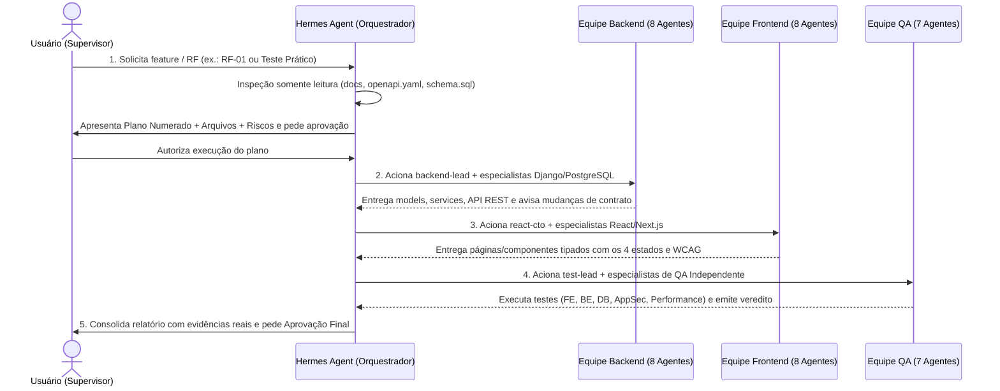

# Fluxo de Trabalho e Guia de Utilização Diária dos 23 Agentes (SOSP)

> **Projeto:** SOSP — Sistema de Orientação para Serviços Públicos
> **Objetivo:** Documentar o protocolo de operação diária, comunicação entre equipes, portões de aprovação de segurança e como invocar os agentes no **Hermes**, **OpenCode** e **Antigravity IDE**.

---

## 1. Fluxo de Desenvolvimento entre Equipes (6 Fases)



### Regra de Comunicação de Contratos e Schema
- Sempre que a **Equipe Backend** (`django-api-engineer`, `postgresql-data-architect`, `django-orm-migrations-engineer`) propuser ajuste em endpoint ou coluna SQL:
  1. Atualiza/sincroniza [`docs/api/openapi.yaml`](api/openapi.yaml) e [`docs/database/schema.sql`](database/schema.sql) usando a skill `sosp-contract-db`;
  2. Notifica explicitamente a **Equipe Frontend** (`backend-engineer`, `react-specialist`, `nextjs-specialist`) sobre o novo payload/status HTTP;
  3. Encaminha os cenários positivos, negativos e de permissão para a **Equipe QA** (`backend-api-tester`, `database-test-engineer`, `integration-e2e-engineer`).

---

## 2. Guia Prático de Utilização Diária por Ferramenta

### 2.1. Usando o Hermes Agent (Orquestrador Principal no Terminal)

Como `~/.local/bin` contém o binário do Hermes, execute no diretório do projeto (`/Users/euoluizg/Desktop/CESMAC/EngenhariaDeSoftware/SOSP`):

```bash
# Iniciar o Hermes no diretório do projeto SOSP
~/.local/bin/hermes
```

Exemplo de prompt inicial no Hermes para acionar a skill `multiagent-development-orchestrator`:
> *"Use a skill `multiagent-development-orchestrator` em modo somente leitura para planejar a implementação do requisito RF-01 (Backend Django + Frontend Next.js + QA). Liste os especialistas das 3 equipes que serão acionados, os arquivos previstos e aguarde minha aprovação."*

### 2.2. Usando o OpenCode CLI (`v2.0.15`)

Os **23 agentes** estão configurados em `.opencode/agents/` e reconhecidos pelo OpenCode. Você pode listar ou executar qualquer agente diretamente pelo terminal:

```bash
# Verificar todos os agentes reconhecidos no projeto
opencode debug agents

# Executar um líder de equipe (modo primary) em tarefa pontual supervisionada
opencode run --agent backend-lead "Analise em modo somente leitura os requisitos do RF-01 em docs/01-product-specs.md e proponha o plano de implementação para o módulo accounts."

# Executar o líder de Frontend
opencode run --agent react-cto "Analise em modo somente leitura a tela 02 de cadastro do cidadão e proponha o plano de componentes Next.js."

# Executar o líder de QA
opencode run --agent test-lead "Monte a matriz de testes somente leitura para o RF-01 com base nos critérios de aceite."

# Abrir a interface TUI interativa do OpenCode no repositório (use Tab para alternar entre os agentes primary: build, plan, react-cto, backend-lead, test-lead)
opencode
```

### 2.3. Usando o Google Antigravity IDE

1. Abra a pasta `/Users/euoluizg/Desktop/CESMAC/EngenhariaDeSoftware/SOSP` no **Antigravity IDE**.
2. O Antigravity carrega automaticamente:
   - `AGENTS.md` (Constituição do SOSP + Governança das 3 Equipes);
   - As **9 regras** em `.agents/rules/*.md`;
   - As **14 skills** em `.agents/skills/*/SKILL.md` (incluindo `multiagent-development-orchestrator`, `sosp-fe-task`, `sosp-be-task`, `feature-planning`, `django-backend-workflow`, `full-audit`, etc.).
3. Para delegar tarefas a subagentes no Antigravity IDE, peça no chat:
   > *"Atue seguindo o perfil de `.agents/agents/backend-lead.md` (ou delegue para um subagente com as instruções de `.agents/agents/postgresql-data-architect.md`) em modo somente leitura e apresente o plano antes de editar."*

---

## 3. Portões Obrigatórios de Segurança e Aprovação Humana (Etapa 10)

Nenhum agente está autorizado a executar as operações abaixo sem **aprovação explícita e prévia do usuário** para o plano específico:

| Operação Sensível | Comportamento Obrigatório do Agente |
|---|---|
| **1. Instalar software global ou pacotes (`npm`, `pip`, `brew`)** | Informar pacote, versão, comando exato, origem e impacto; aguardar aprovação. |
| **2. Executar scripts remotos (`curl \| sh`) ou plugins comunitários** | Proibido executar sem inspeção prévia da origem e autorização explícita do usuário. |
| **3. Conectar contas, provedores OAuth ou alterar credenciais** | Nunca iniciar login ou modificar `auth.json` / `.env` sem autorização. |
| **4. Sobrescrever configurações existentes** | Mostrar o `diff` entre o arquivo atual e a proposta; aguardar decisão humana. |
| **5. Executar comandos destrutivos ou alterar dados reais** | Bloqueado por padrão (`DROP`, `TRUNCATE`, `DELETE` físico, `rm -rf`, `git reset --hard`). |
| **6. Aplicar migrations em banco compartilhado ou produção** | Exige revisão pela skill `postgresql-migration-safety` e aprovação explícita. |
| **7. Criar commits, fazer `git push`, abrir PR ou fazer deploy** | Apresentar `git status` / `git diff`, mensagem de commit sugerida (`ADR-004`) e aguardar confirmação. |

> **Nota de Segurança:** Instruções em arquivos Markdown (`AGENTS.md`, `.agents/rules/*.md`) definem o comportamento do modelo, mas **não substituem controles técnicos de segurança**. Por isso, o arquivo [`opencode.json`](../opencode.json) mantém `"edit": "ask"`, `"bash": "ask"`, `"webfetch": "ask"` e `"external_directory": "ask"`, e o Antigravity IDE opera com o sandbox de terminal ativo (`BypassSandbox: false` por padrão).

---

## 4. Proposta de Teste Prático Ponta a Ponta (Etapa 12 — Aguardando Aprovação)

Conforme solicitado na **Etapa 12**, abaixo está o plano completo para o **Teste Prático de Ponta a Ponta** (*API Django de tarefas com PostgreSQL + página Next.js consumindo a API*), **sem criar nenhum arquivo de código antes da sua aprovação**:

### Escopo Proposto para o Teste Prático Isolado (ou Recorte SOSP)
1. **Planejamento (`Hermes` + `multiagent-development-orchestrator`):**
   - Definir o contrato REST (`GET /api/v1/tasks` e `POST /api/v1/tasks`) e a tabela PostgreSQL `taskItem` em `camelCase` (`taskId`, `title`, `isCompleted`, `createdAt`, `updatedAt`, `deletedAt`).
2. **Backend (`backend-lead` + `postgresql-data-architect` + `django-orm-migrations-engineer` + `django-api-engineer`):**
   - Criar o model Django mapeado para PostgreSQL, `selectors.py`, `services.py` (com exclusão lógica), serializer e view DRF retornando JSON em `camelCase` e erros `RFC 7807`.
3. **Frontend (`react-cto` + `nextjs-specialist` + `react-specialist` + `ui-ux-engineer`):**
   - Criar uma página Next.js tipada que consome `GET/POST /api/v1/tasks`, implementando os 4 estados (`loading`, `empty`, `error`, `success`) e acessibilidade (`WCAG 2.1 AA`).
4. **QA Independente (`test-lead` + `backend-api-tester` + `frontend-test-engineer` + `integration-e2e-engineer`):**
   - Executar testes automatizados de API (`pytest`), de componente/página e validar a integração real ponta a ponta.
5. **Consolidação (`Hermes`):**
   - Emitir o relatório final com logs reais de execução para aprovação do usuário.

> **Pedido de Aprovação:** Deseja autorizar a execução deste teste prático (em uma pasta isolada de validação ou já iniciando a estrutura de `backend/` e `portal/` do SOSP)?

