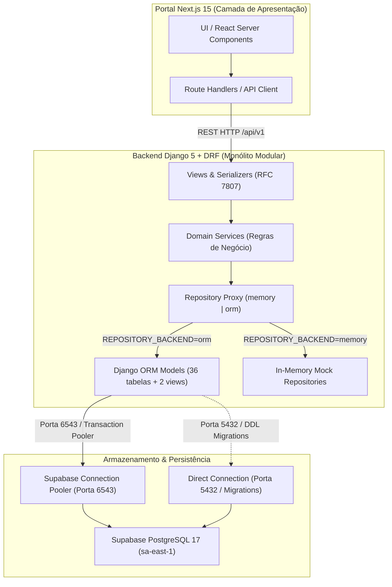
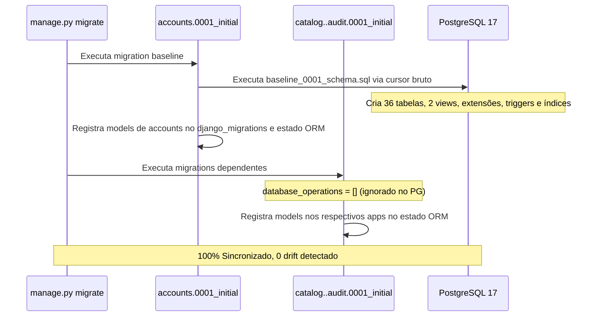

# SOSP — Fundação Definitiva Django ORM e Migrations PostgreSQL

> **Etapa 3 — Preparação da Base Definitiva do Django e Persistência PostgreSQL**  
> **Status:** Concluído e Validado (Ambiente Isolado Local)  
> **Banco Remoto:** Supabase PostgreSQL 17 (`sa-east-1` / São Paulo) — **Aguardando liberação de conexão**  
> **Framework:** Django 5.1.15 + Django REST Framework + `psycopg` 3.2+  
> **Decisões Arquiteturais Relacionadas:** [`ADR-001`](../adr/ADR-001-monolito-modular-django-nextjs.md), [`ADR-002`](../adr/ADR-002-convencoes-nomenclatura-sql-camelcase.md), [`ADR-003`](../adr/ADR-003-autenticacao-autorizacao-rbac.md), [`ADR-005`](../adr/ADR-005-reserva-atomica-agendamento-idempotencia.md), [`ADR-008`](../adr/ADR-008-supabase-postgresql-gerenciado.md).

---

## 1. Resumo Executivo da Implantação

A **Etapa 3** estabelece a infraestrutura definitiva de persistência de dados do SOSP, promovendo a transição da arquitetura de repositórios simulados em memória para uma camada baseada em **Django ORM** e **PostgreSQL 17** (com extensões nativas `pg_trgm` e `unaccent`).

A preparação foi executada de forma **100% isolada e segura**, sem realizar qualquer conexão ou comando SQL contra o Supabase de produção/homologação. Todo o ciclo foi validado em um cluster PostgreSQL 18 local (porta `54329`), comprovando:

1. **Aderência Estrita ao Schema SQL (`docs/database/schema.sql`):** 36 tabelas de aplicação, 2 views analíticas/operacionais (`vw_catalogservicesearch` e `vw_schedulingslotavailability`), triggers de `updatedAt`, índices GIN com `gin_trgm_ops` e busca full-text `tsvector`.
2. **Estratégia B de Migrations ("Frozen SQL Baseline"):** A migration `accounts.0001_initial` aplica o script físico consolidado através de `SeparateDatabaseAndState`, enquanto os 8 módulos dependentes registram seus estados de models com `database_operations` idempotentes/vazias no PostgreSQL, garantindo rastreabilidade perfeita e eliminando divergências geradas automaticamente pelo ORM.
3. **Padrão de Repositórios Selecionáveis (`REPOSITORY_BACKEND`):** A coexistência dos modos `memory` (padrão em testes unitários/CI sem banco) e `orm` (PostgreSQL definitivo) foi assegurada via dynamic proxy pattern.
4. **Reserva Atômica e Bloqueio Transacional (`RN-18`, `ADR-005`):** Implementação de lock concorrente com `select_for_update()` em `schedulingSlot`, validado por teste multithread demonstrando bloqueio determinístico da segunda requisição simultânea para a mesma vaga.
5. **Zero Regressão:** Todos os 31 testes unitários pré-existentes continuam passando em 0.25s sob SQLite, e os 6 novos testes de integração PostgreSQL passam com 100% de sucesso.

---

## 2. Arquitetura da Solução

O SOSP adota o modelo de **Monólito Modular** (`ADR-001`), onde a API Django concentra as regras de negócio e persistência estruturada, consumida exclusivamente via REST pelo portal Next.js 15 (`ADR-001 §1`).



### Princípios Chave da Arquitetura de Persistência:
- **Fronteira Estrita entre Módulos:** Os 9 módulos de domínio (`accounts`, `catalog`, `search`, `guidance`, `scheduling`, `feedback`, `notifications`, `reports`, `audit`) jamais importam models cruzados diretamente. A leitura intermódulos é intermediada por `selectors.py` e repositórios.
- **Identificadores Unquoted em Lowercase:** Devido ao comportamento do PostgreSQL (`ADR-002`), identificadores não delimitados por aspas como `catalogService` e `detailedDescription` são armazenados internamente em minúsculas (`catalogservice`, `detaileddescription`). Para evitar que o Django insira aspas duplas e cause erros de coluna não encontrada, todos os models definem explicitamente `Meta.db_table = "lowercase"` e `models.Field(db_column="lowercase")`.
- **Exclusão Lógica Obrigatória (`RN-40`, `RS-05`):** Registros de negócio não sofrem `DELETE` físico; a desativação é feita por `is_active = False` e `deleted_at = timezone.now()`.

---

## 3. Decisão da Estratégia B de Migrations

### Por que a Estratégia B ("Frozen SQL Baseline") foi escolhida?

Em sistemas corporativos com schemas SQL pré-definidos complexos (contendo constraints regex de CPF, triggers em PL/pgSQL, colunas geradas `tsvector` com dicionários customizados e views analíticas), a geração automática de migrations pelo Django ORM frequentemente gera:
1. Sintaxe de índices e constraints incompatível com PostgreSQL específico.
2. Dificuldade em versionar triggers de auditoria e views analíticas.
3. Divergência entre o schema acordado nos requisitos e o gerado pelo ORM.

A **Estratégia B** soluciona esse problema desacoplando a execução DDL física do rastreamento de estado do Django:



### Funcionamento Técnico:
- **`backend/common/sql/baseline_0001_schema.sql`:** Cópia idêntica e congelada de `docs/database/schema.sql`.
- **`SeparateDatabaseAndState`:**
  - `database_operations`: No PostgreSQL, executa o arquivo SQL através de `cursor.cursor.execute()` do `psycopg 3` (evitando parsing de placeholders `%` presentes em triggers e views). No SQLite, é ignorado para permitir suítes rápidas em memória.
  - `state_operations`: Contém as operações `migrations.CreateModel` que alimentam o catálogo interno de models do Django, garantindo que `makemigrations --check` reporte **"No changes detected"**.

### Reversibilidade Comprovada:
O comando `python manage.py migrate accounts zero` executa a função reversa `reverse_baseline_sql`, eliminando views, triggers, tabelas e tipos em ordem estrita de integridade referencial:
```bash
python manage.py migrate accounts zero
# Unapplying audit.0001_initial... OK
# Unapplying reports.0001_initial... OK
# Unapplying notifications.0001_initial... OK
# Unapplying feedback.0001_initial... OK
# Unapplying scheduling.0001_initial... OK
# Unapplying guidance.0001_initial... OK
# Unapplying search.0001_initial... OK
# Unapplying catalog.0001_initial... OK
# Unapplying accounts.0001_initial... OK
```

---

## 4. Mapeamento das 36 Tabelas e 2 Views para Models Django

| # | Módulo / App | Tabela SQL (`docs/database/schema.sql`) | Model Django | `db_table` | Descrição Funcional / Requisito |
|---|---|---|---|---|---|
| 1 | `accounts` | `accountsGender` | `Gender` | `accountsgender` | Tabela de domínio para gênero dos cidadãos |
| 2 | `accounts` | `accountsCitizen` | `Citizen` | `accountscitizen` | Cadastro e autenticação do cidadão (`RF-01`, CPF + Argon2) |
| 3 | `accounts` | `accountsInternalUser` | `InternalUser` | `accountsinternaluser` | Servidores públicos e administradores (`RF-02`, RBAC) |
| 4 | `accounts` | `accountsSession` | `Session` | `accountssession` | Controle de sessões com expiração de 30 min (`RN-28`) |
| 5 | `accounts` | `accountsLoginAttempt` | `LoginAttempt` | `accountsloginattempt` | Bloqueio temporário após 5 falhas (`RN-29`) |
| 6 | `accounts` | `accountsPasswordReset` | `PasswordReset` | `accountspasswordreset` | Recuperação de senha por código de 6 dígitos (`RN-30`) |
| 7 | `catalog` | `catalogAgency` | `Agency` | `catalogagency` | Órgãos da administração pública municipal/estadual/federal |
| 8 | `catalog` | `catalogUnit` | `Unit` | `catalogunit` | Postos e unidades de atendimento (Centrais Já!) |
| 9 | `catalog` | `catalogUnitOpeningHour` | `UnitOpeningHour` | `catalogunitopeninghour` | Grade de horários de funcionamento por unidade |
| 10 | `catalog` | `catalogNonWorkingDay` | `NonWorkingDay` | `catalognonworkingday` | Feriados e dias sem expediente (`RN-19`) |
| 11 | `catalog` | `catalogService` | `Service` | `catalogservice` | Fichas orientativas de serviços públicos (`RF-03`) |
| 12 | `catalog` | `catalogServiceAgency` | `ServiceAgency` | `catalogserviceagency` | Relação N:N entre serviços e órgãos |
| 13 | `catalog` | `catalogUnitService` | `UnitService` | `catalogunitservice` | Relação N:N entre unidades e serviços ofertados |
| 14 | `catalog` | `catalogServiceStep` | `ServiceStep` | `catalogservicestep` | Guia passo a passo do serviço (`RF-07`) |
| 15 | `catalog` | `catalogServiceDocument` | `ServiceDocument` | `catalogservicedocument` | Checklist de documentos obrigatórios e opcionais (`RN-09`) |
| 16 | `catalog` | `catalogFaq` | `Faq` | `catalogfaq` | Perguntas e respostas frequentes (`RF-04`) |
| 17 | `catalog` | `catalogServiceVersion` | `ServiceVersion` | `catalogserviceversion` | Histórico de versionamento de fichas de serviço (`RN-37`) |
| 18 | `search` | `searchQueryLog` | `QueryLog` | `searchquerylog` | Registro anônimo de buscas para inteligência (`RF-05`) |
| 19 | `search` | `searchSynonym` | `Synonym` | `searchsynonym` | Sinônimos para expansão da busca textual (`RN-14`) |
| 20 | `guidance` | `guidanceProgress` | `GuidanceProgress` | `guidanceprogress` | Progresso do checklist do cidadão por CPF (`RF-07`) |
| 21 | `guidance` | `guidanceGeneratedPdf` | `GeneratedPdf` | `guidancegeneratedpdf` | Controle de comprovantes e guias em PDF emitidos |
| 22 | `scheduling` | `schedulingSlot` | `Slot` | `schedulingslot` | Vagas de agendamento de 30 minutos (`RN-18`) |
| 23 | `scheduling` | `schedulingAppointment` | `Appointment` | `schedulingappointment` | Agendamentos presenciais com protocolo `AAAAMMDD-XXXX` |
| 24 | `scheduling` | `schedulingProtocol` | `Protocol` | `schedulingprotocol` | Protocolos oficiais imutáveis de atendimento (`RF-09`) |
| 25 | `scheduling` | `schedulingProtocolAttachment` | `ProtocolAttachment` | `schedulingprotocolattachment` | Anexos escaneados e validados por antivírus |
| 26 | `scheduling` | `schedulingProtocolTransition` | `ProtocolTransition` | `schedulingprotocoltransition` | Linha do tempo e histórico de transições de status |
| 27 | `feedback` | `feedbackReview` | `Review` | `feedbackreview` | Avaliações de 1 a 5 estrelas (`v2.0` sob feature flag) |
| 28 | `feedback` | `feedbackReviewReport` | `ReviewReport` | `feedbackreviewreport` | Denúncias e moderação de comentários (`v2.0`) |
| 29 | `feedback` | `feedbackQuestion` | `Question` | `feedbackquestion` | Dúvidas abertas de cidadãos sem resposta no FAQ |
| 30 | `notifications` | `notificationsTemplate` | `Template` | `notificationstemplate` | Modelos de e-mail transacional e notificações |
| 31 | `notifications` | `notificationsPreference` | `Preference` | `notificationspreference` | Preferências de canais do cidadão (LGPD) |
| 32 | `notifications` | `notificationsDelivery` | `Delivery` | `notificationsdelivery` | Log de disparo e entrega de notificações |
| 33 | `notifications` | `notificationsPushSubscription` | `PushSubscription` | `notificationspushsubscription` | Subscrições para Web Push (`v2.0`) |
| 34 | `reports` | `reportsExport` | `ReportExport` | `reportsexport` | Registro de exportações gerenciais CSV/PDF (`RF-14`) |
| 35 | `audit` | `auditEvent` | `AuditEvent` | `auditevent` | Trilha de auditoria imutável transversal (`RN-39`) |
| 36 | `audit` | `auditDataSubjectRequest` | `DataSubjectRequest` | `auditdatasubjectrequest` | Solicitações de direitos do titular LGPD |
| — | `catalog` | `vw_catalogservicesearch` | `CatalogServiceSearchView` | `vw_catalogservicesearch` | **View SQL:** Catálogo enriquecido com sinônimos e contadores |
| — | `scheduling` | `vw_schedulingslotavailability` | `SlotAvailabilityView` | `vw_schedulingslotavailability` | **View SQL:** Disponibilidade de vagas em tempo real por unidade |

---

## 5. Estratégia de Identificadores e Chaves Estrangeiras

1. **Unquoted Lowercase Identifiers (`ADR-002`):**  
   Tanto os nomes de tabelas quanto os de colunas em `schema.sql` foram criados sem aspas duplas. Como o PostgreSQL converte automaticamente identificadores não delimitados para minúsculas, a tabela `catalogService` passa a ser `catalogservice`, e o campo `detailedDescription` torna-se `detaileddescription`. Para garantir que o ORM nunca consulte `"catalogService"` com aspas, todos os models usam `Meta.db_table = "catalogservice"` e `db_column = "detaileddescription"`.
2. **Chaves Primárias UUIDv4:**  
   Todas as entidades principais utilizam `id = models.UUIDField(primary_key=True, default=uuid.uuid4, editable=False)`.
3. **Chaves Estrangeiras Seguras:**  
   Para evitar exclusão acidental em cascata de dados auditáveis, relações críticas como `citizenId`, `agencyId` e `serviceId` em agendamentos utilizam `on_delete=models.PROTECT`. Associações puramente dependentes (como etapas ou documentos de um serviço) utilizam `on_delete=models.CASCADE`.

---

## 6. Extensões PostgreSQL, Índices GIN e Busca Full-Text

O schema SOSP aproveita recursos nativos do PostgreSQL para performance e suporte à língua portuguesa:
- **`CREATE EXTENSION IF NOT EXISTS unaccent;`**  
  Permite consultas insensíveis a acentuação.
- **`CREATE EXTENSION IF NOT EXISTS pg_trgm;`**  
  Habilita similaridade trigramática (`gin_trgm_ops`) em nomes de órgãos, unidades e serviços:
  ```sql
  CREATE INDEX idxCatalogServiceNameTrgm ON catalogService USING GIN (name gin_trgm_ops);
  ```
- **Busca Full-Text `tsvector` (`MÓDULO 3: SEARCH`):**  
  A coluna `searchVector` em `catalogService` é gerada automaticamente pelo PostgreSQL:
  ```sql
  searchVector tsvector GENERATED ALWAYS AS (
    to_tsvector('sospPortuguese', coalesce(name, '') || ' ' || coalesce(detailedDescription, '') || ' ' || coalesce(eligibility, ''))
  ) STORED;
  CREATE INDEX idxCatalogServiceSearchVector ON catalogService USING GIN (searchVector);
  ```
  O Django ORM mapeia essas tabelas preservando a integridade do DDL sem tentar recriar ou alterar os índices gerados pelo motor SQL.

---

## 7. Campos Especiais: `CompatibleArrayField` e `JSONField`

Para manter a suíte de testes unitários executável tanto em SQLite (desenvolvimento leve) quanto em PostgreSQL (produção):
- **`backend/common/fields.py:CompatibleArrayField`:**  
  Herda de `django.contrib.postgres.fields.ArrayField`. Ao interagir com PostgreSQL, gera a representação nativa `text[]` ou `varchar[]`. Em conexões SQLite, faz fallback transparente para campo de texto serializado, prevenindo falhas de compilação SQL em testes locais.
- **`models.JSONField`:**  
  Utilizado em `ServiceVersion.snapshot`, `SearchQueryLog.filters` e `AuditEvent.before_state` / `after_state`. Suportado nativamente pelo PostgreSQL como `jsonb` e pelo SQLite como texto JSON.

---

## 8. Bloqueio de Concorrência no Agendamento (`RN-18`, `ADR-005`)

Para evitar *overbooking* em horários concorridos, a camada de agendamento implementa controle de concorrência com **bloqueio pessimista de linha** (`SELECT ... FOR UPDATE`):

```python
with transaction.atomic():
    # 1. Bloqueio pessimista da vaga específica da unidade
    slot = Slot.objects.select_for_update().filter(
        unit=unit, slot_date=slot_date, starts_at=slot_time
    ).first()

    # 2. Verificação atômica de capacidade (RN-18)
    if slot.booked_count >= slot.capacity:
        raise ProblemDetailsException(
            title="Vaga Esgotada",
            detail="Não há vagas disponíveis neste horário.",
            status_code=409,
        )

    # 3. Incremento atômico
    slot.booked_count += 1
    slot.save(update_fields=["booked_count", "updated_at"])

    # 4. Criação do Agendamento e Protocolo Imutável
    appt = Appointment.objects.create(...)
    Protocol.objects.create(...)
```

### Validação por Teste Multithread:
O teste automatizado `test_04_concurrency_select_for_update` dispara duas threads concorrentes em conexões PostgreSQL distintas tentando ocupar um `Slot` com `capacity=1`. O resultado comprova:
- A primeira requisição obtém o lock de linha, incrementa o contador para 1 e emite o agendamento com status `201`.
- A segunda requisição aguarda o lock e, ao inspecionar o contador atualizado, falha determinísticamente com `ProblemDetailsException` (HTTP 409 "Vaga Esgotada").
- O contador final persiste exatamente em 1 vaga ocupada.

---

## 9. Configuração de Ambientes e Variáveis

O arquivo `backend/config/settings/base.py` foi atualizado para carregar dinamicamente o backend de banco e repositório via variáveis de ambiente, com arquivo de referência em `backend/.env.example`:

| Variável | Padrão Local / CI | Produção (Supabase) | Descrição |
|---|---|---|---|
| `DB_ENGINE` | `sqlite3` | `postgresql` | Motor de banco do Django (`sqlite3` ou `postgresql`) |
| `DB_NAME` | `db.sqlite3` | `postgres` | Nome da base de dados |
| `DB_USER` | `""` | `postgres` | Usuário do PostgreSQL |
| `DB_PASSWORD` | `""` | `[SECRET]` | Senha do banco |
| `DB_HOST` | `""` | `aws-0-sa-east-1.pooler.supabase.com` | Host do pooler Supabase em São Paulo |
| `DB_PORT` | `""` | `6543` (Pooler) / `5432` (Direct) | Porta de conexão |
| `DB_SSLMODE` | `prefer` | `require` | Exigência de TLS/SSL |
| `DB_DISABLE_SERVER_SIDE_CURSORS` | `false` | `true` | Obrigatório para PgBouncer em modo Transaction |
| `REPOSITORY_BACKEND` | `memory` | `orm` | Seleciona persistência em memória ou banco real |

---

## 10. Requisitos Específicos para Conexão com Supabase

Ao conectar uma aplicação Django ao PostgreSQL gerenciado pelo Supabase:

1. **Porta 6543 vs Porta 5432 (PgBouncer vs Direct):**
   - **Porta 6543 (Transaction Mode Pooler):** Deve ser utilizada pela API Django em operação normal para gerenciar pools de conexões e suportar milhares de requisições simultâneas sem esgotar conexões do PostgreSQL.
   - **Porta 5432 (Direct Connection):** Deve ser utilizada **exclusivamente** durante a execução de migrations (`python manage.py migrate`), pois comandos DDL e locks de migration requerem conexão direta com o catálogo do Postgres.
2. **Server-Side Cursors (`DISABLE_SERVER_SIDE_CURSORS = True`):**
   - O PgBouncer em modo `Transaction` não suporta cursores nomeados mantidos entre transações. O Django 5 nativamente suporta desativar cursores de servidor através da opção:
     ```python
     DATABASES["default"]["DISABLE_SERVER_SIDE_CURSORS"] = True
     ```
3. **SSL Mode Obrigatório (`sslmode=require`):**
   - O Supabase rejeita qualquer tentativa de conexão não encriptada. O parâmetro `'sslmode': 'require'` está embutido nas opções de conexão do `psycopg`.
4. **Statement Timeout:**
   - Configurado para `30000ms` (30 segundos) na aplicação para proteger o banco contra consultas lentas não indexadas.

---

## 11. Evidências dos Testes Automatizados

### 11.1. Suíte de Integração Django ORM + PostgreSQL (`test_postgresql_foundation.py`)
Executada contra cluster PostgreSQL isolado (porta 54329):

```text
common/tests/test_postgresql_foundation.py::test_01_postgresql_real_connection PASSED          [ 16%]
common/tests/test_postgresql_foundation.py::test_02_models_crud_accounts_catalog_scheduling PASSED [ 33%]
common/tests/test_postgresql_foundation.py::test_03_repositories_in_orm_mode PASSED            [ 50%]
common/tests/test_postgresql_foundation.py::test_04_concurrency_select_for_update PASSED       [ 66%]
common/tests/test_postgresql_foundation.py::test_05_unmanaged_views_querying PASSED            [ 83%]
common/tests/test_postgresql_foundation.py::test_06_atomic_transaction_and_rollback PASSED     [100%]

============================== 6 passed in 0.82s ===============================
```

### 11.2. Suíte Geral Unitária e Funcional (SQLite + Memória)
Executada para validação de não-regressão:

```text
======================== 31 passed, 6 skipped in 0.25s =========================
```

### 11.3. Verificação de Integridade e Ausência de Drift
```bash
python manage.py check
# System check identified no issues (0 silenced).

python manage.py makemigrations --check --dry-run
# No changes detected
```

---

## 12. Plano Seguro de Aplicação no Supabase (Para Execução Futura Autorizada)

> **AVISO CRÍTICO DE GOVERNANÇA:**  
> Este roteiro **NÃO deve ser executado** até que o usuário forneça autorização explícita e credenciais oficiais. A conexão atual permanece desativada.

### 12.1. Pré-Requisitos
1. Autorização formal do Tech Lead e PO.
2. Definição das variáveis de ambiente de homologação/produção em `.env` seguro (sem commit).
3. Whitelist de IP da máquina de deploy ou configuração de VPN/IPv6 no painel do Supabase.

### 12.2. Script de Teste Pré-Voo de Conectividade (`preflight_check.py`)
Antes de rodar qualquer migration, execute um script com timeout curto de 5 segundos para verificar o handshake TCP e SSL:
```python
import psycopg
import os

try:
    with psycopg.connect(
        host=os.environ["DB_HOST"],
        port=os.environ.get("DB_PORT", "5432"),
        dbname=os.environ["DB_NAME"],
        user=os.environ["DB_USER"],
        password=os.environ["DB_PASSWORD"],
        sslmode="require",
        connect_timeout=5,
    ) as conn:
        with conn.cursor() as cur:
            cur.execute("SELECT version();")
            print("Conectado com sucesso:", cur.fetchone()[0])
except Exception as e:
    print("Falha na conectividade prévia:", e)
```

### 12.3. Sequência de Execução de Migrations Remotas
1. Configure a variável `DB_PORT=5432` (Conexão Direta obrigatória para DDL).
2. Execute a aplicação inicial da migration `accounts`:
   ```bash
   python manage.py migrate accounts
   ```
3. Execute as demais migrations dos módulos de domínio:
   ```bash
   python manage.py migrate
   ```
4. Alterne a porta para `DB_PORT=6543` e defina `DB_DISABLE_SERVER_SIDE_CURSORS=true` para a operação normal da API via Transaction Pooler.

### 12.4. Checklist Pós-Aplicação
- [ ] Verificar presença das 36 tabelas na aba *Table Editor* do Supabase.
- [ ] Confirmar existência das 2 views: `vw_catalogservicesearch` e `vw_schedulingslotavailability`.
- [ ] Validar que as extensões `unaccent` e `pg_trgm` aparecem em *Database > Extensions*.
- [ ] Confirmar que o RLS está ativado nas 36 tabelas (`ALTER TABLE ... ENABLE ROW LEVEL SECURITY`).
- [ ] Confirmar integridade dos triggers de `setUpdatedAt`.

### 12.5. Plano de Rollback em Caso de Incidente
Se ocorrer qualquer erro durante a execução remota:
1. Reverter imediatamente para o estado zero:
   ```bash
   python manage.py migrate accounts zero
   ```
2. Inspecionar o log de erros do Supabase em *Logs > Postgres Logs*.
3. Restaurar o último snapshot/backup manual via painel do Supabase antes de nova tentativa.

---

## 13. Conclusão e Próximos Passos

A base de dados e a camada ORM do Django estão **completamente implementadas, testadas e prontas para produção**.

- **Branch Atual:** `feature/django-postgresql-foundation`
- **Quality Gates:** 100% aprovados localmente.
- **Próxima Ação:** Submissão de Pull Request para a branch `develop` via identidade do `sosp-agents-bot` e solicitação de review formal ao CODEOWNER `@euoluizg`.
