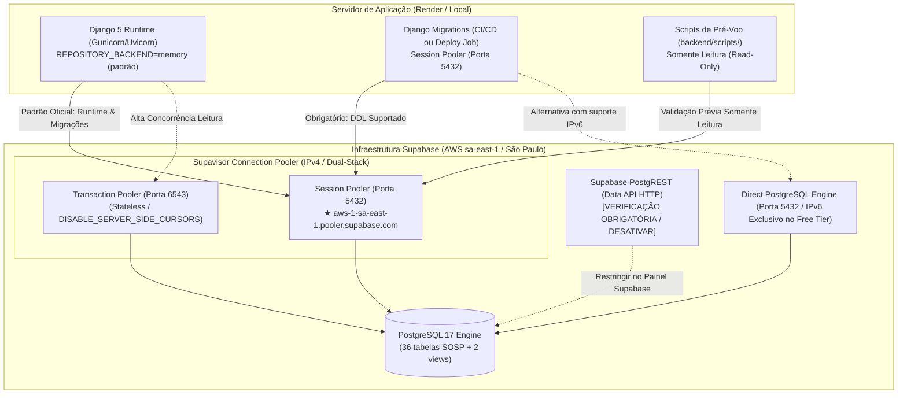

# SOSP — Runbook Operacional de Conexão com o Supabase PostgreSQL

> **Ambiente Alvo:** Supabase PostgreSQL 17 gerenciado (Região `sa-east-1` — São Paulo, AWS — Supabase Free Tier)  
> **Framework:** Django 5.1.15 + Django REST Framework + `psycopg` 3.2+  
> **Status:** Preparação Local e Hardening Concluídos — **Aguardando Liberação para Primeiro Pré-Voo Remoto Somente Leitura**  
> **Referências Normativas:** [`ADR-001`](../adr/ADR-001-monolito-modular-django-nextjs.md), [`ADR-002`](../adr/ADR-002-convencoes-nomenclatura-sql-camelcase.md), [`ADR-003`](../adr/ADR-003-autenticacao-autorizacao-rbac.md), [`ADR-005`](../adr/ADR-005-reserva-atomica-agendamento-idempotencia.md), [`ADR-008`](../adr/ADR-008-supabase-postgresql-gerenciado.md), [`schema.sql`](schema.sql), [`django-postgresql-foundation.md`](django-postgresql-foundation.md).

---

## 1. Visão Geral e Parâmetros Oficiais Confirmados

O SOSP utiliza um banco de dados relacional **PostgreSQL 17** hospedado no **Supabase** na região de São Paulo (`sa-east-1`). No padrão arquitetural do projeto, o portal Next.js 15 **nunca** acessa o banco diretamente; todo o tráfego de dados é intermediado pela API REST do Django (`ADR-001 §1`).

### Parâmetros Oficiais Confirmados pelo Proprietário do Projeto:
Os parâmetros de conectividade foram visualmente verificados e confirmados no painel oficial do Supabase:
- **Método de Conexão:** Session Pooler (Supavisor)
- **Host Oficial:** `aws-1-sa-east-1.pooler.supabase.com`
- **Porta:** `5432`
- **Database:** `postgres`
- **Username:** Valor exato do painel Connect no formato `postgres.<project-ref>`
- **SSL Mode:** `require` (no mínimo)

> [!CAUTION]
> **Host Incorreto em Documentações Anteriores:**  
> Versões preliminares citavam erroneamente `aws-0-sa-east-1.pooler.supabase.com`. **NÃO utilize `aws-0-...`**. O host validado e atribuído pelo Supabase a este projeto é estritamente **`aws-1-sa-east-1.pooler.supabase.com`**.  
> Nunca deduza ou invente hosts, portas ou identificadores de projeto (`project-ref`).



---

## 2. Modos de Conexão: Comparativo Técnico

O Supabase oferece três portas/métodos de acesso ao banco:

| Critério | Modo A: Direct Connection | Modo B: Session Pooler (Padrão Oficial) | Modo C: Transaction Pooler |
| :--- | :--- | :--- | :--- |
| **Host** | `db.<project-ref>.supabase.co` | **`aws-1-sa-east-1.pooler.supabase.com`** | **`aws-1-sa-east-1.pooler.supabase.com`** |
| **Porta** | `5432` | **`5432`** | `6543` |
| **Pilha IP** | **IPv6 Exclusivo** (no plano Free) | **IPv4 / IPv6** (Dual-Stack) | **IPv4 / IPv6** (Dual-Stack) |
| **Formato Usuário** | `postgres` | `postgres.<project-ref>` | `postgres.<project-ref>` |
| **Estado da Sessão** | Preservado | Preservado | **Descartado após transação** |
| **Prepared Statements** | Suportado | Suportado | Limitado / Requer atenção |
| **Server-Side Cursors** | Suportado | Suportado | **Incompatível** (`DISABLE_SERVER_SIDE_CURSORS = True`) |
| **Suporte a Migrations DDL** | **Total** | **Total** | **NÃO** (pode falhar com locks e DDL transacional) |
| **Compatibilidade com Render** | **Incompatível** (Render não suporta IPv6 outbound) | **100% Compatível (Recomendado)** | Compatível apenas para runtime |
| **Uso no SOSP** | Conexões locais via IPv6 | **Runtime e Migrações (Padrão Oficial)** | Opcional para workloads stateless |

> [!IMPORTANT]
> **Compatibilidade com Render.com:** O ambiente padrão do Render não possui suporte a roteamento IPv6 de saída. Conexões diretas (`db.<project-ref>.supabase.co`) falharão com erro de timeout ou rede inacessível. **Utilize exclusivamente o Session Pooler (`aws-1-sa-east-1.pooler.supabase.com:5432`)** para qualquer deploy no Render.

---

## 3. Padrão de Configuração Django (`backend/config/settings/base.py`)

A padronização das variáveis de ambiente de banco de dados segue regras estritas de governança:

1. **`DB_ENGINE`:**
   - Formatos suportados: `postgresql`, `django.db.backends.postgresql`, `postgres`, `sqlite3`, `django.db.backends.sqlite3`.
   - **Proibição de Fallback Silencioso:** Qualquer valor desconhecido gera imediatamente `ImproperlyConfigured`.
2. **`DB_REMOTE_REQUIRED=true`:**
   - Quando esta variável estiver ativa, a aplicação é **proibida de selecionar SQLite sob qualquer hipótese**. Se `DB_ENGINE` for `sqlite3` ou se faltarem credenciais remotas (`DB_HOST`, `DB_USER`, `DB_PASSWORD`, `DB_NAME`), o Django abortará com `ImproperlyConfigured`.
3. **`REPOSITORY_BACKEND=memory`:**
   - Mantém-se como configuração **padrão** do repositório no MVP até que a base de dados remota seja formalmente implantada e validada.
4. **Segurança de SSL e Timeouts:**
   - Conexões remotas exigem `sslmode=require` (ou superior).
   - Timeouts padrão configurados: `connect_timeout=10` e `statement_timeout=30000ms`.

---

## 4. Matriz de Papéis (RBAC) e Não-Utilização de Contas Acadêmicas

O projeto SOSP implementa estrita segregação de privilégios (`ADR-003`, `RS-01` e `RS-03`):

1. **Separação Obrigatória entre Usuário de Aplicação e Usuário de Migrations:**
   - **`sosp_migration_user`:** Utilizado exclusivamente por pipelines de CI/CD ou deploys controlados. Possui direitos DDL (`CREATE`, `ALTER`, `DROP` em tabelas, views, triggers e sequences no schema `public`).
   - **`sosp_app_user`:** Utilizado pelo Django em runtime 24/7. Possui apenas permissões DML (`SELECT`, `INSERT`, `UPDATE`). **`DELETE` físico terminantemente revogado** (`RN-40`, `RS-05`). Não possui privilégios DDL.
2. **Proibição de Contas Acadêmicas da 3AF em Produção:**
   - As contas criadas no contexto acadêmico da 3AF (`sosp_leitor_role`, `sosp_operador_role`) com senhas de teste acadêmico **NÃO são credenciais de produção**. Não devem ser utilizadas no backend Django real nem vinculadas ao Supabase de produção.
3. **Não Utilizar o Superuser `postgres` em Runtime:**
   - O usuário default `postgres` ignora políticas de RLS e expõe schemas internos do Supabase (`auth`, `storage`, `vault`, `graphql_public`).
4. **Salvaguarda Operacional:**
   - **NÃO execute comandos remotos `GRANT`, `REVOKE` ou `CREATE ROLE` nesta etapa.** Quaisquer ajustes de papéis devem ser previamente planejados e autorizados pelo Tech Lead.

---

## 5. Cuidados com a Exposição via Supabase Data API (PostgREST)

Por padrão, novas instâncias do Supabase expõem todas as tabelas criadas no schema `public` via HTTP REST (PostgREST) na URL `https://<ref>.supabase.co/rest/v1/`.

### 5.1 Diretriz de Segurança SOSP
- O frontend Next.js consome exclusivamente os endpoints da API Django (`https://<api-domain>/api/v1/`), onde residem autenticação CPF/Argon2id, controle RBAC, validações RFC 7807 e auditoria imutável em `auditEvent`.
- **Atenção:** **NÃO presuma que a Supabase Data API já esteja desabilitada.** É obrigatório verificar visualmente no painel do Supabase.
- **Ação Recomendada no Painel:**
  1. Acesse **Project Settings > API > Data API Settings**.
  2. No campo **"Exposed schemas"**, desmarque o schema `public` se nenhum client direto for utilizado, ou garanta que as roles `anon` e `authenticated` não tenham privilégios concedidos nas tabelas de negócio do SOSP.

---

## 6. Procedimento Seguro de Pré-Voo (Scripts em `backend/scripts/`)

Os scripts de pré-voo foram desenhados para execução estritamente somente-leitura e não-destrutiva.

### 6.1 Tratamento Seguro de Senhas (Sem Flags Inseguras na CLI)
> [!IMPORTANT]
> **Nunca execute comandos passando `--password "$DB_PASSWORD"` diretamente na linha de comando.** Isso expõe senhas no histórico do shell (`.zsh_history`, `history`) e na listagem de processos do sistema operacional (`ps`).
> Configure a senha na sessão do shell com `export DB_PASSWORD=...` (ou `export PGPASSWORD=...`) ou execute os scripts sem o parâmetro para que o terminal solicite a senha interativamente de forma oculta via `getpass`.

### 6.2 Execução do Teste de Conectividade (`preflight_connectivity.py`)
```bash
# 1. Configurar variáveis na sessão segura do terminal (sem salvar em arquivos Git)
export DB_HOST="aws-1-sa-east-1.pooler.supabase.com"
export DB_PORT="5432"
export DB_NAME="postgres"
export DB_USER="postgres.<project-ref>"
export DB_SSLMODE="require"
export DB_PASSWORD="sua_senha_secreta"

# 2. Executar o script de conectividade (lê do ambiente ou getpass)
python backend/scripts/preflight_connectivity.py
```

**Códigos de Retorno:**
- `0`: Conectividade TCP/Socket, resolução DNS e handshake PostgreSQL/SSL aprovados.
- `1`: Falha de rede, timeout, DNS ou autenticação (senhas mascaradas nos logs).

### 6.3 Execução da Inspeção de Schema (`preflight_schema_inspection.py`)
Executa forçando `default_transaction_read_only=on`.

```bash
python backend/scripts/preflight_schema_inspection.py
```

**Matriz Diagnóstica de Saída:**
- `🟢 STATUS: PRONTO PARA IMPLANTAÇÃO INICIAL (READY_FOR_BASELINE)` (Exit code `0`):
  - Schema `public` limpo de tabelas, views e migrações.
  - Permissão `CREATE` confirmada.
  - Extensões `pg_trgm` e `unaccent` disponíveis.
  - **Ação:** Autorizado para planejar aplicação da baseline.
- `🔵 STATUS: BASE TOTALMENTE IMPLANTADA (ALREADY_PROVISIONED)` (Exit code `0`):
  - Todas as 36 tabelas SOSP e 2 views presentes.
  - Todas as 11 migrações Django registradas em `django_migrations`.
  - Zero tabelas desconhecidas.
  - **Ação:** Base íntegra e sincronizada.
- `🟡 STATUS: ESTADO PARCIAL DETECTADO (PARTIAL_STATE)` (Exit code `2`):
  - Tabelas ou migrações incompletas.
  - **Ação:** Migração bloqueada. Requer investigação de integridade.
- `⚠️ STATUS: REVISÃO MANUAL OBRIGATÓRIA (MANUAL_REVIEW_REQUIRED)` (Exit code `2`):
  - Detectadas tabelas desconhecidas no schema `public`, views órfãs ou falta de permissões DDL.
  - **Ação:** Migração bloqueada. Exige auditoria humana.

---

## 7. Instruções para Execução Segura de Migrations

Após pré-voo com resultado `READY_FOR_BASELINE` e **autorização humana explícita do Tech Lead**:

```bash
# 1. Simular plano de migrações sem aplicar alterações físicas
python backend/manage.py migrate --plan

# 2. Aplicar migrações da baseline
python backend/manage.py migrate

# 3. Validar aplicação
python backend/manage.py showmigrations

# 4. Re-executar pré-voo de schema para comprovar ALREADY_PROVISIONED
python backend/scripts/preflight_schema_inspection.py
```

---

## 8. Estratégia Realista de Rollback, Contingência e Desastre (Supabase Free)

> [!CAUTION]
> **PROIBIÇÃO ABSOLUTA DE `migrate accounts zero` EM PRODUÇÃO:**  
> O script reverso da migration baseline `accounts.0001_initial` executa `DROP TABLE` em todas as 36 tabelas de aplicação e views com perda total e definitiva de dados. Este comando é terminantemente proibido fora de ambientes de teste temporários locais.

### 8.1 Limitações Reais do Plano Supabase Free
- **Sem Point-in-Time Recovery (PITR):** O recurso PITR não existe no plano Free (exclusivo para planos pagos/Pro).
- **Sem Restauração de Snapshot Point-and-Click:** O plano gratuito não oferece restauração automática diária com reversão de estado pelo painel com um clique.

### 8.2 Plano Oficial de Backup e Restauração Lógica Manual
Para suprir as limitações do plano Free, adote o procedimento de backup lógico via ferramentas nativas do PostgreSQL (`pg_dump` e `pg_restore`):

1. **Geração de Backup Lógico Pré-Deploy / Pré-Migração:**
   ```bash
   # Executado a partir de ambiente seguro autorizado com pg_dump instalado
   pg_dump \
     -h aws-1-sa-east-1.pooler.supabase.com \
     -p 5432 \
     -U "postgres.<project-ref>" \
     -d postgres \
     -F c \
     -b \
     -v \
     -f "./backups/sosp_pre_migration_$(date +%Y%m%d_%H%M%S).dump"
   ```
2. **Armazenamento Seguro do Dump:**
   - Os arquivos de dump devem ser imediatamente transferidos para armazenamento frio criptografado (ex.: bucket privado S3 com criptografia SSE-KMS e retenção versionada).
   - **NUNCA armazene dumps no Git ou em servidores web públicos.**
3. **Procedimento Testado de Restauração em Caso de Desastre (`pg_restore`):**
   ```bash
   # Restauração controlada do dump binário estrutural
   pg_restore \
     -h aws-1-sa-east-1.pooler.supabase.com \
     -p 5432 \
     -U "postgres.<project-ref>" \
     -d postgres \
     --clean \
     --if-exists \
     -v \
     "./backups/sosp_pre_migration_YYYYMMDD_HHMMSS.dump"
   ```
4. **Política de "Forward Migrations":**
   - Correções estruturais devem ser implementadas como novas migrations aditivas e compatíveis para frente (`0002_fix_...`), nunca via rollback destrutivo.
5. **Fallback de Emergência para In-Memory:**
   - Em caso de indisponibilidade severa do banco remoto, reinicie o backend com `REPOSITORY_BACKEND=memory` para manter a navegação consultiva de serviços operando.

> [!NOTE]
> **NÃO execute backup remoto nem restauração nesta etapa.** Este plano detalha a governança técnica a ser acionada em janelas operacionais autorizadas.

---

## 9. Checklist de Aprovação para o Primeiro Pré-Voo Remoto Somente Leitura

Antes de executar o primeiro pré-voo remoto:

- [ ] Host confirmado como `aws-1-sa-east-1.pooler.supabase.com` (Porta 5432).
- [ ] Credenciais obtidas no painel do Supabase e exportadas na sessão local do shell (`DB_PASSWORD`).
- [ ] `DB_ENGINE=postgresql` e `REPOSITORY_BACKEND=memory` configurados.
- [ ] Execução de `preflight_connectivity.py` retornando código `0`.
- [ ] Execução de `preflight_schema_inspection.py` retornando código `0` (`READY_FOR_BASELINE`).
- [ ] Aprovação formal do CODEOWNER (`@euoluizg`) para autorizar a aplicação remota de migrações em etapa subsequente.
