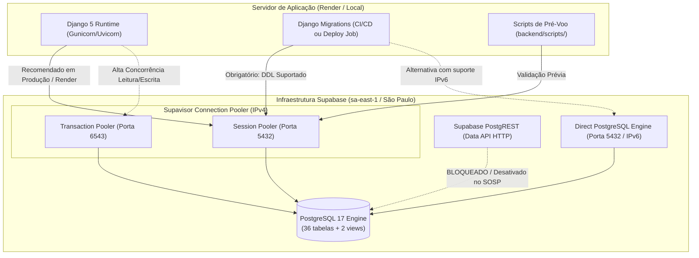

# SOSP — Runbook Operacional de Conexão com o Supabase PostgreSQL

> **Ambiente Alvo:** Supabase PostgreSQL 17 gerenciado (Região `sa-east-1` — São Paulo, AWS)  
> **Framework:** Django 5.1.15 + Django REST Framework + `psycopg` 3.2+  
> **Status:** Preparação Local Concluída — **Aguardando Liberação para Pré-Voo Remoto**  
> **Referências Normativas:** [`ADR-001`](../adr/ADR-001-monolito-modular-django-nextjs.md), [`ADR-002`](../adr/ADR-002-convencoes-nomenclatura-sql-camelcase.md), [`ADR-003`](../adr/ADR-003-autenticacao-autorizacao-rbac.md), [`ADR-005`](../adr/ADR-005-reserva-atomica-agendamento-idempotencia.md), [`ADR-008`](../adr/ADR-008-supabase-postgresql-gerenciado.md), [`schema.sql`](schema.sql), [`django-postgresql-foundation.md`](django-postgresql-foundation.md).

---

## 1. Visão Geral e Arquitetura de Rede

O SOSP utiliza um banco de dados relacional **PostgreSQL 17** hospedado no **Supabase** na região de São Paulo (`sa-east-1`). No padrão arquitetural do projeto, o portal Next.js 15 **nunca** acessa o banco diretamente; todo o tráfego de dados é intermediado pela API REST do Django (`ADR-001 §1`).

Para garantir segurança, resiliência e estabilidade, a conexão entre o Django e o Supabase deve respeitar os diferentes modos de pooling e topologias de rede disponibilizadas pela infraestrutura do Supabase.



---

## 2. Modos de Conexão: Comparativo Técnico e Recomendações

O Supabase oferece três portas/métodos de acesso ao banco. É crucial escolher o método adequado para cada tipo de carga:

| Critério | Modo A: Direct Connection | Modo B: Session Pooler (Recomendado) | Modo C: Transaction Pooler |
| :--- | :--- | :--- | :--- |
| **Host** | `db.<project-ref>.supabase.co` | `aws-0-sa-east-1.pooler.supabase.com` | `aws-0-sa-east-1.pooler.supabase.com` |
| **Porta** | `5432` | `5432` | `6543` |
| **Pilha IP** | **IPv6 Exclusivo** (no plano Free) | **IPv4 / IPv6** (Dual-Stack) | **IPv4 / IPv6** (Dual-Stack) |
| **Usuário** | `postgres` (ou custom) | `postgres.<project-ref>` | `postgres.<project-ref>` |
| **Estado da Sessão** | Preservado | Preservado | **Descartado após transação** |
| **Prepared Statements** | Suportado | Suportado | Limitado / Requer atenção |
| **Server-Side Cursors** | Suportado | Suportado | **Incompatível** (`DISABLE_SERVER_SIDE_CURSORS = True`) |
| **Suporte a Migrations DDL** | **Total** | **Total** | **NÃO** (pode falhar com locks e DDL transacional) |
| **Compatibilidade com Render** | **Baixa** (Render não suporta IPv6 outbound) | **Excelente** (Padrão recomendado) | Boa para runtime, proibido para DDL |
| **Uso no SOSP** | Conexões locais via IPv6 | **Runtime e Migrações (Padrão Oficial)** | Opcional para workloads de alta volumetria de leitura |

> [!IMPORTANT]
> **Atenção especial ao Render.com:** O ambiente do Render não possui suporte nativo a roteamento IPv6 externo. Conexões diretas (`db.<project-ref>.supabase.co`) falharão com erro de timeout ou rede inacessível. **Utilize sempre o Session Pooler (Porta 5432) no host do pooler** para deploys no Render.

---

## 3. Passo a Passo de Extração das Credenciais no Supabase

Para configurar as variáveis de ambiente sem expor segredos nem gerar erros de autenticação:

1. Acesse o [Supabase Dashboard](https://supabase.com/dashboard) e entre na organização do projeto SOSP.
2. Selecione o projeto provisionado na região **São Paulo (`sa-east-1`)**.
3. No topo da página do projeto, clique no botão **"Connect"** (ao lado de "Project settings").
4. Na aba **"Connection parameters"** ou **"URI"**:
   - **Para Session Pooler (Recomendado):**
     - Selecione **"Connection Pooling"** e método **"Session"**.
     - Host: `aws-0-sa-east-1.pooler.supabase.com`
     - Porta: `5432`
     - Database: `postgres`
     - User: `postgres.<PROJECT_REF>`
   - **Para Direct Connection (Somente redes com IPv6):**
     - Selecione **"Direct Connection"**.
     - Host: `db.<PROJECT_REF>.supabase.co`
     - Porta: `5432`
     - Database: `postgres`
     - User: `postgres`
5. **Senha do Banco (`DB_PASSWORD`):**
   - Corresponde à senha definida no momento do provisionamento do projeto.
   - Caso tenha sido perdida, vá em **Project Settings > Database > Database password** e clique em **"Reset database password"**. Guarde o valor seguro em um cofre de senhas (ex: 1Password / Bitwarden).
6. **Mapeamento para Variáveis de Ambiente do SOSP:**

```bash
# Configuração para Produção / Homologação (Render / Session Pooler)
REPOSITORY_BACKEND=orm
DB_ENGINE=django.db.backends.postgresql
DB_HOST=aws-0-sa-east-1.pooler.supabase.com
DB_PORT=5432
DB_NAME=postgres
DB_USER=postgres.xxxxxxxxxxxxxxxxxxxx
DB_PASSWORD="sua_senha_secreta_aqui"
DB_SSLMODE=require
DB_CONNECT_TIMEOUT=10
DB_STATEMENT_TIMEOUT=30000
DB_REMOTE_REQUIRED=true
```

> [!WARNING]
> Nunca salve ou commite o arquivo `.env` com senhas reais no Git. Utilize variáveis de ambiente injetadas pelo painel do Render ou cofre de segredos do GitHub Actions (`Secrets`).

---

## 4. Matriz de Papéis (RBAC) e Segurança de Banco

O projeto SOSP implementa estrita separação de privilégios (`ADR-003`).

### 4.1 Por que NÃO utilizar o usuário `postgres` (Superuser) no Runtime do Django?
1. **Bypass de RLS (Row Level Security):** O superuser `postgres` ignora silenciosamente todas as políticas de RLS e regras de segregação de dados.
2. **Exposição de Schemas Internos:** O superuser tem acesso irrestrito aos schemas internos do Supabase (`auth`, `storage`, `vault`, `graphql_public`), criando superfícies de ataque em caso de SQL Injection.
3. **Privilégios DDL Excessivos:** Um bug ou injeção em runtime poderia executar `DROP TABLE`, `ALTER TABLE` ou `TRUNCATE`, violando a regra de persistência auditada (`RN-40`, `RS-05`).

### 4.2 Matriz Recomendada de Papéis SQL

Em produção, adote a segregação em dois papéis distintos:

| Papel | Finalidade | Privilégios | Escopo |
| :--- | :--- | :--- | :--- |
| `sosp_migration_user` | Execução de Migrations e DDL | `CREATE`, `ALTER`, `DROP` em tabelas, views, triggers e sequences no schema `public`. | Utilizado **exclusivamente** durante pipelines de CI/CD ou deploys controlados. |
| `sosp_app_user` (ou `sosp_operador_role`) | Runtime da API Django (Gunicorn/Uvicorn) | `SELECT`, `INSERT`, `UPDATE` nas 36 tabelas de aplicação e views. **`DELETE` revogado**. Sem direitos DDL. | Utilizado pela aplicação web em regime 24/7. |

```sql
-- Exemplo de provisionamento de papel restrito para aplicação (executado via SQL Editor do Supabase)
CREATE ROLE sosp_app_user WITH LOGIN PASSWORD 'senha_forte_gerada';
GRANT CONNECT ON DATABASE postgres TO sosp_app_user;
GRANT USAGE ON SCHEMA public TO sosp_app_user;

-- Permissões DML estritas (sem DELETE)
GRANT SELECT, INSERT, UPDATE ON ALL TABLES IN SCHEMA public TO sosp_app_user;
GRANT USAGE, SELECT ON ALL SEQUENCES IN SCHEMA public TO sosp_app_user;

-- Padrão para novas tabelas futuras
ALTER DEFAULT PRIVILEGES IN SCHEMA public GRANT SELECT, INSERT, UPDATE ON TABLES TO sosp_app_user;
ALTER DEFAULT PRIVILEGES IN SCHEMA public GRANT USAGE, SELECT ON SEQUENCES TO sosp_app_user;
```

---

## 5. Cuidados com a Exposição via Supabase Data API (PostgREST)

Por padrão, o Supabase expõe automaticamente todas as tabelas criadas no schema `public` através da sua API REST HTTP (PostgREST) em `https://<ref>.supabase.co/rest/v1/`.

### 5.1 Risco para a Arquitetura SOSP
- O SOSP opera sob o modelo **Monólito Modular** onde todas as operações de cidadãos e servidores passam pela **API REST do Django** (`/api/v1/`), a qual aplica validação de schemas `RFC 7807`, auditoria imutável em `auditEvent`, verificação de integridade e regras de negócio.
- Se o PostgREST estiver ativo no schema `public` sem RLS estrita, qualquer usuário com a chave pública `anonKey` do Supabase poderia consultar ou mutar tabelas diretamente, contornando a auditoria do Django.

### 5.2 Ação Recomendada de Mitigação
1. No painel do Supabase, acesse **Project Settings > API > Data API Settings**.
2. No campo **"Exposed schemas"**, avalie remover `public` caso nenhuma funcionalidade de client-direct seja necessária, ou assegure que as roles `anon` e `authenticated` não tenham privilégios de consulta/escrita nas tabelas de negócio:

```sql
-- Revogar permissões automáticas da API HTTP pública para tabelas do SOSP
REVOKE ALL ON ALL TABLES IN SCHEMA public FROM anon, authenticated;
REVOKE ALL ON ALL SEQUENCES IN SCHEMA public FROM anon, authenticated;
REVOKE ALL ON ALL ROUTINES IN SCHEMA public FROM anon, authenticated;
```

---

## 6. Procedimento de Pré-Voo de Conectividade e Inspeção de Schema

Antes de rodar qualquer comando de migração ou inicialização no banco remoto, execute os scripts de diagnóstico criados em `backend/scripts/`.

### 6.1 Teste de Conectividade de Rede e SSL (`preflight_connectivity.py`)
Valida a resolução DNS, o handshake TCP, a negociação TLS/SSL e a autenticação básica com `SELECT version(), current_database(), current_user;`.

```bash
# Execução usando variáveis do ambiente atual
python backend/scripts/preflight_connectivity.py

# Ou informando explicitamente os parâmetros do Supabase
python backend/scripts/preflight_connectivity.py \
  --host aws-0-sa-east-1.pooler.supabase.com \
  --port 5432 \
  --dbname postgres \
  --user "postgres.<project-ref>" \
  --password "$DB_PASSWORD" \
  --sslmode require
```

**Comportamento Esperado:**
- Código de saída `0`.
- Saída indicando resolução de IP, handshake bem-sucedido, versão do PostgreSQL (>= 17.0) e latência de ping.
- Máscara completa de dados sensíveis em logs (senhas e URLs nunca são impressas).

### 6.2 Inspeção Estrutural de Schema (`preflight_schema_inspection.py`)
Conecta em **modo estritamente somente leitura** (`default_transaction_read_only=on`) e gera o raio-X completo do banco.

```bash
python backend/scripts/preflight_schema_inspection.py \
  --host aws-0-sa-east-1.pooler.supabase.com \
  --port 5432 \
  --dbname postgres \
  --user "postgres.<project-ref>" \
  --password "$DB_PASSWORD" \
  --sslmode require
```

**Diagnóstico Retornado:**
- `🟢 STATUS: PRONTO PARA IMPLANTAÇÃO INICIAL (READY_FOR_BASELINE)`:
  - 0 tabelas de aplicação SOSP encontradas.
  - Tabela `django_migrations` ausente ou limpa.
  - **Ação:** Autorizado a prosseguir com o comando `python manage.py migrate`.
- `🔵 STATUS: BASE TOTALMENTE IMPLANTADA (ALREADY_PROVISIONED)`:
  - As 36 tabelas de aplicação e 2 views já existem.
  - Todas as migrations (11 registros) estão aplicadas.
  - **Ação:** O banco está íntegro e em sincronia; nenhuma migração necessária.
- `🟡 STATUS: ESTADO PARCIAL OU INCONSISTENTE (PARTIAL_STATE)`:
  - Existem tabelas parciais ou discrepância na tabela de migrações.
  - **Ação:** Interrompa a operação e investigue antes de aplicar migrações.

---

## 7. Instruções para Execução Segura de Migrations

Após a validação de pré-voo com resultado `READY_FOR_BASELINE`:

### 7.1 Pré-requisitos
1. Conexão configurada via **Session Pooler (Porta 5432)** ou **Direct Connection (Porta 5432 com IPv6)**.
2. **NUNCA** execute migrations apontando para a porta `6543` (Transaction Pooler).

### 7.2 Passo a Passo de Execução
```bash
# 1. Simular o plano de execução sem aplicar modificações
python backend/manage.py migrate --plan

# 2. Executar a migração da baseline consolidada
python backend/manage.py migrate

# 3. Validar a aplicação das migrações
python backend/manage.py showmigrations

# 4. Executar novamente a inspeção estrutural para comprovar conformidade
python backend/scripts/preflight_schema_inspection.py
```

---

## 8. Estratégia de Rollback, Contingência e Desastre

> [!CAUTION]
> **NUNCA EXECUTE `python manage.py migrate accounts zero` EM PRODUÇÃO.**
> O script reverso da migration baseline `accounts.0001_initial` executa o desfazimento físico com `DROP TABLE` em todas as 36 tabelas de aplicação e views. A execução deste comando em produção causaria **perda total irreversível de todos os dados do sistema**.

### 8.1 Política de Rollback em Produção

1. **Restauração de Snapshot / Point-in-Time Recovery (PITR):**
   - O Supabase realiza backups diários automatizados e suporte a PITR (conforme plano).
   - Em caso de falha catastrófica ou corrupção estrutural, a restauração deve ser realizada a partir do snapshot oficial mais recente via dashboard do Supabase (**Project Settings > Database > Backups**).
2. **Migrações Aditivas ("Forward Migrations"):**
   - Se uma nova migration introduzir um comportamento indesejado, a correção arquitetural consiste em criar uma nova migration aditiva (`0002_fix_...`), testada localmente, que ajuste os campos de forma retrocompatível.
3. **Plano de Contingência Operacional (Fallback para In-Memory):**
   - Caso o banco de dados remoto fique temporariamente indisponível por indisponibilidade regional da AWS ou problema de rede, a aplicação Django pode ser reiniciada emergencialmente com `REPOSITORY_BACKEND=memory`, permitindo a navegação consultiva e respostas simuladas enquanto o serviço de banco é restabelecido.

---

## 9. Checklist de Aprovação para Conexão Remota

Antes de iniciar a etapa remota no Supabase:

- [ ] Credenciais obtidas no Dashboard do Supabase para o Session Pooler (porta 5432).
- [ ] Variáveis de ambiente configuradas no arquivo local `.env` (ignorado pelo Git).
- [ ] Execução bem-sucedida de `preflight_connectivity.py` retornando código 0.
- [ ] Execução de `preflight_schema_inspection.py` diagnosticando `READY_FOR_BASELINE`.
- [ ] Aprovação humana explícita do Tech Lead / CODEOWNER (`@euoluizg`) para execução da migration remota.
